# Roadways Bus Game: Unity Android Conversion & Technical Implementation Blueprint

## 1. Executive Summary & Architecture Overview

The **Roadways Bus Game** is an arcade-puzzle sorting game where multi-colored candy characters (**Chilbis**) march in tightly packed formation along a racing circuit, and the player dispatches color-matching buses from a depot into angled parking bays to board them and clear the traffic.

### Target Platform Specifications:
- **Engine**: Unity 2022.3 LTS or Unity 6.
- **Render Pipeline**: **Universal Render Pipeline (URP)** with Forward Mobile Renderer.
- **Target OS**: Android 8.0+ (API Level 26 to 34+).
- **Target Architecture**: ARM64 (64-bit mandatory for Google Play) + ARMv7 fallback.
- **Graphics API**: Vulkan (primary) with OpenGL ES 3.2 (fallback).
- **Display Orientation**: Portrait Locked (`9:16` to `20:9` responsive safe area).
- **Performance Budget**: Locked 60 FPS on mid-range Android devices (`< 50` draw calls, `< 120 MB` RAM).

```mermaid
flowchart TD
    subgraph UnityProject ["Unity URP Mobile Architecture"]
        CameraRig["Phase 1: Angled Camera Rig<br/>(Portrait 44° FOV • Static View)"]
        SplineTrack["Phase 2: Procedural Roadway Splines<br/>(Catmull-Rom Track • Apex Kerbs • Feeder Roads)"]
        ChilbiSquad["Phase 3: 2.5D Chilbi Characters<br/>(430 Formation • 8 Candy Themes • GPU Instancing)"]
        BusDepot["Phase 4: Top-Down Bus Fleet<br/>(Hermite Steering Kinematics • -30° Parking Bays)"]
        GameLoop["Phase 5: Passenger Boarding & Sort Loop<br/>(Color Matching • Peeling Off • Bus Departure)"]
        JuiceAudio["Phase 6: Audio Synthesis & Haptics<br/>(Air-Brakes • Harmonic Horns • Android Vibrator)"]
        AndroidBuild["Phase 7: Build & Packaging Pipeline<br/>(IL2CPP • Gradle • Keystore • ADB Device Deploy)"]
    end

    CameraRig --> SplineTrack
    SplineTrack --> ChilbiSquad
    ChilbiSquad --> BusDepot
    BusDepot --> GameLoop
    GameLoop --> JuiceAudio
    JuiceAudio --> AndroidBuild
```



---

## 2. Phase-by-Phase Granular Step Breakdown

---

### Phase 1: Unity Project Setup, Architecture & Camera Rig (15 Detailed Steps) - COMPLETED

- [x] **Step 1.1: Unity Editor & Modules Installation**: Installed and verified Unity Editor with Android Build Support, Android SDK & NDK Tools, and OpenJDK modules.
- [x] **Step 1.2: Project Initialization**: Initialized project with Universal Render Pipeline (URP).
- [x] **Step 1.3: Project Settings & Identity**:
  - Company Name: `Roadways`
  - Product Name: `Roadways Bus Game`
  - Package Name: `com.roadways.busgame`
  - Version: `0.1.0` (Bundle Version Code: `1`).
  - Target Architecture: ARM64 + IL2CPP.
- [x] **Step 1.4: URP Mobile Asset Configuration**:
  - Created `Mobile_RPAsset` with Forward rendering path.
  - Disabled Depth and Opaque textures for fill-rate efficiency.
  - Anti-aliasing configured to 2x MSAA.
  - HDR disabled.
  - Main Light soft shadows configured with 1024 resolution and 25m distance.
- [x] **Step 1.5: Resolution & Orientation Setup**:
  - Default Orientation: `Portrait` locked (Landscape & Upside Down disabled).
  - `Render outside safe area` enabled for mobile camera notches.
  - Status Bar Hidden: `true`.
- [x] **Step 1.6: Professional Folder Hierarchy**:
  Created `Assets/_Project/` with `Scripts/Runtime/`, `Scripts/Editor/`, `Prefabs/`, `Materials/`, `Shaders/`, `Textures/`, `Audio/`, `ScriptableObjects/`, `Settings/`, and `Scenes/`.
- [x] **Step 1.7: Git Repository Setup & `.gitignore`**:
  Configured comprehensive Unity `.gitignore`.
- [x] **Step 1.8: Master Scene Hierarchy Layout**:
  Created `MainGame.unity` with root nodes:
  - `--- [MANAGERS] ---` (GameManager, UIManager, AudioManager, InputManager)
  - `--- [CAMERAS] ---` (MainCamera, CameraTarget, UICamera)
  - `--- [ENVIRONMENT] ---` (DirectionalLight, ParkEnvironment, GardenStones, Decals)
  - `--- [ROAD_NETWORK] ---` (TrackSpline, Curbs, Shoulders, HighwayNeck)
  - `--- [CHARACTERS] ---` (ChilbiFormationManager, WalkerPool)
  - `--- [BUS_SYSTEM] ---` (BusFleetDepot, TrapeziumPanel, BayManager)
  - `--- [UI] ---` (CanvasScaler, WatermarkHeader, ReplayButton)
- [x] **Step 1.9: Camera Rig Coordinates & LookAt**:
  - Position: `X = 0, Y = 30, Z = 42`.
  - Target: `(0, 0, 8)` with pitch $\approx 35^\circ$ downward.
- [x] **Step 1.10: Responsive Portrait Camera FOV Controller**:
  Implemented `ResponsiveCameraFOV.cs` with dynamic vertical FOV adjustment across mobile screens (`9:16` to `20:9`).
- [x] **Step 1.11: Static Camera Lock**:
  Implemented `CameraRigController.cs` locking transform and preventing displacement.
- [x] **Step 1.12: Ambient Lighting & Color Grading**:
  Flat ambient light set to `#f7e8ea`, directional light soft intensity `0.85` at rotation `(45, -30, 0)`, warm white `#fff9f5`.
- [x] **Step 1.13: Park Ground Mesh**:
  Implemented `EnvironmentBuilder.cs` generating $80\text{m} \times 120\text{m}$ pastel pink `#fff1f2` lawn plane.
- [x] **Step 1.14: Concentric Lawn Pathway Decals**:
  Procedural circular ground ribbon paths with translucent pastel borders (`#f2d5db`, alpha `0.35`).
- [x] **Step 1.15: Zen Garden Stone Accents (Strict Zero Trees/Leaves)**:
  Procedural low-poly pebble meshes around lawn perimeter. Enforced zero trees, zero floating leaves, and zero clutter.

---

### Phase 2: Procedural Track & Roadway Spline Network (14 Detailed Steps)

- [ ] **Step 2.1: Splines Package Setup**: Install `com.unity.splines` via Package Manager or create a standalone `CatmullRomSpline.cs` mathematics utility.
- [ ] **Step 2.2: 16-Point Circuit Closed Spline Geometry**:
  Port the 16 exact Catmull-Rom spline control points from `3D_Showcase_Preview.html`:
  - Chicane dip: $(480, 125)$ between rounded crests $(360, 95)$ and $(605, 80)$.
  - Left hairpin turn: apex $(203, 170)$.
  - Right apex turn: $(794, 210)$.
  - Bottom straightaway: $Y = 236$.
- [ ] **Step 2.3: Spline Arc-Length Lookup Table (LUT)**:
  - Sample the closed spline into 1000 equidistant segments.
  - Cache cumulative distances $s(i)$ and normalized tangents $T(i)$ for $O(1)$ constant-linear-speed evaluation.
- [ ] **Step 2.4: Procedural Road Surface Ribbon Mesh**:
  - Implement `RoadMeshBuilder.cs` that extrudes a quad strip along the spline normals.
  - Road width: exactly 82 units (`#525769` dark slate asphalt).
- [ ] **Step 2.5: White Edge Curbs Mesh Generation**:
  - Extrude 2-unit wide white curb strips along both inner and outer road boundaries (`#e6e9ee`).
- [ ] **Step 2.6: Tan Dirt Shoulder Meshes**:
  - Extrude 11-unit wide dirt shoulders flanking the exterior white curbs (`#cbb27a`).
- [ ] **Step 2.7: 5 Red & White Inner Apex Kerbs**:
  - Generate alternating red (`#e74c3c`) and white (`#ffffff`) 8-unit curb blocks placed at the 5 inner turn apexes:
    1. Chicane dip inner curve.
    2. Top-left crest apex.
    3. Top-right crest apex.
    4. Left hairpin inner apex.
    5. Bottom-right turn apex.
- [ ] **Step 2.8: Dashed Centerline Shader**:
  - Custom URP Unlit shader with procedural alpha dash pattern (`dashLength = 10`, `gapLength = 8`).
- [ ] **Step 2.9: Left Feeder Connecting Road**:
  - Curve spline entering from screen left ($X = -50$) curving smoothly to merge into the circuit at $(88, 134)$.
- [ ] **Step 2.10: Right Feeder Road**:
  - Curve spline exiting from right circuit crest outward to screen edge ($X = 1015$).
- [ ] **Step 2.11: Feeder White Stop Bar**:
  - Procedural quad stop line rendered across the feeder road at $X = 30$ ($25\text{px}$ clearance from ring outer curb).
- [ ] **Step 2.12: Trapezium Asphalt Highway Neck**:
  - Build flared asphalt polygon bridging the bottom straight ($X = 390$ to $610$) down into the top edge of the trapezium parking area ($Y = 320$).
  - Route white side curbs and dirt shoulders along the outer flaring neck borders.
- [ ] **Step 2.13: Central Grass Island Mesh**:
  - Infill the closed inner boundary with a clean pastel lawn mesh matching the ground color (`#fff1f2`).
- [ ] **Step 2.14: Roadway Trigger Colliders**:
  - Place invisible 2D trigger volumes for:
    - Feeder merge trigger.
    - Highway exit neck trigger.
    - Feeder queue boundary stop line.

---

### Phase 3: 2.5D Chilbi Rigging & 430 Character Simulation (15 Detailed Steps)

- [ ] **Step 3.1: 2.5D Silhouette & Upright Posture**:
  - Design a single seamless candy bean body mesh (head dome and torso merged into one continuous silhouette with rounded radius $8.5$).
  - Upright 2.5D billboard orientation: character stands vertically on ground plane with `facingX = dx >= 0 ? 1 : -1`.
- [ ] **Step 3.2: Procedural Pelvic Leg Joints**:
  - Anchor left and right stepping legs deep inside pelvic sockets ($Y = -6$, extending inside torso to $Y = -9$).
  - Rotate hips in opposite phases: $\theta_{near} = \sin(2\pi f t) \times 28^\circ$, $\theta_{far} = -\theta_{near}$.
- [ ] **Step 3.3: Human-like Rounded Arm Joints**:
  - Anchor shoulder joints at $Y = -17$.
  - Render curved bicep-forearm mesh with smooth rounded elbow bend ($3.6$ width).
  - Arm counter-swing synchronized with opposite leg: $\theta_{arm} = -\theta_{leg} \times 0.9$.
- [ ] **Step 3.4: Ground Contact Oval Shadow**:
  - Semi-transparent black ellipse (`#000000`, alpha `0.22`) parented to ground position, scaling subtly with body bobbing.
- [ ] **Step 3.5: Matte Candy Shading**:
  - Create `ChilbiMatte.shader` (URP Unlit) with vertical gradient ramp (highlight top, solid body middle, deeper shadow bottom).
  - Zero pale specular shine, zero glossy reflections, zero eyes.
- [ ] **Step 3.6: Master Color Palette ScriptableObject**:
  Create `ColorPaletteDatabase.cs` holding all 8 master color definitions:
  1. Red: `#c0392b`
  2. Yellow: `#f39c12`
  3. Blue: `#2548ad`
  4. Green: `#20bf6b`
  5. Purple: `#8854d0`
  6. Orange: `#e67e22`
  7. Pink: `#e84393`
  8. Cyan: `#0fbcf9`
  (Includes limb accent tones, gradient stops, and horn frequencies).
- [ ] **Step 3.7: 430 Character Formation Data Architecture**:
  - Total count: exactly 430 Chilbis.
  - Rows: 62 rows (61 rows of 7 abreast + 1 row of 3).
  - Columns: 7 equal lanes across the 82px road ($d \in [-35.1, +35.1]$, spacing $11.7\text{px}$).
  - Repeating block sequence: 5 Red $\to$ 7 Yellow $\to$ 4 Blue $\to$ 8 Green $\to$ 6 Purple $\to$ 5 Orange $\to$ 6 Pink $\to$ 5 Cyan.
  - Enforce strictly one color per row.
- [ ] **Step 3.8: High-Speed Entrance Sprint Phase**:
  - Feeder road sprint speed: $150\text{ px/s}$.
  - Rapid leg stride frequency: $19.5\text{ Hz}$.
  - Torso forward lean: $8^\circ$.
  - Arm pump angle: $42^\circ$.
- [ ] **Step 3.9: Junction Deceleration Curve**:
  - Smoothstep deceleration over $t \in [0.9\text{s}, 2.3\text{s}]$ at junction $(88, 134)$ from $150\text{ px/s}$ down to cruising speed $46\text{ px/s}$.
  - Stride frequency eases smoothly from $19.5\text{ Hz}$ to $8.0\text{ Hz}$.
- [ ] **Step 3.10: Ring Road Capacity & Tight Loop Closure**:
  - Maximum circuit capacity: exactly 60 rows ($420$ Chilbis).
  - Uniform row spacing: $13.82\text{px}$ ($829.3\text{px} / 60$).
  - Distance from Row 59 to Row 0 is mathematically identical ($13.76\text{px}$) with zero visible seam.
- [ ] **Step 3.11: Feeder Queue Hold System**:
  - Rows 60 and 61 (10 Chilbis) halt behind $X = 30$ stop bar once circuit is full.
  - Front queue position: $queueFrontDist = feederLength - 68.0\text{px}$.
  - Queue idle animation: gentle synchronized bipedal waddle ($1.8\text{ Hz}$).
- [ ] **Step 3.12: GPU Instancing System for Mobile Performance**:
  - Implement `ChilbiInstancedRenderer.cs` using `Graphics.RenderMeshInstanced` to draw all 430 characters in a single GPU draw call.
  - Pack per-character matrices (position, rotation, scale) and color property blocks (`MaterialPropertyBlock`).
- [ ] **Step 3.13: C# Job System & Burst Kinematics**:
  - Move position updates, arc-length lookups, and leg rotation math into `ChilbiWalkJob` (IJobParallelFor) compiled with Burst Compiler.
  - Executes in $< 0.3\text{ms}$ per frame on mobile CPU.
- [ ] **Step 3.14: Lead Runner Designation**:
  - Designate Cyan Lead Chilbi in center lane ($14\text{px}$ ahead of Row 0) leading the parade.
- [ ] **Step 3.15: Heat-Saver Development Toggle**:
  - Implement `RENDER_ONLY_LEAD_CHILBI` boolean in `ChilbiManager.cs` to render only 1 Lead Chilbi during editor development while executing full 430 math.

---

### Phase 4: Top-Down Bus Fleet & Parking Bays (14 Detailed Steps)

- [ ] **Step 4.1: Trapezium Base Panel Mesh**:
  - Polygon mesh covering bottom area with rounded top corners ($Y = 180$ to $Y = 1000$).
  - Material: Slate grey (`#525769`), matching asphalt surface.
- [ ] **Step 4.2: 9 Angled Trapezium Parking Bays**:
  - Arrange 9 rectangular slots tilted at **`-30°`** in a centered single row:
    - 5 Standard Bays (left): `2px` solid white border (`#ffffff`).
    - 1 VIP Bay (4th from right): `2px` solid gold border (`#ffd700`) with tilted gold "VIP" text.
    - 3 Unlock Bays (right): `2px` solid green border (`#2ecc71`) with centered bold `+` symbol.
  - Dimensions: $25\text{px} \times 50\text{px}$, corner radius $5.5\text{px}$, spacing gap $8\text{px}$.
- [ ] **Step 4.3: Top-Down Bus Mesh & Materials**:
  - Create flat 2D/3D bus model matching exact parking bay dimensions ($25\text{px} \times 50\text{px}$, `rx = 5.5`).
  - Dark tinted front windshield visor (`#1e2430`), rear window, and side window cutouts.
  - Solid matte body color (Red, Yellow, Blue, Green, Purple, Orange, Pink, Cyan) matching `MasterColorPalettes`.
  - Zero specular shine, zero drop shadows.
- [ ] **Step 4.4: Forward Directional Roof Arrow**:
  - Model crisp white arrow on bus roof pointing forward in vehicle travel direction:
    - Vector: `M 12.5,17 L 18.5,24.5 L 14.8,24.5 L 14.8,34 Q 14.8,35 12.5,35 Q 10.2,35 10.2,34 L 10.2,24.5 L 6.5,24.5 Z`.
    - Rounded corners (`stroke-linejoin="round"`, `width = 1.0`).
- [ ] **Step 4.5: Fleet Depot Layout**:
  - Arrange all 8 matching buses in a single horizontal row inside the bottom boundary panel (`#d3daed`).
  - Responsive horizontal spacing (`gap = clamp(10px, 2.5vw, 16px)`) fitting all mobile screen widths without wrapping.
- [ ] **Step 4.6: Touch Input & Selection System**:
  - Raycast / 2D Collider on each depot bus.
  - Handle mobile touch events using Unity New Input System (`EnhancedTouch.Touch`).
- [ ] **Step 4.7: Path Clearance & State Verification**:
  - In `BusFleetController.cs`:
    - Check if target parking bay (Bay 0) is occupied.
    - Check if another bus is currently in transit.
    - If blocked: trigger rejection wiggle and warning audio.
    - If clear: proceed with dispatch.
- [ ] **Step 4.8: Rejection Wiggle Feedback**:
  - Animate horizontal shake: $X \to -4\text{px} \to +4\text{px} \to -3\text{px} \to 0$ over $0.35\text{s}$.
  - Play dual low buzz warning horn sound ($220\text{ Hz}$).
- [ ] **Step 4.9: Cubic Hermite Spline Kinematics**:
  - Implement `HermiteKinematics.cs` calculating position and velocity:
    $$\vec{P}(t) = h_{00}(t)\vec{P}_0 + h_{10}(t)\vec{T}_0 + h_{01}(t)\vec{P}_1 + h_{11}(t)\vec{T}_1$$
    $$\vec{V}(t) = \vec{P}'(t)$$
  - Calculate vehicle heading strictly from velocity tangent:
    $$\theta(t) = \operatorname{atan2}(V_x, -V_y) \times \frac{180}{\pi}$$
- [ ] **Step 4.10: Dedicated Head-First Bay Entry Corridor**:
  - Define bay approach mouth waypoint at $(145.5, 368.4)$ ($55\text{px}$ outside bay along $-30^\circ$ centerline).
  - Phase 1: Accelerate forward out of depot in arrow direction (straight UP, $0^\circ$).
  - Phase 2: Follow velocity-tangent curve to approach mouth.
  - Phase 3: Lock heading strictly to **`-30.0°`** and drive straight forward through the bay mouth into the stall.
- [ ] **Step 4.11: Suspension Physics & Braking Dynamics**:
  - Startup forward stretch: `scale(0.98, 1.025)`.
  - Braking compression inside bay: nose-dip `scale(1.02, 0.975)`.
  - Rebound settle back to `scale(1.0, 1.0)` as vehicle locks into bay.
- [ ] **Step 4.12: Pneumatic Air-Brake Audio Trigger**:
  - On final settle, trigger pneumatic air release hiss ("pssshh-clack!") and parking latch click.
- [ ] **Step 4.13: Roof Arrow Smooth Disappearance**:
  - Fade out roof arrow mesh (`alpha: 1.0 -> 0.0`) and scale down to `0.3` over $0.28\text{s}$ upon docking.
- [ ] **Step 4.14: Reverse Back-Out Depot Return**:
  - Tapping parked bus reverses it straight out along $-30^\circ$ axis, re-enables arrow, and drives back into depot slot.

---

### Phase 5: Passenger Boarding & Sorting Game Loop (12 Detailed Steps)

- [ ] **Step 5.1: Bay-to-Circuit Color Match Detector**:
  - Implement `BoardingController.cs` monitoring active bus color in Bay 0.
  - Compare with the color of the front waiting row on the circuit.
- [ ] **Step 5.2: Highway Peeling-Off Spline Route**:
  - Generate a smooth exit spline branching from the bottom straight ($Y = 236$) through the highway neck directly to the docked bus door ($118, 320$).
- [ ] **Step 5.3: Row-by-Row Peeling Animation**:
  - When colors match, the 7 Chilbis in the front row break formation one by one (cascading $0.08\text{s}$ stagger).
  - Walk down the highway neck toward the parked bus.
- [ ] **Step 5.4: Passenger Hop-In Animation**:
  - Parabolic hop into bus entry: $Y = Y_{base} + \sin(\pi u) \times 12\text{px}$.
  - Scale squash-and-stretch on landing.
  - Play cheerful boarding pop sound.
- [ ] **Step 5.5: Seat Capacity Counter**:
  - Track passenger capacity (7 passengers per bus = 1 full row).
  - Display floating passenger pill over bus (e.g. `0/7` $\to$ `7/7`).
- [ ] **Step 5.6: Bus Full State & Departure Acceleration**:
  - When capacity reaches 7/7:
    - Doors seal.
    - Double departure horn honk.
    - Accelerate forward along $-30^\circ$ axis out of the parking bay up through the highway exit.
- [ ] **Step 5.7: Bay Reset & Next Vehicle Signal**:
  - Mark Bay 0 as vacant.
  - Signal depot that parking spot is ready for next bus.
- [ ] **Step 5.8: Circuit Queue Advance**:
  - Remaining circuit rows advance forward by 1 row gap ($13.82\text{px}$).
  - Feeder queue advances: 1 row leaves feeder and enters circuit.
- [ ] **Step 5.9: Multi-Bay Management (Bays 0 to 8)**:
  - Expand logic to manage all 9 trapezium bays simultaneously:
    - 5 Standard Bays active by default.
    - 1 VIP Bay (double coin bonus / special passenger).
    - 3 Unlock Bays (unlocked with in-game currency or ads).
- [ ] **Step 5.10: Scoring & Streak Combo System**:
  - Award coins per passenger boarded.
  - Streak multiplier for consecutive matching departures without mis-parking.
- [ ] **Step 5.11: Win Condition & Celebration**:
  - Trigger win screen when all 430 Chilbis have boarded:
    - Confetti particle burst.
    - Victory fanfare audio.
    - Level complete stats (Time, Stars, Coins).
- [ ] **Step 5.12: Gridlock / Game Over Detection**:
  - If all active parking bays are occupied, and none match the color of the front waiting circuit row:
    - Trigger "Out of Moves" warning.
    - Gridlock game over modal with option to Revive / Undo / Shuffle.

---

### Phase 6: Audio Synthesis, Native Haptics & Visual Juice (12 Detailed Steps)

- [ ] **Step 6.1: Audio Architecture in Unity**:
  - Create `AudioController.cs` with an `AudioMixer`:
    - Master
    - Music (Pastel park background melody)
    - SFX (Horns, Pops, Air Brakes)
    - UI (Clicks, Fanfares)
- [ ] **Step 6.2: 12-Voice Kids Cheer Chorus**:
  - Import high-fidelity audio clip ("Hey! Goooo! Let's gooo!") triggered during high-speed feeder entrance.
- [ ] **Step 6.3: 8 Harmonic Bus Horn Synthesizers / Clips**:
  - 8 harmonic dual-tone bus horn clips matching project frequencies:
    1. Red: $440\text{ Hz}$
    2. Yellow: $392\text{ Hz}$
    3. Blue: $494\text{ Hz}$
    4. Green: $523\text{ Hz}$
    5. Purple: $587\text{ Hz}$
    6. Orange: $622\text{ Hz}$
    7. Pink: $659\text{ Hz}$
    8. Cyan: $740\text{ Hz}$
- [ ] **Step 6.4: Pneumatic Air-Brake Audio**:
  - Bandpass-filtered air hiss and mechanical latch click ("pssshh-clack!") upon vehicle parking.
- [ ] **Step 6.5: Engine Acceleration Rumble**:
  - Pitch-shifted low-frequency engine loop accelerating with vehicle speed.
- [ ] **Step 6.6: Boarding Pop Sound FX**:
  - Crisp, playful popping sounds ascending in pitch as passengers 1 through 7 board.
- [ ] **Step 6.7: Android Native Haptics Plugin**:
  - Create `AndroidHaptics.cs` calling Android `Vibrator` and `VibrationEffect` via JNI:
    - Lightweight fallback for devices below API 26 (`Handheld.Vibrate()`).
- [ ] **Step 6.8: Light Tick Haptic on Bus Tap**:
  - $15\text{ms}$ light vibration tick upon selecting and dispatching a bus.
- [ ] **Step 6.9: Double Buzz Haptic on Blocked Path**:
  - $40\text{ms}$ rumble, $30\text{ms}$ pause, $60\text{ms}$ rumble when path is blocked.
- [ ] **Step 6.10: Firm Click Haptic on Bay Docking**:
  - $25\text{ms}$ firm tactile click when bus locks into parking bay.
- [ ] **Step 6.11: Soft Pop Haptic on Passenger Boarding**:
  - $10\text{ms}$ subtle micro-vibration as each Chilbi hops aboard.
- [ ] **Step 6.12: UI Header & Replay Button**:
  - Responsive header watermark pill showing level progress, Chilbis remaining, and active queue counts.
  - Glassmorphic "Replay Cheer & Run" button.

---

### Phase 7: Android Build Pipeline, Optimization & Device Profiling (12 Detailed Steps)

- [ ] **Step 7.1: Unity Android Preferences Verification**:
  - Verify JDK, Android SDK, and NDK paths in Unity Preferences > External Tools.
- [ ] **Step 7.2: Android Graphics API & Texture Compression**:
  - In Player Settings > Android:
    - Graphics APIs: `Vulkan` (primary), `OpenGLES3` (secondary).
    - Texture Compression: `ASTC` (standard for modern Android GPUs).
- [ ] **Step 7.3: IL2CPP & ARM64 Architecture Setup**:
  - Scripting Backend: `IL2CPP`.
  - Target Architectures: `ARM64` enabled (mandatory for Google Play 64-bit requirement).
  - C++ Compiler Configuration: `Release`.
- [ ] **Step 7.4: Android Min & Target SDK Versions**:
  - Minimum API Level: Android 8.0 'Oreo' (API Level 26).
  - Target API Level: Android 14 (API Level 34) or latest Google Play requirement.
- [ ] **Step 7.5: Android Manifest & Fullscreen Immersive Mode**:
  - Custom `AndroidManifest.xml`:
    ```xml
    <activity android:name="com.unity3d.player.UnityPlayerActivity"
              android:theme="@style/UnityThemeSelector"
              android:screenOrientation="portrait"
              android:configChanges="orientation|screenSize|keyboardHidden">
        <intent-filter>
            <action android:name="android.intent.action.MAIN" />
            <category android:name="android.intent.category.LAUNCHER" />
        </intent-filter>
    </activity>
    ```
- [ ] **Step 7.6: Gradle Templates Customization**:
  - Enable Custom Main Gradle Template (`mainTemplate.gradle`).
  - Enable Custom Launcher Gradle Template (`launcherTemplate.gradle`).
  - Configure ProGuard / R8 code shrinking for release build size reduction.
- [ ] **Step 7.7: Release Keystore Creation**:
  - Generate production keystore (`roadways_release.keystore`) using Unity Keystore Manager or Java `keytool`.
  - Configure alias and secure passwords.
- [ ] **Step 7.8: Development APK Build Target**:
  - Build standalone `.apk` for direct ADB testing.
  - Enable `Development Build` and `Autoconnect Profiler` for performance debugging.
- [ ] **Step 7.9: Direct ADB Deployment to Target Phone (`Realme RMX3690`)**:
  - Connect target phone via USB (`adb devices`).
  - Deploy and launch directly:
    ```bash
    adb install -r RoadwaysBusGame.apk
    adb shell am start -n com.roadways.busgame/com.unity3d.player.UnityPlayerActivity
    ```
- [ ] **Step 7.10: Unity Profiler Mobile Analysis**:
  - Connect Unity Profiler to phone over ADB/WiFi.
  - Verify:
    - Total frame time $< 16.6\text{ms}$ (steady 60 FPS).
    - Draw calls $< 50$.
    - Memory allocation $< 120\text{ MB}$.
    - Zero GC alloc spikes during walker loop.
- [ ] **Step 7.11: Thermal & Battery Throttling Test**:
  - Run continuous 15-minute parade simulation on device.
  - Ensure zero thermal throttling or frame drops on mid-range hardware.
- [ ] **Step 7.12: Production App Bundle (AAB) Generation**:
  - Toggle `Build App Bundle (Google Play)` in Build Settings.
  - Export final signed `.aab` ready for Google Play Console upload.
