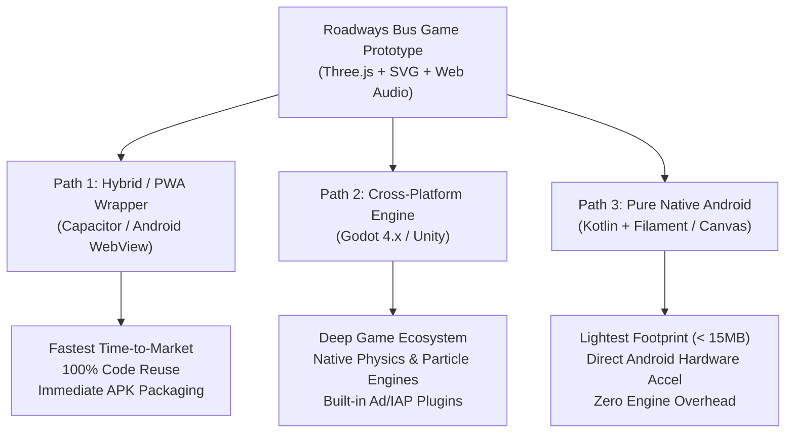
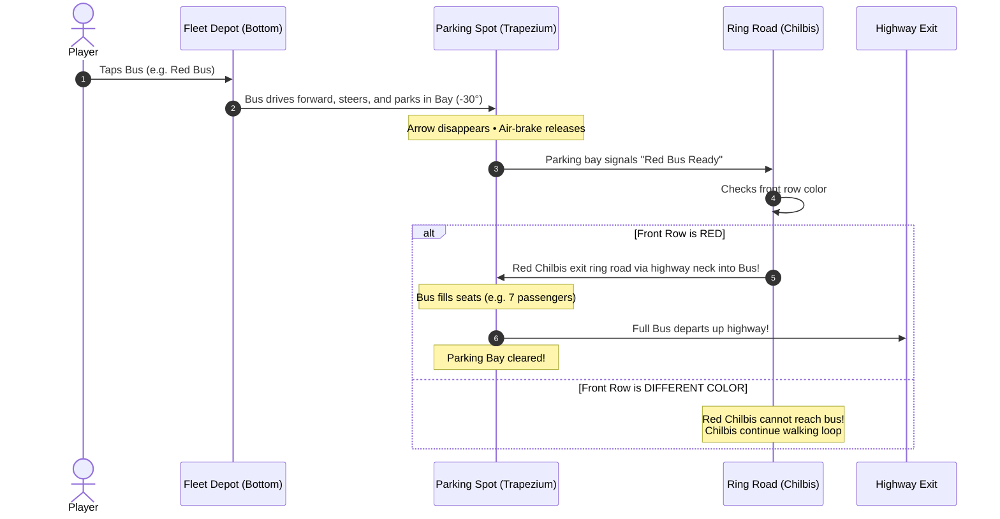

# Roadways Bus Game: Android Conversion Strategy & Project Roadmap

## 1. Executive Overview

The **Roadways Bus Game** has achieved a working, high-fidelity interactive prototype featuring:
1. **Cherry Blossom 3D Park** (Angled Three.js perspective, pastel lawn rings, stone garden accents, zero tree/leaf clutter).
2. **Unified SVG Circuit Network** (Catmull-Rom racing circuit, red/white apex kerbs, screen-side feeder roads, seamless highway neck into the trapezium).
3. **430 Chilbi Character Formation** (Upright 2.5D side-view candy rigs, single-color rows across 8 master palettes, high-speed sprint entrance, smooth deceleration, tight-packed 60-row circuit capacity, queue hold buffer, heat-saver mode).
4. **Top-Down Bus Fleet & Parking Bays** (8 color-matched buses, forward-facing roof arrows, 9 angled trapezium parking bays tilted at -30° with VIP and unlock slots).
5. **Authentic Vehicular Driving Kinematics** (Cubic Hermite velocity-tangent steering, head-first bay entry through the mouth of the bay, braking suspension settle, pneumatic air-brake audio, and roof arrow disappearance upon docking).

The goal now is to **transition this rich prototype into an Android mobile game**.

---

## 2. Technical Conversion Approaches (How Is It Possible?)

Converting this game to Android can be achieved through three distinct architectural paths:

### Approach 1: Modern Hybrid Packaging (Capacitor / TWA / Custom Android WebView) — *Recommended for Immediate Delivery*
- **How it works**:
  - The current codebase (Three.js 3D canvas + 2D SVG overlay + Web Audio) is bundled inside a modern Android APK using **Capacitor** or a dedicated **Android WebView** activity.
  - Hardware acceleration (`hardwareAccelerated="true"`) gives 60 FPS performance on all modern Android devices (Chromium engine on Android 10+ handles WebGL and SVG paths natively with zero lag).
- **Pros**:
  - **100% logic and visual reuse**: Not a single line of your carefully calibrated math, Catmull-Rom splines, or Hermite kinematics needs to be rewritten.
  - **Fastest path to test on device**: An installable `.apk` can be generated immediately.
  - Full support for Android hardware vibration (`navigator.vibrate`), touch gestures, and local storage save states.
- **Cons**:
  - Slight APK size overhead (~20–30 MB for bundle + assets).

---

### Approach 2: Native Cross-Platform Engine (Godot 4 / Unity) — *Best for Long-Term Studio Scale*
- **How it works**:
  - Rebuilding the game scene in **Godot 4** (2D/3D hybrid) or **Unity**:
    - Ground: Flat 3D mesh plane with orthographic or fixed-perspective camera.
    - Road Network: 2D `Path2D` / `Line2D` with custom curve shaders.
    - Chilbis: 2D Sprite rigs / Spine 2D / Bone rigs with procedural step animations.
    - Buses: 2D RigidBody / KinematicCharacter with steering controllers.
- **Pros**:
  - Industry-standard tooling for mobile ads (AdMob, AppLovin), in-app purchases, and Google Play Game Services.
  - High performance across lower-end devices.
- **Cons**:
  - Requires completely rewriting all JavaScript math, Catmull-Rom spline LUTs, and SVG DOM manipulation into C# or GDScript.
  - Takes several weeks to re-tune the exact visual feel already achieved in HTML.

---

### Approach 3: Pure Native Android (Kotlin + Filament / Canvas) — *Best for Ultra-Lightweight System Apps*
- **How it works**:
  - Using Google’s **Filament** 3D engine (or OpenGL ES) for the background park plane, and Jetpack Compose / custom Android `Canvas` (`android.graphics.Path`) for the road network and buses.
- **Pros**:
  - Tiny APK size (< 10 MB), instantaneous startup, zero third-party engine licensing.
- **Cons**:
  - Higher development effort for procedural character rigging and audio synthesis compared to Web Audio and SVG.

---

## 3. Comparison Matrix

| Criteria | Approach 1: Capacitor / WebView | Approach 2: Godot / Unity | Approach 3: Native Kotlin |
| :--- | :--- | :--- | :--- |
| **Time to Working APK** | **1–2 Days** (Immediate) | 3–5 Weeks | 4–6 Weeks |
| **Visual Fidelity Parity** | **100% Identical** | Needs Manual Porting | Needs Manual Porting |
| **Physics & Math Reuse** | **100% Direct** | Complete Rewrite | Complete Rewrite |
| **Device Frame Rate** | 60 FPS (Hardware Accel) | 60–120 FPS | 60–120 FPS |
| **Google Play Publishing** | Supported (AAB / TWA) | Supported (Native AAB) | Supported (Native AAB) |
| **Ad / IAP Integration** | Easy (Capacitor Plugins) | Native Plugins | Native Android SDK |

> [!TIP]
> **Recommended Strategy**: Use **Approach 1 (Capacitor / Android WebView)** first to get a fully playable, installable Android APK running on your phone with zero delay. You can validate the complete gameplay loop, player progression, and touch feel directly in your hands. If you later choose to scale up to a full Unity/Godot studio project, you will already have the complete playable reference specification.

---

## 4. Complete Android Gameplay Architecture

To turn the current prototype into a full game, we need to complete the core **"Bus Jam / Sorting"** loop:

### The 4 Core Game Loop Components:
1. **Dispatch Mechanic** *(Already Implemented)*:
   - Player taps a bus; if path is clear, vehicle drives along velocity-tangent curve and docks in the parking bay.
2. **Passenger Boarding Mechanic** *(Next Step)*:
   - When a bus is parked in the bay, Chilbis of the **matching color** at the front of the ring road queue peel off into the highway neck.
   - Chilbis walk down the neck and hop into the parked bus with cheerful pop sounds.
   - Seat capacity indicator (e.g. 7 passengers per row).
3. **Bus Departure Mechanic**:
   - Once full, the bus honks, accelerates forward out of the parking bay, and drives out through the connecting road or highway.
   - The parking bay becomes free again for the next vehicle.
4. **Win & Fail Conditions**:
   - **Win**: All 430 Chilbis successfully boarded and all rows cleared!
   - **Gridlock (Game Over)**: All 9 parking bays are occupied by buses, but none of them match the color of the front waiting Chilbis (puzzle sorting challenge).

---

## 5. Next Steps Roadmap

### Phase 1: Prototype Gameplay Loop Completion (In-Browser / Mobile Test)
- [ ] **Step 1: Boarding Route**: Define the path from the ring road bottom straight through the highway neck into the parked bus.
- [ ] **Step 2: Color-Matching Trigger**: Detect when a parked bus color matches the active front row of Chilbis.
- [ ] **Step 3: Boarding Animation & Seat Counter**: Chilbis peel off, hop into bus, and increment seat counter.
- [ ] **Step 4: Bus Departure**: Full bus drives out, freeing the parking spot.
- [ ] **Step 5: Multi-Bay Management**: Enable all 9 trapezium bays to receive buses (Standard, VIP, Unlock).

### Phase 2: Android Project Setup & Packaging
- [ ] **Step 6: Initialize Android Project**: Set up Capacitor or custom Android Studio wrapper with native WebView.
- [ ] **Step 7: Android Permissions & Config**: Configure full-screen immersive mode, orientation lock (`portrait`), and hardware acceleration.
- [ ] **Step 8: Native Haptic Feedback**: Bridge bus taps and docking latch events to Android haptic vibrator (`Vibrator` API).
- [ ] **Step 9: Direct Device Deploy**: Run and verify the live APK directly on the connected Android phone (`Realme RMX3690`).

### Phase 3: Game Polish & Progression
- [ ] **Step 10: Level Progression**: Add Level 1 (2 colors, simple), Level 2 (4 colors), Level 3 (8 colors, tight queue).
- [ ] **Step 11: Monetization / Unlockables**: VIP bus rewards and unlocking extra bays with green `+` slots.
