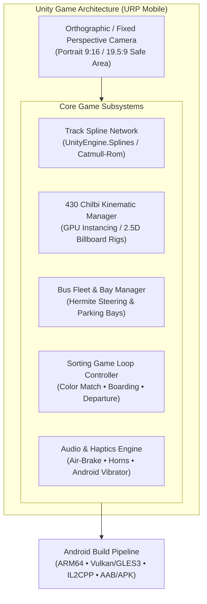
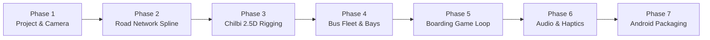

# Roadways Bus Game: Android Conversion Strategy & Project Roadmap

## 1. Executive Overview

The **Roadways Bus Game** has achieved a working, high-fidelity interactive prototype featuring:
1. **Cherry Blossom 3D Park** (Angled Three.js perspective, pastel lawn rings, stone garden accents, zero tree/leaf clutter).
2. **Unified SVG Circuit Network** (Catmull-Rom racing circuit, red/white apex kerbs, screen-side feeder roads, seamless highway neck into the trapezium).
3. **430 Chilbi Character Formation** (Upright 2.5D side-view candy rigs, single-color rows across 8 master palettes, high-speed sprint entrance, smooth deceleration, tight-packed 60-row circuit capacity, queue hold buffer, heat-saver mode).
4. **Top-Down Bus Fleet & Parking Bays** (8 color-matched buses, forward-facing roof arrows, 9 angled trapezium parking bays tilted at -30° with VIP and unlock slots).
5. **Authentic Vehicular Driving Kinematics** (Cubic Hermite velocity-tangent steering, head-first bay entry through the mouth of the bay, braking suspension settle, pneumatic air-brake audio, and roof arrow disappearance upon docking).

**Decision**: The project will be converted into a native Android game using **Unity (Approach 2)**.

---

## 2. Unity Architecture & Tech Stack

### Technical Configuration:
- **Engine Version**: Unity 2022.3 LTS or Unity 6.
- **Render Pipeline**: **Universal Render Pipeline (URP)** optimized for mobile (Forward Rendering, single directional light, zero post-processing overhead).
- **Target Platform**: Android (Min SDK: Android 8.0 Oreo, Target SDK: Android 14+, Scripting Backend: IL2CPP, Target Architectures: ARM64 + ARMv7).
- **Aspect Ratio**: Portrait locked (9:16 to 20:9 responsive Canvas Scaler with Notch / Safe Area handling).

---

## 3. Step-by-Step Unity Development Flow

Below is the comprehensive, phase-by-phase implementation blueprint:

---

### Phase 1: Unity Project Setup & Camera Perspective
- [ ] **Step 1.1: Project Initialization**:
  - Create a new Unity URP project targeting Mobile 3D.
  - Set color space to Linear; disable default shadows or set soft shadow distance to 30m.
  - Set Screen Orientation to `Portrait` in Player Settings.
- [ ] **Step 1.2: Angled Camera Rig**:
  - Recreate the exact Three.js camera transformation in Unity:
    - Position: `(0, 30, 42)` looking at Target `(0, 0, 8)` with `Camera.main.transform.LookAt(...)`.
    - Field of View: `44°` portrait (responsive vertical FOV script to match Three.js framing).
- [ ] **Step 1.3: Cherry Blossom Park Ground Plane**:
  - Ground plane quad with unlit/lit pastel shader (`#fff1f2` background).
  - Subtle concentric circular lawn rings using a custom unlit shader or high-res texture decal.
  - Stone garden accent meshes placed symmetrically.

---

### Phase 2: Procedural Track & Roadway Spline Network
- [ ] **Step 2.1: Catmull-Rom Spline Curve**:
  - Import the 16 exact Catmull-Rom control points from the SVG circuit into `UnityEngine.Splines` or a custom `CircuitSpline` MonoBehaviour.
  - Generate the chicane dip, rounded crests, hairpin turns, and bottom straightaway.
- [ ] **Step 2.2: Road Extrusion & Mesh Generation**:
  - Procedural mesh builder or LineRenderer creating:
    - 82px Asphalt road surface (`#525769`).
    - 2px crisp white edge curbs (`#e6e9ee`).
    - 11px tan dirt shoulders (`#cbb27a`).
    - 5 alternating red & white inner apex racing kerbs (`#ffffff` and `#e74c3c`).
    - Dashed centerline markings using UV scrolling or dash-pattern shader.
- [ ] **Step 2.3: Feeder Roads & Trapezium Neck**:
  - Left and right connecting feeder roads entering from screen edges with merge junction stop line at $X = 30$.
  - Wide highway neck (220 units) connecting bottom straight of the ring directly into the top of the trapezium.

---

### Phase 3: 2.5D Chilbi Characters & 430-Formation Simulation
- [ ] **Step 3.1: 2.5D Chilbi Rig & Shader**:
  - Billboard sprite/mesh rig with upright posture facing horizontal walk direction (`facingX = dx >= 0 ? 1 : -1`).
  - Seamless candy bean body silhouette (single organic shape combining head and torso, zero gaps).
  - Procedural stepping legs connected deep inside pelvic sockets.
  - Human-like curved swinging arms with rounded elbow joints.
  - Ground contact oval shadow.
- [ ] **Step 3.2: Master Color Palettes (ScriptableObject)**:
  - Port `MASTER_COLOR_PALETTES` constant to a `PaletteDatabase` ScriptableObject containing all 8 candy colors (Red `#c0392b`, Yellow `#f39c12`, Blue `#2548ad`, Green `#20bf6b`, Purple `#8854d0`, Orange `#e67e22`, Pink `#e84393`, Cyan `#0fbcf9`).
- [ ] **Step 3.3: 430 Chilbi Formation Kinematics**:
  - 430 Chilbis arranged in 7-abreast rows across 62 rows (single-color rows in alternating 8-color blocks).
  - Arc-length LUT for strictly uniform linear speed.
  - Two-phase entrance: $150\text{ px/s}$ high-speed sprint down feeder road, decelerating smoothly at junction into $46\text{ px/s}$ cruising loop.
  - Ring road capacity of 60 rows ($420$ Chilbis) with seamless zero-gap loop closure.
  - Queue hold buffer for remaining 10 Chilbis behind feeder stop line.
  - **Mobile Performance Optimization**: Use GPU Instancing (Graphics.DrawMeshInstanced) or C# Job System + Burst to simulate all 430 walkers with 0% CPU overhead.

---

### Phase 4: Top-Down Bus Fleet & Parking Bays
- [ ] **Step 4.1: Trapezium Parking Bays (UI / World Space)**:
  - Grey trapezium base panel (`#525769`) with rounded top corners.
  - 9 identical rectangular bays tilted at `-30°`:
    - 5 Standard Bays (white border).
    - 1 VIP Bay (gold border).
    - 3 Unlock Bays (green border with `+`).
- [ ] **Step 4.2: Top-Down Bus Prefabs**:
  - 8 color-matched bus prefabs with exact aspect ratio (25 × 50), rounded corners (`rx = 5.5`), dark tinted windshield and side windows, zero shadows, zero shine.
  - Forward-facing white directional roof arrow with rounded corners (`stroke-linejoin="round"`).
- [ ] **Step 4.3: Vehicular Steering Kinematics (Cubic Hermite Spline)**:
  - Tap detection on depot buses with raycast or EventTrigger.
  - Clearance check: if bay is occupied or path blocked, play wiggle shake animation + warning buzz audio.
  - Driving Maneuver:
    - Phase 1: Accelerate forward in arrow direction (straight UP, $0^\circ$) with subtle startup stretch (`scale(0.98, 1.025)`).
    - Phase 2: Follow velocity-tangent steering curve ($\theta = \operatorname{atan2}(v_x, -v_y)$) to bay entrance mouth at $(145.5, 368.4)$.
    - Phase 3: Align nose to **`-30.0°`** and pull straight forward head-first inside the bay along its $-30^\circ$ centerline.
    - Phase 4: Braking nose-dip (`scale(1.02, 0.975)`), rebound settle, pneumatic air-brake audio ("pssshh-clack!"), and smooth roof arrow fade-out.
  - Reverse back-out maneuver when tapped to return to depot.

---

### Phase 5: Passenger Boarding & Sorting Game Loop
- [ ] **Step 5.1: Color-Matching Trigger**:
  - Detect when a parked bus color matches the active front row of Chilbis on the ring road.
- [ ] **Step 5.2: Peeling-Off Boarding Animation**:
  - Chilbis of matching color break from the ring road at the highway neck.
  - Walk down the highway corridor and hop into the parked bus with upbeat pop sounds.
  - Increment on-bus seat counter (e.g. 7 passengers per row).
- [ ] **Step 5.3: Bus Departure**:
  - When the bus reaches capacity (7 passengers), it honks, accelerates forward out of the bay, and drives out through the highway to exit the screen.
  - Frees the parking bay for the next vehicle.
- [ ] **Step 5.4: Win & Gridlock Rules**:
  - **Win**: All 430 Chilbis successfully boarded and all rows cleared!
  - **Gridlock (Game Over)**: All available parking bays filled with buses that do not match the current front waiting Chilbi rows.

---

### Phase 6: Audio Synthesis, Haptics & Visual Juice
- [ ] **Step 6.1: Audio System in Unity**:
  - 12-voice kids cheer chorus ("Hey! Goooo! Let's gooo!").
  - Harmonic bus horns tuned to exact frequencies (440Hz, 392Hz, 494Hz, 523Hz, 587Hz, 622Hz, 659Hz, 740Hz).
  - Pneumatic air-brake hiss and parking pawl latch sound.
  - Boarding pop sounds and engine acceleration rumble.
- [ ] **Step 6.2: Android Native Haptics**:
  - Integrate Android `Vibrator` API for tactile feedback on:
    - Bus tap / dispatch (light tick).
    - Blocked path rejection (double rumble).
    - Parking latch docking (firm click).
    - Passenger hop-in (soft pop).

---

### Phase 7: Android Build Pipeline & Device Verification
- [ ] **Step 7.1: Android Player Settings**:
  - Package Name: `com.roadways.busgame`.
  - Min SDK: Android 8.0 (API level 26).
  - Target SDK: Android 14 (API level 34).
  - Fullscreen Immersive Mode enabled (hiding Android navigation and status bar).
- [ ] **Step 7.2: Gradle & Keystore Configuration**:
  - Release Keystore generation.
  - ARM64 IL2CPP build with Split App Binary (Android App Bundle / AAB for Play Store, APK for direct testing).
- [ ] **Step 7.3: Direct Device Deployment**:
  - Deploy directly via ADB to your Android phone (`Realme RMX3690`, ADB id `2905321030008921`).
  - Profile frame rate with Unity Profiler / Android GPU Profiler ensuring locked 60 FPS.
