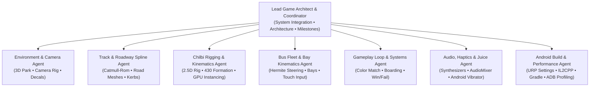

# Roadways Bus Game: Multi-Agent Architecture & Engineering Roster (`Agents.md`)

## 1. Overview & Purpose

This document defines the specialized agent roster, roles, responsibilities, operational workflows, and coordination protocols for developing and porting the **Roadways Bus Game** to Unity (Universal Render Pipeline for Android). Each agent owns a distinct vertical slice of the game system, ensuring zero merge conflicts, strict mathematical fidelity, and rapid iterative progress.

---

## 2. Specialized Agent Roles & Ownership

### Agent 1: Lead Game Architect & Coordinator (`@agent-architect`)
- **Role**: Technical Direction, System Architecture & Milestone Verification.
- **Responsibilities**:
  - Owns the root scene composition (`MainGame.unity`) and high-level manager orchestration.
  - Enforces mathematical constants parity (e.g. `MasterColorPalettes`, speed ratios, spacing constraints).
  - Validates cross-system dependencies (e.g. connecting Spline output to Chilbi Kinematics).
  - Conducts code reviews, git commit hygiene, and milestone sign-offs.

---

### Agent 2: Environment & Camera Rig Agent (`@agent-environment`)
- **Role**: 3D Scene Composition & Camera Systems.
- **Responsibilities**:
  - **Camera Rig**: Positions camera at `(0, 30, 42)` looking at Target `(0, 0, 8)` with pitch $\approx 35^\circ$ and static lock.
  - **Responsive FOV**: Implements responsive portrait FOV controller ($44^\circ$ vertical base FOV) adjusting for tall mobile screens (`9:16` to `20:9`).
  - **Cherry Blossom Park**: Creates pastel ground plane (`#fff1f2`), circular lawn pathway decals (`#f2d5db`), and zen garden stone meshes.
  - **Restrictions Enforcement**: Strictly zero trees, zero floating leaf particles, and zero character/vehicle clutter on the lawn.

---

### Agent 3: Track & Roadway Spline Agent (`@agent-spline`)
- **Role**: Procedural Spline Geometry & Mesh Generation.
- **Responsibilities**:
  - **Catmull-Rom Spline**: Implements the 16-point closed-loop racing circuit with arc-length lookup table (LUT).
  - **Procedural Road Extrusion**: Builds the 82-unit asphalt surface (`#525769`), 2-unit white curbs (`#e6e9ee`), and 11-unit dirt shoulders (`#cbb27a`).
  - **Inner Apex Kerbs**: Places the 5 alternating red/white kerbs (`#ffffff` / `#e74c3c`) at chicane dip and hairpin turns.
  - **Feeder Roads & Highway Neck**: Generates left/right screen-side feeder splines with $X=30$ stop bar and the flared highway neck into the trapezium.

---

### Agent 4: Chilbi Rigging & Kinematics Agent (`@agent-chilbi`)
- **Role**: 2.5D Character Rigging, Formation Kinematics & GPU Instancing.
- **Responsibilities**:
  - **Candy Bean Silhouette**: Seamless organic body combining head dome and torso into one continuous shape.
  - **Joint Mechanics**: Pelvic leg joints ($Y = -6$) and rounded elbow bipedal arms ($Y = -17$) swinging synchronously.
  - **Formation Data**: 430 Chilbis across 62 rows (7-abreast, single-color rows cycling across 8 master colors).
  - **Kinematic Controllers**: $150\text{ px/s}$ high-speed feeder entrance, junction deceleration, $46\text{ px/s}$ circuit cruising, 60-row circuit lock ($420$ Chilbis), and queue buffer hold.
  - **Mobile Performance**: GPU Instancing (`Graphics.RenderMeshInstanced`) and C# Job System + Burst compilation for locked 60 FPS.

---

### Agent 5: Bus Fleet & Parking Kinematics Agent (`@agent-bus`)
- **Role**: Vehicle Models, Touch Input & Vehicular Driving Physics.
- **Responsibilities**:
  - **Top-Down Bus Prefabs**: 8 matte bus models ($25 \times 50$ units, $rx = 5.5$, tinted windows, forward-facing white roof arrows).
  - **Trapezium Parking Bays**: 9 angled slots tilted at `-30°` (5 standard, 1 VIP, 3 unlock).
  - **Clearance Verification**: Detects whether destination bay is occupied or vehicle is in flight; triggers rejection wiggle + warning audio when blocked.
  - **Cubic Hermite Steering**: Implements velocity-tangent steering ($\theta = \operatorname{atan2}(v_x, -v_y)$), bay approach waypoint $(145.5, 368.4)$, head-first bay entry, suspension settle, and roof arrow disappearance.
  - **Reverse Back-Out**: Handles reverse exit maneuver when tapped to return to depot.

---

### Agent 6: Gameplay Loop & Sorting Systems Agent (`@agent-loop`)
- **Role**: Game State, Boarding Logic, Progression & Game Over Rules.
- **Responsibilities**:
  - **Color Matching**: Detects when docked bus matches the active front row of Chilbis.
  - **Boarding Sequence**: Triggers row peeling-off along highway neck, parabolic hop-in animation, and 7-passenger capacity counter.
  - **Bus Departure**: Full bus seals doors, honks, and accelerates forward out of the bay to exit screen.
  - **Queue Progression**: Advances circuit rows forward and feeds queued rows from feeder road.
  - **Multi-Bay Management**: Manages all 9 bays simultaneously.
  - **Game States**: Handles Win state (all 430 Chilbis cleared) and Gridlock / Game Over state (all bays filled with non-matching buses).

---

### Agent 7: Audio Synthesis, Native Haptics & Juice Agent (`@agent-audio`)
- **Role**: Sound Design, Tactile Feedback & Visual Polish.
- **Responsibilities**:
  - **Audio System**: AudioMixer routing, kids cheer chorus clip, 8 harmonic bus horns ($392\text{ Hz}$ to $740\text{ Hz}$), engine acceleration rumble, and boarding pops.
  - **Pneumatic Air Brake**: Synthesizes bandpass-filtered pneumatic air-brake hiss ("pssshh-clack!") upon docking.
  - **Android Haptics**: JNI bridge to Android `Vibrator` / `VibrationEffect` for dispatch tick, blocked rumble, dock click, and hop-in micro-pulses.
  - **Juice**: Screen-space UI header watermark, squashes and stretches, and confetti particle burst on win.

---

### Agent 8: Android Build & Performance Optimization Agent (`@agent-build`)
- **Role**: Build Pipeline, Android Player Settings & Device Profiling.
- **Responsibilities**:
  - **Graphics API**: Configures Vulkan primary, GLES3 fallback, and ASTC texture compression.
  - **IL2CPP & ARM64**: Sets up 64-bit compilation for Google Play Store compliance.
  - **Gradle & Keystore**: Customizes Gradle templates, ProGuard shrinking, and production keystore signing.
  - **ADB Deployment**: Manages direct deploy to target device (`Realme RMX3690`, ADB id `2905321030008921`).
  - **Profiling**: Monitors Unity Profiler metrics (frame time $< 16.6\text{ms}$, draw calls $< 50$, memory $< 120\text{MB}$).

---

## 3. Communication & Delivery Workflow

1. **Feature Branching**: Each agent works on an isolated feature branch named `feature/phase<N>-<agent-name>`.
2. **Master Constant Synchronization**: No agent hardcodes colors, coordinates, or speeds; all systems pull from `ColorPaletteDatabase.cs` and `GameConstants.cs`.
3. **Automated Verification**: Before merging, each agent runs an automated test scene verifying zero console warnings, frame rate stability, and visual parity against `3D_Showcase_Preview.html`.
4. **Integration Sign-off**: `@agent-architect` merges branches and tags releases.

<!-- BEGIN:project-track -->
## Project tracking

This repo reports to All Project Tracks. When you finish work here, update
`.project-track/status.json`:

- `stage`: idea | prototype | alpha | beta | released | live | paused | archived
- `next`: the one thing to do next, in a sentence
- `blockers`: what is in the way; `[]` when nothing is
- `updatedAt`: now, ISO 8601

Append one `{"ts":"<iso>","event":"note","summary":"<one line>"}` line to
`.project-track/activity.jsonl` for a decision or change worth remembering later. Nothing else.
<!-- END:project-track -->
