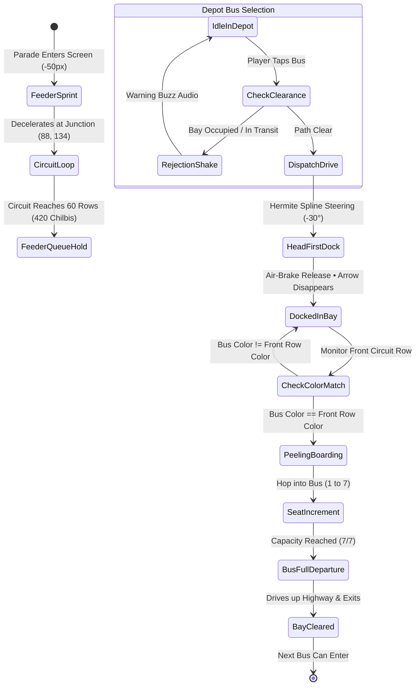
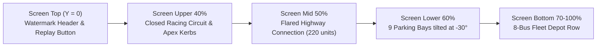
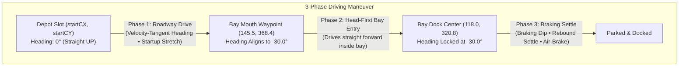
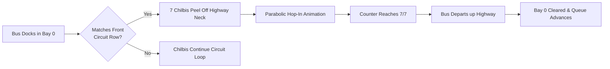
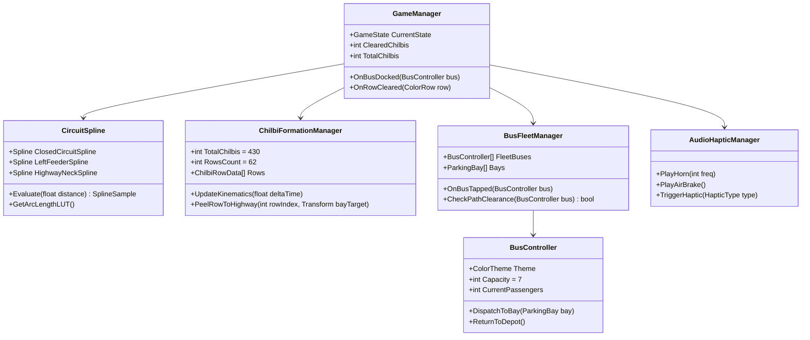

# Roadways Bus Game: Game Design & Technical Design Document (`Design.md`)

## 1. Game Concept & Core Loop

**Roadways Bus Game** is an elevated arcade-puzzle sorting game. Players observe an endless parade of vibrant candy characters (**Chilbis**) marching around a Cherry Blossom racing circuit in single-color rows. At the bottom terminal, players dispatch color-matching buses into angled parking bays. When a bus docks, matching characters peel off the circuit and board. Full buses depart, freeing the bay. If all bays fill with mismatched vehicles, the player reaches **gridlock**.



---

## 2. Visual & Art Direction

### Color Palette & Master Theme
The visual style is **Matte Candy Pastel**:
- **Background Lawn**: `#fff1f2` (soft warm cherry blossom pastel).
- **Lawn Pathway Rings**: `#f2d5db` (subtle concentric walking paths, alpha `0.35`).
- **Asphalt Road Surface**: `#525769` (dark slate matte asphalt).
- **Edge Curbs**: `#e6e9ee` (pure crisp white boundary).
- **Dirt Shoulders**: `#cbb27a` (warm tan dirt border).
- **Terminal Panel**: `#525769` (matching road asphalt) with `#d3daed` depot floor.

### Master Color Palettes (8 Unified Candy Themes)
Both Chilbi characters and bus models share identical primary hex colors:
```json
{
  "red":    { "name": "Crimson Express",     "hex": "#c0392b", "accent": "#a82c1f", "hornFreq": 440 },
  "yellow": { "name": "Amber School Buggy",  "hex": "#f39c12", "accent": "#d4880f", "hornFreq": 392 },
  "blue":   { "name": "Cobalt Commuter",     "hex": "#2548ad", "accent": "#1c3987", "hornFreq": 494 },
  "green":  { "name": "Emerald Eco",         "hex": "#20bf6b", "accent": "#168d4f", "hornFreq": 523 },
  "purple": { "name": "Royal Violet",        "hex": "#8854d0", "accent": "#6c3db5", "hornFreq": 587 },
  "orange": { "name": "Tangerine Transit",   "hex": "#e67e22", "accent": "#cf6717", "hornFreq": 622 },
  "pink":   { "name": "Bubblegum Shuttle",   "hex": "#e84393", "accent": "#cf2d7c", "hornFreq": 659 },
  "cyan":   { "name": "Cyan Deck-Master",    "hex": "#0fbcf9", "accent": "#0998cc", "hornFreq": 740 }
}
```

### Negative Art Constraints
- Strictly **zero trees**.
- Strictly **zero floating leaf particles** or ground petal meshes.
- Strictly **zero characters or obstacles** on the lawn surface.
- Strictly **zero specular shine** or pale glossy highlights on character heads and bus roofs.
- Strictly **zero eyes** on Chilbi characters.

---

## 3. Coordinate Systems, Camera & Viewport Projection

### Camera Rig Specifications
- **Position**: `(X = 0, Y = 30, Z = 42)`.
- **Target Point**: `(X = 0, Y = 0, Z = 8)`.
- **Camera Pitch**: $\approx 35^\circ$ downward angle.
- **Base Vertical FOV**: $44^\circ$ at reference aspect ratio $9:16$ ($0.5625$).



### Dynamic Portrait FOV Formula
To ensure consistent vertical composition on tall mobile devices (`19.5:9`, `20:9`):
$$\text{FOV}_{v} = 2 \times \arctan\left(\tan\left(\frac{44^\circ}{2}\right) \times \frac{\text{Aspect}_{ref}}{\text{Aspect}_{current}}\right)$$

---

## 4. Procedural Spline Mathematics

### 16-Point Catmull-Rom Circuit Spline
The racing circuit is defined by 16 closed-loop control points:
$$P_i = \left\{(280, 170), (220, 150), (360, 95), (420, 105), (480, 125), (540, 105), (605, 80), (705, 110), (794, 210), (740, 230), (660, 236), (500, 236), (360, 236), (203, 170), (220, 200), (250, 185)\right\}$$

### Centripetal Catmull-Rom Formulation
For segment $t \in [0, 1]$ between $P_1$ and $P_2$, with neighbors $P_0$ and $P_3$:
$$C(t) = \frac{1}{2} \begin{bmatrix} 1 & t & t^2 & t^3 \end{bmatrix} \begin{bmatrix} 0 & 2 & 0 & 0 \\ -1 & 0 & 1 & 0 \\ 2 & -5 & 4 & -1 \\ -1 & 3 & -3 & 1 \end{bmatrix} \begin{bmatrix} P_0 \\ P_1 \\ P_2 \\ P_3 \end{bmatrix}$$

### Arc-Length Lookup Table (LUT)
The closed spline is sampled into 1000 equidistant points. Total loop length:
$$L_{total} = 829.3\text{ units}$$
Given distance $s$, the parameter $t$ is evaluated via binary search in $O(\log N)$, guaranteeing strictly constant linear velocity ($46.0\text{ units/s}$) across all curves and chicane dips.

---

## 5. 2.5D Chilbi Rig & Kinematic Architecture

### Mesh & Joint Topology
```text
Chilbi Root (X, Y, GroundShadow)
└── Body Group (Bobs Y = sin(2*PI*f*t)*1.8px, Tilts Z = cos(2*PI*f*t)*2.5deg)
    ├── Candy Bean Mesh (rect x="-8.5" y="-30" w="17" h="27" rx="8.5")
    ├── Hip Near Joint (X = +2.0, Y = -6.0)
    │   └── Near Leg & Foot (strides +28° to -28°)
    ├── Hip Far Joint (X = -2.0, Y = -6.0)
    │   └── Far Leg & Foot (strides -28° to +28°)
    ├── Shoulder Near Joint (X = +2.5, Y = -17.0)
    │   └── Curved Arm with Rounded Elbow (swings -25° to +25°)
    └── Shoulder Far Joint (X = -2.5, Y = -17.0)
        └── Curved Arm with Rounded Elbow (swings +25° to -25°)
```

### 430 Character Squad Formation
- **Total Count**: Exactly 430 characters.
- **Rows**: 62 rows (61 rows of 7 + 1 row of 3).
- **Lane Width**: Road width is 82 units. 7 lanes spaced at $d \in [-35.1, +35.1]$ with equal $11.71\text{ units}$ clearance.
- **Speed Profiles**:
  - Feeder Sprint: $150\text{ units/s}$, leg stride $19.5\text{ Hz}$, torso lean $8^\circ$.
  - Deceleration Ease: Smooth transition over $1.4\text{s}$ into circuit.
  - Cruising Walk: $46\text{ units/s}$, leg stride $8.0\text{ Hz}$, body bobbing $16.0\text{ Hz}$.
- **Circuit Capacity**: 60 rows ($420$ Chilbis) fill the circuit loop with exact $13.82\text{ units}$ row spacing.
- **Queue Buffer**: Remaining 10 Chilbis (Rows 60 & 61) hold behind $X = 30$ stop line ($25\text{px}$ clearance from ring outer curb) with synchronized idle waddles.

---

## 6. Top-Down Bus Fleet & Trapezium Terminal

### Trapezium Terminal & Bay Layout
- **Terminal Panel**: Slate grey (`#525769`) with smooth quadratic bezier corners (`Q 400,0 480,0` and `Q 1200,0 1272,180`).
- **9 Angled Bays**: Centered single row tilted at **`-30°`**:
  - Bays 0–4: Standard slots (`border: 2px solid #ffffff`).
  - Bay 5: VIP slot (`border: 2px solid #ffd700` with gold "VIP" label).
  - Bays 6–8: Unlock slots (`border: 2px solid #2ecc71` with bold `+` icon).
  - Bay Dimensions: $25\text{px} \times 50\text{px}$, corner radius $6\text{px}$, gap $8\text{px}$.

### Vehicle Prefabs
- **Dimensions**: $25\text{px} \times 50\text{px}$, corner radius $5.5\text{px}$.
- **Top-Down Shading**: Solid matte primary color, dark tinted front windshield visor (`#1e2430`), rear window, and side window cutouts.
- **Roof Arrow**: Crisp matte white forward arrow:
  `d="M 12.5,17 L 18.5,24.5 L 14.8,24.5 L 14.8,34 Q 14.8,35 12.5,35 Q 10.2,35 10.2,34 L 10.2,24.5 L 6.5,24.5 Z"` with rounded corners (`stroke-linejoin="round"`).

---

## 7. Vehicular Driving Kinematics (Hermite Steering)

To prevent the bus from appearing "dragged", all vehicle motion is governed by **Cubic Hermite Spline Kinematics** where the bus heading $\theta$ is derived directly from its velocity tangent:

$$\vec{P}(u) = (2u^3 - 3u^2 + 1)\vec{P}_0 + (u^3 - 2u^2 + u)\vec{T}_0 + (-2u^3 + 3u^2)\vec{P}_1 + (u^3 - u^2)\vec{T}_1$$
$$\vec{V}(u) = (6u^2 - 6u)\vec{P}_0 + (3u^2 - 4u + 1)\vec{T}_0 + (-6u^2 + 6u)\vec{P}_1 + (3u^2 - 2u)\vec{T}_1$$
$$\theta(u) = \operatorname{atan2}(V_x, -V_y) \times \frac{180^\circ}{\pi}$$



### Arrival Behavior
- **Suspension Settle**: Startup forward stretch `scale(0.98, 1.025)`, braking dip `scale(1.02, 0.975)`, and rebound settle to `(1.0, 1.0)`.
- **Air-Brake Hiss**: Pneumatic air exhaust hiss ("pssshh-clack!") upon final settle.
- **Roof Arrow Fade**: Arrow fades to 0 opacity over $0.28\text{s}$ upon docking.

---

## 8. Passenger Boarding & Sorting Game Loop



### Core Rules & Win/Fail States
1. **Capacity**: Exactly 7 passengers per bus (matches 1 full row).
2. **Win Condition**: All 430 Chilbis successfully boarded and all 62 rows cleared.
3. **Fail / Gridlock Condition**: All active bays filled with buses that do not match the current front waiting row.

---

## 9. Audio Synthesis & Native Android Haptics

### Audio Design Specifications
- **12-Voice Kids Cheer Chorus**: High-energy audio clip ("Hey! Goooo! Let's gooo!") triggered during high-speed feeder sprint.
- **Harmonic Dual-Tone Bus Horns**:
  Dual oscillators (Sawtooth fundamental + Sine 1.25x harmonic) tuned to project frequencies ($392\text{ Hz}$ to $740\text{ Hz}$).
- **Pneumatic Air-Brake Exhaust**:
  Synthesized white noise filtered through a $1600\text{ Hz} \to 500\text{ Hz}$ bandpass filter ($Q = 2.5$) with exponential gain decay, followed by a triangle wave mechanical pawl click ($750\text{ Hz} \to 320\text{ Hz}$).

### Android Native Haptics Bridge (`AndroidHaptics.cs`)
Calls Android `Vibrator` and `VibrationEffect` via JNI:
| Action | Haptic Effect | Duration / Pattern | Amplitude |
| :--- | :--- | :--- | :--- |
| **Bus Selection** | Light Click | 15 ms single tick | 80 / 255 |
| **Path Blocked** | Rejection Buzz | 40ms on, 30ms off, 60ms on | 200 / 255 |
| **Bay Docking** | Firm Latch | 25 ms crisp tap | 180 / 255 |
| **Passenger Boarding** | Micro Pop | 10 ms subtle pulse | 60 / 255 |

---

## 10. Software Class Architecture (Unity C#)


