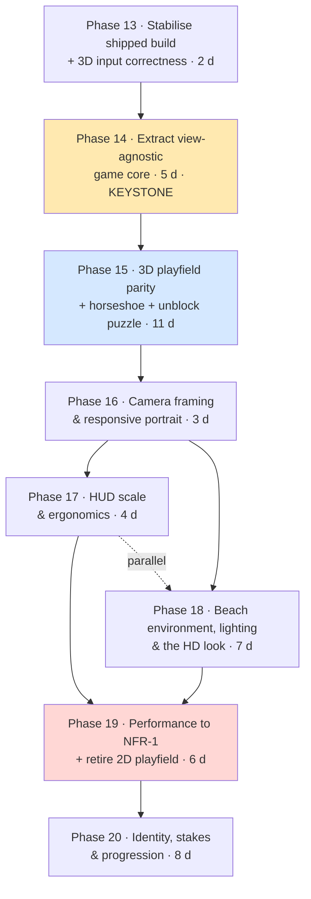

# Roadways Bus Game — Remediation Roadmap, Phases 13 → 20

**Created:** 2026-11-21
**Source:** every finding in [`UI_UX_AUDIT_2026-11-21.md`](./UI_UX_AUDIT_2026-11-21.md)
**Numbering:** continues the existing programme — Phases 1–12 complete (`180e18b` = Phase 12)
**Branches:** `feature/phase<N>-<agent-name>`, per [`Agents.md`](./Agents.md) §3.1
**Scope decided:** all 8 phases · **≈ 46 developer-days** (~9 weeks solo, ~6 weeks with two developers)
**Visual & structural target:** [`VISUAL_TARGET_BUS_FEVER.md`](./VISUAL_TARGET_BUS_FEVER.md) — derived from the supplied *Bus Fever Party!* reference screenshot

---

## 0. Decision record

| Gate | Decision | Consequence |
| :--- | :--- | :--- |
| **G1 · 2D canvas game vs. 3D implementation** | **Finish the 3D path.** | The audit recommended the opposite (§J.6) on cost grounds. The decision was reaffirmed, so this roadmap is planned for 3D in full. The structure below is **not** the 2D plan with lighting bolted on — Phases 14–19 are different work. |
| **G2 · TextMeshPro** | **Migrate.** | Phase 17. The HUD stays screen-space in 3D, so the scale pass is unchanged from the 2D plan. |
| **G3 · Does emoji render on device?** | **Check today — 2 minutes.** | If tofu, item 17.6 is P0 (two icon-only buttons would be blank boxes). |
| **G4 · Show a linear "next up" preview of the circular parade?** | **Superseded by G5.** | The reference solves queue legibility with *geometry* — a horseshoe with visible exit gates. Better and cheaper than the gate-plus-strip I proposed. Phase 15 builds the horseshoe; Phase 17 drops the strip. |
| **G5 · Adopt the arrow/unblock depot puzzle?** | **Yes — adopted.** | The depot becomes ~30 scattered vehicles of varied length and angle, each with a direction arrow, leaving only when its path is clear. **+6 d** (4 d in Phase 15, 2 d in Phase 20). Fixes the audit's core criticism that the loop has almost no decisions in it (§B-3, §C-3). |
| **G6 · Theme** | **Switch to beach.** | Chosen over keeping cherry blossom. I argued for sakura on differentiation grounds (§5 of the target doc) — the decision was made the other way, so this roadmap plans the beach in full. See Phase 18.0 for how to stay distinct *within* the beach theme. **+2 d** environment rebuild. |

### What choosing 3D changed, and why

Taking 3D seriously means the audit's §J fixes split in two:

- **Still needed, essentially unchanged:** everything screen-space. The HUD, modals, start screen, Back button, pause, scale/legibility, touch targets, emoji→sprites, haptics, audio, splash. In 3D the HUD is still a `ScreenSpaceOverlay` canvas, so §B-2, §B-4, §B-7, §B-8, §B-9, §B-11, §E-1, §E-2 carry over verbatim.
- **Replaced by better 3D solutions:** the sprite-shading hacks (J-2), bay-tint contrast (J-4), panel-ratio space reclamation (J-1), canvas splitting and sprite atlasing. In 3D these become real lighting, real materials, camera framing and GPU instancing. **The "dull" problem (§J) gets solved properly rather than faked** — this is the genuine upside of the decision.
- **Newly required, and the bulk of the cost:** the 3D playfield has **no gameplay logic at all.** Verified: `grep -rln "score\|boarding\|gridlock\|Victory\|level"` across `Bus/`, `Characters/`, `Spline/` returns **nothing**. All ~2,350 lines of boarding, colour matching, scoring, combos, levels, win/fail, gridlock, boosters, FTUE and persistence live in `BusFleetUIController` welded to `RectTransform`s. **Phase 14 exists to fix that, and nothing else can start until it does.**

### Honest assessment of what already exists in 3D

Better than the audit implied — I called it "dormant"; it is more accurately "built but unwired".

| Already working | Evidence |
| :--- | :--- |
| 16-point Catmull-Rom circuit + arc-length LUT, road/curb/shoulder extrusion, apex kerbs, feeder roads, highway neck | `Spline/` — 7 files, `TrackNetworkManager.BuildCompleteTrackNetwork()` |
| Trapezium terminal, 9 bay slots with type/occupancy/lock state, `GetFirstAvailableBay()` | `Bus/ParkingBayManager.cs:64-195` |
| 8 bus prefabs: meshes, materials, `BoxCollider`, full state machine (dispatch → dock → return), Hermite drive, blocked wiggle, roof-arrow visibility, `BoardPassenger()` | `Bus/BusVehicleController.cs` |
| Raycast touch picking, correctly written for the Input System (`activeInputHandler: 1`) | `Bus/BusFleetController.cs:112-153` |
| Full 430-Chilbi kinematics with a locomotion state machine: feeder sprint 150 → junction decel → circuit cruise 46 → queue hold behind the stop bar | `Characters/ChilbiFormationManager.cs:121-210` |
| GPU instanced renderer scaffolding (`Graphics.RenderMeshInstanced`, `MaterialPropertyBlock`) | `Characters/ChilbiInstancedRenderer.cs` |
| Camera rig at `(0,30,42)` → `(0,0,8)`, responsive portrait FOV | `Camera/` |
| `GameConstants` + `ColorPaletteDatabase` as a real parity source — including `AmbientLightColor #f7e8ea` and `DirectionalLightColor #fff9f5`, already specified | `Architecture/` |

| Missing or broken in 3D | Impact |
| :--- | :--- |
| **All gameplay logic** (see above) | Phase 14 |
| **Raycast ignores UI.** `Physics.Raycast` runs with no `EventSystem.current.IsPointerOverGameObject()` check, so a tap on a HUD button or an open modal **also dispatches a bus behind it** | **P0** — Phase 13.8 |
| No boarding animation: Chilbis never peel off, walk the neck, or hop in | Phase 15 |
| Same global single-flight lock (`isAnyBusInFlight`) and same auto-bay-assign as 2D | Phases 15/20 — §B-6, §C-3 carry over |
| `FindObjectOfType` (deprecated) on the tap path | Phase 13.8 |
| **Burst and Jobs are not installed.** `com.unity.burst`, `.collections`, `.mathematics` are absent from `Packages/manifest.json`, yet `Agents.md` Agent 4 and NFR-3 both require them. `UpdateKinematics` is a single-threaded `for` over 430 characters per frame | Phase 19 — and the biggest schedule risk |
| `renderOnlyLeadChilbi` "Development Heat-Saver Toggle" exists in `ChilbiFormationManager.cs:22` | A pre-existing signal that 430 characters in 3D already caused thermal trouble. Treat Phase 19 as load-bearing, not polish. |
| `m_SupportsHDR: 0`, `m_ColorGradingMode: 0`, every `LiftGammaGain` channel neutral | Phase 18 |

### Primary risks of this path

1. **NFR-1 is materially harder in 3D.** < 50 draw calls, 0 B GC/frame and 60 fps with 420 animated characters on a Snapdragon 680 is achievable *only* if GPU instancing and Burst both land well. The instancing is scaffolded; Burst is not installed. **Phase 19 is the phase that can fail.** Mitigation: measure at the end of Phase 15, not Phase 19 — see 15.9.
2. **Thermal/battery** (NFR-3) is a real risk at 430 characters; the existing heat-saver toggle is evidence.
3. **You must stay playable throughout.** Phases 14–15 are the dangerous stretch. Mitigation: the view interface in Phase 14 keeps the 2D playfield alive and shippable behind a feature flag until 3D reaches parity in Phase 15. **Do not delete the 2D playfield before Phase 19.**

### Dependency graph

**Critical path:** 13 → 14 → 15 → 16 → 17 → 19 → 20 = **39 d**, plus Phase 18 (7 d) which can overlap 17 with a second developer. Solo: **46 d.**

---

# Phase 13 · Stabilise the shipped build + 3D input correctness

> **Goal:** nothing is unrecoverable, no tap goes unanswered, and the 3D tap path is sound before anything is built on it.
> **Owners:** `@agent-loop` (lead), `@agent-bus`
> **Branch:** `feature/phase13-agent-loop` · **Effort:** 2 d · **Depends on:** nothing
> **Audit refs:** §B-1, §B-2, §B-6, §B-9 · plus two new 3D findings

Every item is a guard clause or a feedback call. These fixes survive the migration intact, because they are all in logic or screen-space code.

| # | Fix | Site | Detail |
| :--- | :--- | :--- | :--- |
| 13.1 | **Kill the soft-lock** | `BusFleetUIController.cs:1009` | Add `if (isBoardingActive) return;` to `OnParkedBusClicked`, routed through `RejectShake` + a tip. |
| 13.2 | **Don't recycle a voided boarding** | `BusFleetUIController.cs:437-441` | Re-check `parkedBusObjects[bayIndex] != null` before `RecycleRow(row)`; if the bus is gone, restore the row in place keeping its original index. Carry this rule into the Phase 14 core — it is a **logic** invariant, not a UI one. |
| 13.3 | **Android Back button** | new handler, `GameUIController` | Modal open → close topmost; playing → Pause; start screen → confirm then quit. Build a small modal stack, not an `if`-chain. |
| 13.4 | **Real pause** | `GameUIController.cs:1617` + both `Update`s | A static `IsPaused` flag gating parade advance and `CheckBoarding`. **Not `Time.timeScale`** — all animation already runs on `unscaledDeltaTime`, so `timeScale` stops nothing while breaking the one `WaitForSeconds`. In Phase 15 the same flag must also gate `ChilbiFormationManager.UpdateKinematics`. |
| 13.5 | **Answer every tap** | `BusFleetUIController.cs:781-782` | The two silent `return`s get a shake + tick; desaturate the depot while in flight so the lock is visible. |
| 13.6 | **Shorten the dispatch** | `BusFleetUIController.cs:943` | `1.25f → 0.9f`. Mirror the value in `BusVehicleController` so 2D and 3D feel identical. |
| 13.7 | **Settings hygiene** | `GameUIController.cs:1670-1810` | Delete "Replay Chilbi Cheer" (dev hook in a player menu); order Resume → Restart → Main Menu, ≥ 24 units apart, confirm on Restart. |
| **13.8** | **3D: block UI click-through** ⚠️ **NEW, P0** | `BusFleetController.cs:112-153` | `HandlePointerInput` raycasts the physics scene with no UI check, so taps on HUD buttons and open modals dispatch buses behind them. Guard with `EventSystem.current.IsPointerOverGameObject()` (and the pointer-id variant for touch). **Fix before Phase 15 builds on this path.** Also replace the deprecated `FindObjectOfType` at `:174` with a cached reference. |

### Exit gate

- [ ] **Soft-lock regression test** as an automated play-mode test: dispatch → wait for boarding → tap the bus → level still completable.
- [ ] Back at every node (start, gameplay, all 5 modals) never quits except from the start screen with confirmation.
- [ ] Settings modal open 60 s: progress, parade position and bay occupancy unchanged.
- [ ] **In a 3D test scene, tapping a HUD button or an open modal dispatches nothing.**
- [ ] No tap handler returns without a visible or audible response.

---

# Phase 14 · Extract the view-agnostic game core — **the keystone**

> **Goal:** gameplay logic exists once, independent of how it is drawn.
> **Owners:** `@agent-architect` (lead), `@agent-loop`
> **Branch:** `feature/phase14-agent-architect` · **Effort:** 5 d · **Depends on:** Phase 13
> **Audit refs:** §J.3 root cause, §E-4, and the enabling work for everything after

**Nothing else in this roadmap can start until this is done.** The 3D systems cannot be "switched on" because there is no game to switch on — the game is 2,350 lines of logic fused to `RectTransform`s in `BusFleetUIController`. Porting it by copying it into the 3D classes would create a second divergent copy, which is precisely the mistake that produced the FR-4.1 palette bug (§J.3: two hardcoded palettes, while the "single source of truth" served only the unused 3D code).

| # | Work | Detail |
| :--- | :--- | :--- |
| 14.1 | **Create `RoadwaysGame.Core`** | An assembly definition with **no reference to `UnityEngine.UI`**. The compiler then enforces the separation — this is what stops the logic leaking back into the view. |
| 14.2 | **Move the state** | `GameSession`: level, target, score, combo, streak timing, cleared count, booster counts, bay occupancy, flight/boarding flags, persistence. Lift from `BusFleetUIController.cs:1596-1740` and `:2240-2335`. |
| 14.3 | **Move the rules** | `MatchEngine`: front-row resolution, colour matching, boarding eligibility, gridlock detection, win detection, bay unlock thresholds, recall/shuffle effects. Lift from `:372-470`, `:1640-1700`, `:2250-2300`. |
| 14.4 | **Define `IPlayfieldView`** | `DispatchBus(busId, bayId)`, `RecallBus(bayId)`, `DepartBus(bayId)`, `BoardPassenger(bayId, n)`, `SetPassengerCount(bayId, n, max)`, `HighlightRow(rowId)`, `SetBusBlocked(busId, bool)`, `RejectBus(busId)`, `SetBayUnlocked(bayId, bool)`, `ResetPlayfield()` — plus callbacks `OnBusTapped`, `OnBayTapped`, `OnDispatchComplete`, `OnRecallComplete`, `OnDepartComplete`. Animation **duration and easing stay in the view**; the core only ever asks for outcomes and is told when they finish. |
| 14.5 | **Define `IHudView`** | `SetProgress`, `SetLevel`, `ShowTip`, `ShowModal`, `SetBoosterCounts`, `ShowFloatingScore`. Keeps the HUD reusable across both playfields unchanged. |
| 14.6 | **Re-point the 2D UI as the first implementation** | `BusFleetUIController` becomes `Playfield2DView : IPlayfieldView` — animations and sprites only. `GameUIController` becomes `HudView : IHudView`. Pure refactor: **no behaviour change.** |
| 14.7 | **One palette, canonically** | With the core in place, make `ColorPaletteDatabase` genuinely canonical: delete `BusFleetUIController.Fleet[]` (`:41-50`) and `ChilbiFlowController.Themes[]` (`:41-51`), seeded from the **brighter Chilbi values**. Pull green from teal `#00B894` (H168, ambiguous against the H196 cyan bus) to **`#2BD97C`**. Fixes FR-4.1 and `Agents.md` §3.2. *(Audit §J.3, F-9b)* |
| 14.8 | **Unit-test the rules** | The core has no Unity dependencies, so it is directly testable. Minimum: the soft-lock invariant from 13.2, gridlock detection, win detection, combo timing, bay unlock thresholds. **These tests are the safety net for Phase 15** — they are what let you swap the view without re-testing the game by hand. |

### Exit gate

- [ ] `grep -rn "RectTransform\|UnityEngine.UI" ` over `RoadwaysGame.Core` returns nothing, and the assembly compiles without a UI reference.
- [ ] The 2D game plays **identically** to the Phase 13 build — same levels, score, combos, gridlock, victory, boosters. Verified by playing levels 1–5 side by side with the Phase 13 APK.
- [ ] Zero gameplay decisions remain in `Playfield2DView` or `HudView` (they may animate and report; they may not decide).
- [ ] Core unit tests pass, including the soft-lock invariant.
- [ ] **FR-4.1 parity assert** in CI: for every `i`, Chilbi theme `i` colour `==` bus `i` colour.
- [ ] No `Color32` literal for a gameplay colour remains outside `ColorPaletteDatabase`.

---

# Phase 15 · 3D playfield parity behind the interface

> **Goal:** a feature flag switches between the 2D and 3D playfields, and both play the game identically.
> **Owners:** `@agent-bus` (lead), `@agent-chilbi`, `@agent-spline`
> **Branch:** `feature/phase15-agent-bus` · **Effort:** 11 d · **Depends on:** Phase 14

The existing 3D systems become `Playfield3DView : IPlayfieldView`. Most of the kinematics already exist; the gap is boarding, wiring, the missing feedback — **and, per G5, a whole new depot puzzle.**

This is now the biggest phase in the programme. Items 15.10–15.13 are the adopted unblock mechanic; 15.0 is the horseshoe queue that replaces the closed circuit.

| # | Work | Detail |
| :--- | :--- | :--- |
| **15.0** | **Horseshoe queue** ⚠️ **NEW** | Replace the 16-point closed Catmull-Rom circuit with a **U-shaped band open at the bottom**, with **two exit gates** in the inner wall feeding the apron. Keep `CatmullRomSpline` and `SplineArcLengthTable` — the maths is sound; only the control points and the closure change. Pack the crowd **5 abreast** (from 7) with tighter, overlapping spacing so it reads as a dense crowd rather than a thin line. **This retires audit §B-3 almost entirely**: the front of the queue becomes self-evident from the geometry, so no boarding-gate marker or next-up strip is needed. Amend `Requirements.md` FR-2.1, FR-3.2, FR-3.9. |
| 15.1 | **`Playfield3DView`** | Implement the interface over `BusFleetController`, `ParkingBayManager`, `BusVehicleController`, `ChilbiFormationManager`. `BusVehicleController` already has dispatch/dock/return/wiggle/arrow/`BoardPassenger()` — mostly adaptation, not new code. |
| 15.2 | **Row identity in the formation** | The core addresses rows by id. `ChilbiFormationManager` tracks `formationData[i].rowIndex` already; expose `GetFrontRow()`, `GetRowColor(row)`, `GetRowMembers(row)`, `RecycleRow(row)` against the arc-length LUT. **Reuse the corrected front-row logic from 14.3 — do not reimplement it here.** |
| 15.3 | **Boarding sequence in 3D** ← largest single item | Peel the matched row off the circuit, walk it down the highway neck (`HighwayNeckBuilder` geometry already exists), parabolic hop into the bus, 7-passenger counter, then depart. The 2D version is `BusFleetUIController.cs:393-470`; the *timings* port, the motion is new. **Drive completion from actual passenger arrival, not a hardcoded `WaitForSeconds(1.3f)`** — that hardcoded wait is what makes the 2D version fragile. |
| 15.4 | **Per-bay flight locks** | 3D has the same global `isAnyBusInFlight` (`BusFleetController.cs:163`). The Hermite paths are independent and bays are distinct — make the lock per-bay now, while the view is being written, rather than retrofitting in Phase 20. Resolves §B-6(c) and §C-4 for free. |
| 15.5 | **Visible rejection feedback** | 3D currently answers a blocked tap with `Debug.Log` only (`:168`, `:180`). Wire `PlayBlockedWiggle` + audio + haptics through the view so §B-6 holds in 3D too. |
| **15.10** | **Jam generator** ⚠️ **NEW (G5)** | ~30 vehicles of **varied length** (short car, long bus) scattered across the depot at **varied angles**, each with a roof **direction arrow**. Needs a generator that produces jams which are *solvable* and *escalating* — this is the real work, not the rendering. Start with hand-authored levels 1–10 to establish the difficulty language, then generate. |
| **15.11** | **Path-clearance solver** ⚠️ **NEW (G5)** | A vehicle may leave only if its swept path in the arrow direction is clear to the apron. Needs a swept-rect / raycast test against every other vehicle, re-evaluated as the jam changes. Put it in `RoadwaysGame.Core` (Phase 14) — it is a **rule**, not a view concern, and it must be unit-testable. |
| **15.12** | **Blocked-vehicle feedback** ⚠️ **NEW (G5)** | Tapping a blocked vehicle must show *why*: nudge it in its arrow direction until it bumps the blocker, and flash the blocker. The audit praised Roadways' existing tandem-blocking feedback (greyed bus + lock badge + both shake + named blocker) — **carry that quality over**, it is better than most shipped games in this genre. |
| **15.13** | **Solvability guarantee** ⚠️ **NEW (G5)** | Every generated level must be verified solvable by the core before it ships to the player. Without this, the unblock mechanic creates a new unwinnable-level class — the same failure mode as the Phase 13 soft-lock, arrived at differently. |
| 15.6 | **Passenger counter in world space** | A billboarded counter above each docked bus, replacing the 5.7 sp 2D badge. Must stay legible at the camera's fixed pitch — spec it as a minimum on-screen height, not a world size. |
| 15.7 | **Pause integration** | The 13.4 `IsPaused` flag must gate `ChilbiFormationManager.UpdateKinematics` and every `BusVehicleController.Update` drive phase. |
| 15.8 | **Feature flag** | `UsePlayfield3D` in player prefs + an Editor toggle. Both views ship in the same build until Phase 19. This is the de-risking mechanism — **do not skip it.** |
| **15.9** | **Early performance probe** ⚠️ | Profile 420 Chilbis + 8 buses on the Realme **at the end of this phase**, before Phases 16–18 add lighting and shadows. Record frame time, draw calls, GC/frame, PSS in `PROCESS_LOG.md`. If the gap to NFR-1 is large, Phase 19 must be re-scoped or pulled forward — **finding that out in Phase 19 is too late.** |

### Exit gate

- [ ] Levels 1–5 are completable end to end in the 3D view, with identical scoring to the 2D view (the core guarantees this; verify it empirically).
- [ ] The feature flag switches views with no scene reload and no state loss.
- [ ] Soft-lock regression test passes **in both views**.
- [ ] Every blocked or rejected tap produces visible + audible feedback in 3D.
- [ ] Two buses dispatch simultaneously to different bays without state corruption.
- [ ] 15.9 baseline numbers recorded, with an explicit go / re-scope decision written down.
- [ ] **The front of the queue is obvious from the geometry alone** — shown to one person who has not seen the game, with no UI marker present.
- [ ] **Every generated jam is verified solvable** by the core solver before it reaches the player (15.13), asserted in CI.
- [ ] Tapping a blocked vehicle shows *which* vehicle blocks it.

---

# Phase 16 · Camera framing & responsive portrait

> **Goal:** the whole playfield is visible and well-composed on every Android portrait aspect ratio.
> **Owners:** `@agent-environment` (lead), `@agent-architect`
> **Branch:** `feature/phase16-agent-environment` · **Effort:** 3 d · **Depends on:** Phase 15
> **Audit refs:** §B-5, §D — **re-solved for 3D**

In 3D the audit's space problem (§D: ~40 % of the screen a flat grey panel; the fixed `240 + 660 + 208` stack overflowing below 18.5:9) is a **camera framing** problem instead. `CameraRigController` and `ResponsiveCameraFOV` exist; `GameConstants` fixes the rig at `(0,30,42)` → `(0,0,8)` with a 44° base vertical FOV against a 9:16 reference.

| # | Work | Detail |
| :--- | :--- | :--- |
| 16.1 | **Frame to the reference band budget** | Target, from the reference screenshot: **HUD ~9 % · queue ~21 % · apron ~14 % · depot puzzle ~44 % · boosters ~9 %**, with **≤ 5 % empty**. Note the depot gets *the largest share* — it is now the puzzle (G5). Derive the rig from this requirement; do not inherit `(0,30,42)` as a given. |
| **16.1b** | **Raise the camera pitch** | `GameConstants.CameraPitch: 35° → ~52°`. At 35° you cannot show vehicle tops **and** sides the way the reference does, and the roof arrows — now load-bearing for the mechanic — read poorly. Re-derive `CameraPosition` from 16.1 rather than keeping `(0,30,42)`. Amend `Requirements.md` FR-1.4. |
| 16.2 | **Validate the responsive FOV** | `ResponsiveCameraFOV` (56 lines) must hold vertical framing from **16:9 through 20:9 and 4:3**. The audit found the 2D layout silently broke below 18.5:9 because it was only ever checked on the 20:9 dev device; do not repeat that. |
| 16.3 | **Safe-area-aware HUD** | `Screen.safeArea` is read **nowhere** in `Assets/`, while `renderOutsideSafeArea = true` is set in `Phase1Setup.cs:50` and `AndroidBuildScript.cs:78`. Offset the header by the top inset (currently a hardcoded `-48` units = **16 dp**, so the level pill sits under the status bar and any punch-hole). Honour the bottom inset against gesture nav. *(§B-5)* |
| 16.4 | **Aspect-ratio test harness** | 16:9, 18:9, 19.5:9, 20:9, 4:3 in the Editor resolution list + a one-click screenshot-all script. Keep in CI. |
| 16.5 | **Dead-space audit in 3D** | Re-measure against the 16.1 budget: **≤ 5 %** non-functional. The reference achieves ~97 % functional use; Roadways today is ~60 % with 40 % empty grey (audit §D). |

### Exit gate

- [ ] Screenshots at all five ratios: circuit, terminal and depot fully visible; nothing clipped; nothing overlapping.
- [ ] On a punch-hole device, no HUD element is occluded.
- [ ] Band budget within ±3 % of 16.1; non-functional decoration ≤ **5 %**.
- [ ] Roof arrows clearly readable on every vehicle at the chosen pitch.
- [ ] Depot entirely within the bottom third (thumb zone).

---

# Phase 17 · Readable puzzle + HUD scale & ergonomics

> **Goal:** the player can see what boards next, and can read and hit every control.
> **Owners:** `@agent-loop` (puzzle legibility), `@agent-bus` (depot ergonomics), `@agent-architect` (tokens)
> **Branch:** `feature/phase17-agent-loop` · **Effort:** 4 d · **Depends on:** Phase 16
> **Audit refs:** §B-4, §B-7, §B-11, §B-12 · **Gates:** G2, G3 · §B-3 is now handled by 15.0

**The highest-value gameplay work in the programme.** Today "front row" is the row nearest an unmarked arc-length `s = 0` on a 1936 px loop, flipping every ~0.2 s, with nothing on screen indicating it (`ChilbiFlowController.cs:393-418`; the 3D equivalent via the circuit LUT). The player's only real decision is made blind.

**Market confirmation:** *Bus Fever Party!* (Lumi Games, ~10M installs) shows its passenger queue openly at the top of the screen, puts a boarding counter under each parked bus, and **sells a booster that sorts the queue by colour** — it monetises queue readability, which is only possible because the queue is visible. See audit §J.4, including its evidence limits.

### 17a · Residual legibility

> **Most of this sub-phase was deleted by G5.** The horseshoe queue with visible exit gates (15.0) solves queue legibility with geometry, so the world-space boarding gate and the next-up colour strip I originally specified are **no longer needed**. The reference's answer is better and cheaper than mine. What remains:

| # | Work | Detail |
| :--- | :--- | :--- |
| 17.3 | **Exit-gate highlight** | A subtle outline or single bounce on the colour block currently at an exit gate. With 15.0 in place this is reinforcement, not explanation. |
| 17.4 | **One progress bar replaces two pills** | The header prints **level twice** (`GameUIController.cs:519` and `BusFleetUIController.cs:2293`) and crams four metrics at 7 sp. One slim bar: cleared/target with level inline. Score and high score move to the victory modal. *(§B-7)* |
| 17.5 | **FTUE: latch and calm** | The pointer recomputes its target every frame, so it strobes across four buses; previously-targeted buses are left stuck at ~1.08 scale (reset only in `HideFTUEPointer`). Latch on first choice; hold until tapped or the row leaves the gate. Raise the 6 s idle nag to ~12 s, cap at 2 per session. *(§B-12)* |

### 17b · HUD scale & ergonomics

Root cause: `referenceResolution = (1080,1920)` with match-width ⇒ **1 unit = ⅓ dp**, so `fontSize 21` = **7 sp** and a `64`-wide control = **21 dp**. **Do not change `referenceResolution`** — it rescales every generated texture, and the proportional layout is already correct. Fix element sizes.

| # | Work | Detail |
| :--- | :--- | :--- |
| 17.6 | **Design tokens first** | `UITokens.cs`: `TextS/M/L/XL = 34/46/58/84` units (11/15/19/28 sp), `TouchMin = 150` (50 dp), `GapMin = 24`, two radii, three button shapes. Without this the scale pass yields 200 fresh magic numbers. |
| 17.7 | **TextMeshPro migration** *(G2)* | TMP 3.0.9 is already a dependency and unused. The scale pass touches every text object regardless, so legacy `Text` means touching them all twice. Also fixes small-size softness and enables sprite fallback for 17.8. |
| 17.8 | **Text ×2.2 + sprite icons** *(G3)* | ~40 `fontSize` assignments: `21→46`, `17→38`, `13→34`, `24→52`, pills grown to match. Minimum 14 sp anywhere. Replace ~40 emoji (`⚙️ 🗺️ ⭐ 👑 🌸 🅿️ 🏆 🔒 …`) with one icon set — **P0 if G3 shows tofu**, since the Settings and Map buttons are icon-only. |
| 17.9 | **Touch targets + colour-blind shapes** | Header buttons `64×62 → 150×150` (50 dp), ≥ 24 units apart (currently **2.7 dp** — mis-taps near-certain). Booster dock `54 → 150` tall. Saga-map nodes `138×78 → ≥150` tall. **Plus one glyph per colour** (circle/triangle/square/star/diamond/cross/hexagon/ring) on both Chilbi and bus — in 3D these can be mesh decals. ~8 % of men cannot reliably separate red `#C0392B` from orange `#E67E22`; this is not optional in a colour-matching game. *(§E-3)* |
| 17.10 | **3D bus tap targets** | The 2D 21 dp problem returns as a `BoxCollider` sizing problem (`BusVehicleController.cs:324`). Verify each bus's **projected on-screen footprint** is ≥ 48 dp at the Phase 16 framing; inflate the collider beyond the mesh if not. A world-space collider does not guarantee a screen-space target. |

### Exit gate

- [ ] **Comprehension test:** three people who have never seen the game play Level 1 unexplained; all three state the rule unprompted within 60 s. This is the gate, not a code assertion.
- [ ] A player can name the next two colours before tapping, from the screen alone.
- [ ] Level progress readable without reading a number.
- [ ] **Automated dp audit** over every `Selectable` and every bus collider's projected footprint: zero below 48 dp. Keep in CI.
- [ ] Every string ≥ 14 sp, asserted over every `TMP_Text`.
- [ ] Every colour distinguishable in a greyscale screenshot.
- [ ] No emoji in any user-facing string.

---

# Phase 18 · Lighting, materials & the HD look

> **Goal:** the game stops looking dull — properly, with real light.
> **Owners:** `@agent-environment` (lead), `@agent-bus`, `@agent-chilbi`
> **Branch:** `feature/phase18-agent-environment` · **Effort:** 7 d · **Depends on:** Phase 16 · **Can run parallel with 17**
> **Audit refs:** §J.1, §J.2, §J.6 — **this is the payoff for choosing 3D**

### 18.0 · Beach environment rebuild *(G6)* ⚠️ **NEW — 2 d**

The theme switches from cherry blossom park to beach, matching the reference: turquoise sea band, warm sand, and real props — umbrella, towels, surfboard, ball, cooler, palm fronds. `EnvironmentBuilder.cs` is rebuilt around this.

**Two spec rules must be amended or they will block the whole look:**

- **FR-1.1 / FR-1.2** specify the `#fff1f2` pastel park ground and `#f2d5db` lawn decals. Replace with the beach ground spec.
- **FR-1.3** — *"Strictly zero trees, zero falling leaf particles, and zero obstacles/characters/vehicles on the grass lawn"* — **must be deleted.** That rule is a direct cause of the measured dullness: it is why the backdrop is empty paper at L97 (audit §J.1). The reference's backdrop is dense with props, and that density is doing real work for the image.

**Staying distinct inside the beach theme.** You chose the reference's setting, so differentiation has to come from the treatment rather than the subject. Three cheap, high-impact levers:

1. **Time of day.** The reference reads as flat midday. Take **golden hour** — low warm key, long soft shadows, a warmer sand and a deeper teal sea. Instantly your own image, same production value, and long shadows flatter the chunky vehicle shapes.
2. **Keep the Chilbis.** The candy-bean rig with its seamless dome-torso silhouette is yours and the audit rated it a genuine asset. Do not redraw it to match the reference's capsules — a packed crowd of *your* characters on a beach is a different picture.
3. **One signature prop line.** Pick a motif the reference does not have (a pier, striped cabanas, a lighthouse on the headland) and use it consistently in art, icons and the store listing.

Without at least these, the risk I raised at G6 is real: visually indistinguishable from a 10M-install incumbent, competing on their ground with their recognition.

---

### 18.1–18.7 · Lighting, materials and palette

The audit measured the cause of "dull": **≈ 6 % of screen pixels carry any chroma**; the two largest surfaces are cold grey (`#D3DAED` S42 L88, `#525769` S12 L37); the buses are flat unshaded fills with no contact shadow; bus-against-bay contrast is **7 ΔL** while decorative background-against-road is **60 ΔL**. In 2D those were worked around with gradient hacks. In 3D they are fixed at the source.

| # | Work | Detail |
| :--- | :--- | :--- |
| 18.1 | **Turn the pipeline on** | `Mobile_URP_Asset.asset`: `m_SupportsHDR: 0 → 1`, `m_ColorGradingMode: 0 → HDR`. Without these there is no highlight headroom and grading is LDR, which is the technical reason an "HD" look is currently impossible. |
| 18.2 | **Key light + soft shadows** | One directional key using the already-specified `GameConstants.DirectionalLightColor #fff9f5` with `AmbientLightColor #f7e8ea` ambient. `m_MainLightShadowsSupported` is already 1 at 1024 with a 25 m distance — tune for the fixed camera. **Soft contact shadows under buses and Chilbis do more for a "3D/HD" read than anything else in this list** (the 2D buses have no shadow at all). |
| 18.3 | **Grading** | Mild Bloom, `ColorAdjustments` saturation ≈ +10, gentle `Vignette`, slight `ShadowsMidtonesHighlights` warmth. All these overrides already exist in `DefaultVolumeProfile.asset` with every value neutral — they have simply never been used, because an overlay canvas cannot be post-processed. In 3D they finally apply. |
| 18.4 | **Materials with real shading** | Replace flat unlit fills with matte-but-lit materials: a slight top-light falloff, a rim on vehicle edges, genuine window reflection. **Amend `Requirements.md` FR-4.3**, which currently mandates "zero specular shine… zero drop shadows or roof gloss" — as written, the spec *requires* the dull look. Redefine "matte" as *no mirror specular*, not *no shading*. Do this explicitly so a later agent doesn't revert it for "parity". *(§J.2.1, §J-2, §J-5)* |
| 18.5 | **Brighten the palette** | Push `ColorPaletteDatabase` (canonical since 14.7) from **S 75 / L 50** (2013 flat-UI) to **S 85–95 / L 60–70** (candy): red `#C0392B → #EE5253`, yellow `#F39C12 → #FED330`, blue `#2548AD → #1E90FF`. Purple, orange, pink, cyan already match — leave them. *(§J.2.5, §J-3)* |
| 18.6 | **Fix the contrast budget** | Bay interiors must read ≥ 25 ΔL against a docked bus (currently 7). In 3D use material value + an occlusion gradient at the bay mouth rather than the 2D `#626479 → #3E4252` tint. Also re-balance the curb, which currently out-contrasts the gameplay. *(§J.2.3, §J-4)* |
| 18.7 | **Warm the neutrals** | `DepotFloorColor #D3DAED` is H224 **cold**. Against a warm sand backdrop this reads as placeholder UI chrome. The reference uses a light blue-grey depot floor that works because the *sea* is cool too — pick the depot floor against the final sky/sea, not in isolation. *(§J.2.4, §J-5)* |
| **18.8** | **Match the reference's material read** | Per vehicle: lit top face, darker sides, a specular edge highlight, a darker window band, and a soft contact shadow. That five-part recipe is what makes the reference's vehicles look moulded rather than printed. Apply the same to the crowd: lighter crown, darker base, soft shadow. |

### Exit gate

- [ ] **Chroma coverage ≥ 20 %** (from ≈ 6 %), measured by HSL histogram on a gameplay screenshot. Keep the script.
- [ ] Docked-bus-against-bay ≥ **25 ΔL**, verified with a picker.
- [ ] Every bus and Chilbi casts a visible contact shadow.
- [ ] Warm/cool coherence: every surface sits deliberately in the beach scheme (warm sand key / cool sea accent); no stray cold greys left over from the park palette.
- [ ] **Side-by-side against the reference screenshot**, reviewed by someone who is not the author: comparable saturation, density and shadow softness.
- [ ] **Distinctness check:** the same reviewer, shown both, can say *why* they are different games (18.0).
- [ ] A/B screenshots against the Phase 13 build.
- [ ] Frame time has not regressed past the 15.9 baseline by more than the Phase 19 budget allows — **record it; lighting and shadows are not free.**

---

# Phase 19 · Performance to NFR-1 + retire the 2D playfield

> **Goal:** hit the stated performance contract on real hardware, then delete the dead path.
> **Owners:** `@agent-build` (lead), `@agent-chilbi`, `@agent-architect`
> **Branch:** `feature/phase19-agent-build` · **Effort:** 6 d · **Depends on:** Phases 17 + 18
> **Audit refs:** §F-perf, NFR-1, NFR-3 · **This is the phase that can fail — see §0 Risk 1**

| # | Work | Detail |
| :--- | :--- | :--- |
| 19.1 | **Re-baseline** | Full Profiler + Frame Debugger pass on the Realme RMX3690 with lighting on: frame time, draw calls, GC/frame, PSS, thermal over 15 min. Compare against 15.9. Everything below is then justified or dropped **on evidence, not on this document.** |
| 19.2 | **Land GPU instancing** | `ChilbiInstancedRenderer` is scaffolded (`Graphics.RenderMeshInstanced`, `MaterialPropertyBlock`, 1023-batch awareness) but unproven at 420 characters with shadows. This is the primary lever for NFR-1's < 50 draw calls. Verify instancing is not broken by the Phase 18 shadow pass. |
| 19.3 | **Install and use Burst + Jobs** | `com.unity.burst`, `.collections`, `.mathematics` are **absent from `Packages/manifest.json`**, yet `Agents.md` Agent 4 and NFR-3 both require them, and `ChilbiFormationManager.UpdateKinematics` is a single-threaded `for` over 430 characters every frame. Install, then move kinematics to an `IJobParallelFor`. NFR-3's "< 1.5 ms CPU per frame" is not credible without this. |
| 19.4 | **Retire the heat-saver** | `renderOnlyLeadChilbi` (`ChilbiFormationManager.cs:22`) exists because 430 characters already caused thermal trouble. It must become unnecessary, not stay as a crutch. Keep it as a profiling aid only, defaulted off and excluded from release. |
| 19.5 | **Delete the 2D playfield** | Only now, with 3D proven on device: remove `Playfield2DView`, `ChilbiFlowController`, the 2D sprite generators and the `UsePlayfield3D` flag. `HudView` and the modals **stay** — they are screen-space and still the product. Expect to delete well over 3,000 lines. |
| 19.6 | **Un-bake the scene** | `[ExecuteAlways]` + `BuildUI()` in `Awake`/`OnEnable` serialised 56 generated Chilbi hierarchies (336 Images) into a **7.8 MB** `MainGame.unity`, all destroyed and rebuilt at runtime. 19.5 removes most of the cause; guard the editor-time build so it cannot recur. |
| 19.7 | **Residual hygiene** | Cache the remaining `GameObject.Find` calls (`ApplyDisplayMode` 3 per 0.25 s; `FindStatusText` per HUD update). Batch `PlayerPrefs.Save()` — currently up to 7 synchronous disk flushes per bus (`:1197-1200`) — to level end and `OnApplicationPause`. Cache any remaining generated UI sprites. |

### Exit gate — on the Realme RMX3690, not in the Editor

- [ ] Frame time < **16.6 ms** with 420 Chilbis + 8 buses + shadows, sustained 5 min
- [ ] Draw calls < **50**
- [ ] `GC.Alloc` in `Update` = **0 B**
- [ ] PSS < **120 MB**, **flat over 15 min** (proves no leak)
- [ ] 15 min continuous play, no thermal throttling (NFR-3)
- [ ] Kinematics CPU < **1.5 ms**/frame (NFR-3)
- [ ] `renderOnlyLeadChilbi` off in release and not needed
- [ ] `MainGame.unity` well under 7.8 MB; no 2D playfield code remains

> **If the first four fail after 19.2–19.4:** the fallback is reducing *visible* character count (shorter visible parade, LOD past the far side of the circuit) rather than abandoning 3D. Decide this with numbers, and record the decision.

---

# Phase 20 · Identity, stakes & progression

> **Goal:** the UI belongs to the game, the game can be lost, and progress survives.
> **Owners:** `@agent-audio` (juice/audio/haptics), `@agent-loop` (stakes), `@agent-architect` (visual system)
> **Branch:** `feature/phase20-agent-audio` · **Effort:** 8 d · **Depends on:** Phase 19
> **Audit refs:** §E-1, §E-2, §E-4, §B-8, §B-10, §C-3, §C-7

### 20a · Identity

| # | Work | Detail |
| :--- | :--- | :--- |
| 20.1 | **Re-skin all five modals** | Start, Settings, Victory, Saga Map, Gridlock are dark navy `#162030` + gold + 4 px neon borders — a different product from the beach scene behind them. Re-skin in the beach palette: warm sand card, soft cream border, deep ink text, one accent per modal type. **Gold becomes VIP-only, so gold means something.** The reference's own buttons are a clean saturated blue with a light top bevel and a soft drop shadow — a good model. |
| 20.2 | **Font pair** | The project ships **zero** font files and renders everything in system Arial Bold. One rounded display face for logo/numbers, one rounded UI face for body (e.g. Baloo 2 / Nunito). |
| 20.3 | **Three control shapes** | `CreatePillSprite(128,64,24)` is used for buttons, badges, HUD pills, toggles *and* map nodes, so primary, secondary and destructive actions are identical geometry in different colours. Soft-rect primary / pill secondary / circular icon. |
| **20.0** | **HUD → three elements** *(reference)* | Delete both pills. Circular restart (top-left), **level number as bare outlined text, no container** (top-centre), circular pause (top-right). All ≥ 50 dp, inside the safe area. No score, no counters, no status line on the play screen — the reference carries exactly three elements and is far more readable for it. Score and high score live in the victory modal. *(supersedes 17.4's progress bar — the reference does not show one)* |
| **20.0b** | **Boosters → three, bottom centre** *(reference)* | ~70 dp rounded squares with chunky 3D icons, white outlined labels and circular count badges. Roadways' Recall and Shuffle map onto the reference's Arrange and Jumble; the third slot takes VIP. From 290 × 54 units (97 × **18 dp**, at the top of the depot panel) to large, thumb-reachable and bottom-centre. |
| **20.0c** | **Bays → eight, shallow tilt** *(reference)* | `TotalParkingBays: 9 → 8` and `ParkingBayAngleDeg: −30° → ~−12°`. Layout: 1 VIP (gold) → 4 standard (grey) → 3 locked (green `+`) — *corrected from 7: the reference shows 1 + 4 + 3 = 8*. −30° makes slots narrow lozenges; a shallow tilt keeps them wide and legible as destinations. Amend `Requirements.md` FR-6.2 and FR-7.3. |
| 20.4 | **Start screen declutter** | Keep the title, `PLAY LEVEL n` (the only well-sized control in the build — don't touch it) and one progress line. Delete "🌸 SAKURA TRAFFIC SORTING 🌸" and "🚌 Bus Fleet & Chilbi Parade Challenge" — both are park-themed and now wrong as well as redundant. Card over the live 3D beach, which is now worth showing. |
| 20.5 | **Branded splash** | `m_ShowUnitySplashScreen: 1` with `m_SplashScreenLogos: []` — the first frame says "Made with Unity". |
| 20.6 | **Honest haptics** | All four "distinct" patterns call `Handheld.Vibrate()` and **discard the duration argument** (`:2338-2356`), so every haptic is the same fixed buzz — fired 7× in ~0.6 s during boarding. Either a real `VibrationEffect` JNI bridge per FR-12.2, or cut to two patterns rate-limited to one per 150 ms. **Current behaviour is worse than no haptics.** |
| 20.7 | **Real audio** | One audio file exists. The 8 "harmonic horns" are `sin(f)*0.7 + sin(1.5f)*0.3` (`:1404-1410`) — a two-tone beep. Sample the horns, air brake and boarding pop. |
| 20.8 | **Aggregate score pops** | 7 `+10` floaters overlap in the same 70 units over 0.85 s (`:1183-1190`). One `+70` on departure; the badge punch carries the beat. |

### 20b · Stakes & progression

| # | Work | Detail |
| :--- | :--- | :--- |
| 20.9 | **Give gridlock a cost** | At zero boosters the label becomes "**FREE EMERGENCY RECALL**" (`:1970`) — an unlimited free escape, so **the game cannot be lost.** That contradicts FR-11.2 and removes all tension. Keep the generous recovery (right for a casual audience) but make it cost something legible: a star, a combo reset, or finite tows refilled on win. Scarcity, not a wall. |
| 20.10 | **Star ratings** | Gives 20.9 something to spend, gives the saga map a purpose, gives a reason to replay a cleared level. |
| **20.11b** | **Jam difficulty curve** ⚠️ **NEW (G5) — 2 d** | The unblock mechanic needs a designed progression: vehicle count, length variety, angle variety, chain depth (how many vehicles must move before the target frees), and the interaction with colour matching. Hand-author levels 1–10 to set the language, then tune the 15.10 generator against them. **This is where the game's difficulty actually lives now** — more than the Chilbi target count. |
| 20.11 | **Extend the level curve** | `LevelTargetChilbis` caps at **140 from level 5** (`:1602-1614`) — L5, L6, L7… are identical, and FR-11.1's 430-Chilbi win never occurs. Extend the curve; add a mechanical twist per band (longer buses, a locked bay, a mixed-colour row). |
| 20.12 | **Optional bay choice** | `GetFirstAvailableBay()` auto-picks the lowest free index in **both** implementations (`BusFleetUIController.cs:748`, `ParkingBayManager.cs:177`), so nine bays, a VIP bay and three unlock bays exist but the player influences none — and the VIP 2× bonus is pure luck. Let a tap on a bay choose it; keep auto-assign as default. *Bus Fever Party*'s recurring player tip is "keep one grey spot free" — spot management is where the depth is. |
| 20.13 | **Mid-level persistence** | Only level, high score and booster counts persist; backgrounding restarts the level at 0 while keeping the level number. Serialise bay occupancy, score and cleared count on `OnApplicationPause` — trivial now that `GameSession` owns all of it. |
| 20.14 | **Reconcile the docs** | `GAME_EXPERIENCE_AUDIT_AND_ROADMAP.md` is marked "APPROVED ARCHITECTURAL BASELINE" and rates visual quality 8.8/10 while claiming pause, differentiated haptics, synthesised horn/brake/rumble audio, cutout handling, colour-blind icons and a 430-Chilbi win that the code does not implement (audit §E-4). Decisions are being made from it. Mark unimplemented items as planned, or delete them. |

### Exit gate

- [ ] A stranger shown the start screen and a gameplay screenshot says they are the same game.
- [ ] Zero emoji; zero system-Arial text; ≤ 2 radii and ≤ 3 button shapes.
- [ ] Gold appears only on VIP elements.
- [ ] Haptics ≤ 1 pulse per 150 ms; the patterns are distinguishable by hand on device.
- [ ] A player who plays badly can **lose**, and understands why.
- [ ] Levels 5–10 mechanically distinguishable, **by jam structure and not only by target count**.
- [ ] HUD carries exactly three elements on the play screen.
- [ ] Every booster button ≥ 70 dp, bottom-centre, with a visible count badge.
- [ ] Force-stop mid-level, relaunch: the level resumes where it was.
- [ ] 5-person playtest: unprompted session length > 10 min.
- [ ] No claim in `Requirements.md` or `GAME_EXPERIENCE_AUDIT_AND_ROADMAP.md` that the build does not satisfy.

---

## Appendix A · Milestones you can show someone

| After | You can demo | Days |
| :--- | :--- | :--- |
| Phase 13 | The current game, but it can't be soft-locked or accidentally quit | 2 |
| Phase 14 | Identical game, now with a testable core — **invisible to players, essential to everything** | 7 |
| Phase 15 | **The game running in 3D** with the horseshoe queue and the unblock puzzle, switchable against 2D | 18 |
| Phase 16 | Framed correctly on every phone | 21 |
| Phase 17 | A game a stranger can understand and operate | 25 |
| Phase 18 | **The beach, lit — the look from the reference screenshot** | 32 |
| Phase 19 | 60 fps on the Realme, 2D path deleted | 38 |
| Phase 20 | A game with an identity, stakes and progression | 46 |

**If the schedule compresses, cut from Phase 20 first** (identity and progression), then defer 18.5–18.7 (palette/contrast refinement, keeping 18.1–18.4 lighting). **Never cut 13, 14 or 19.** 13 is correctness, 14 is the enabler for all of it, and 19 is the difference between a demo and a shippable Android game.

## Appendix B · Carried-forward verification harness

Six artefacts built during these phases that must stay in CI, each guarding a bug class that will otherwise return:

| Harness | Built in | Guards |
| :--- | :--- | :--- |
| Soft-lock play-mode test | 13 | The one unrecoverable state |
| Core rule unit tests | 14 | Gameplay regressions during the view swap |
| FR-4.1 palette parity assert | 14 | Palette drift between Chilbi and bus |
| Aspect-ratio screenshot matrix (5 ratios) | 16 | The "works on my 20:9 device" class |
| dp/sp audit over `Selectable`s, `TMP_Text`s and projected bus colliders | 17 | Touch-target and legibility regressions |
| Chroma-coverage histogram + Profiler baselines in `PROCESS_LOG.md` | 18 / 15.9 + 19 | Visual and performance regressions |

## Appendix C · Full coverage check

Every item from the audit's §F priority list and §J.5, mapped to a phase. Nothing is dropped; several are **re-solved in 3D** rather than implemented as written.

| Audit item | Phase | Note |
| :--- | :--- | :--- |
| F-1 soft-lock | 13.1/13.2 → 14.8 | invariant moves into the core |
| F-2 Back button | 13.3 | |
| F-3 readable state | 17.1–17.3 | world-space gate + screen strip |
| F-4 scale & targets | 17.6–17.10 | + new 3D collider-footprint check |
| F-5 safe area + responsive | 16.2–16.4 | **re-solved as camera framing** |
| F-6 answer taps | 13.5/13.6, 15.4/15.5 | 15.4 also covers §C-4 |
| F-7 real pause | 13.4 → 15.7 | |
| F-8 emoji → sprites | 17.8 | |
| F-9 haptics | 20.6 | |
| F-9b palette unification | 14.7 | |
| F-10 progress bar | 17.4 | |
| F-11 modal re-skin | 20.1 | |
| F-12 shape channel | 17.9 | mesh decals in 3D |
| F-13 gridlock cost | 20.9 | |
| F-14 panel ratio / space | 16.1/16.5 | **re-solved as camera framing** |
| F-14b bus shading | 18.2/18.4 | **re-solved as real lighting** |
| F-14c bay contrast | 18.6 | **re-solved as materials** |
| F-14d warm depot | 18.7 | |
| F-15 score pops | 20.8 | |
| F-16 FTUE latch | 17.5 | |
| F-17 mid-level persistence | 20.13 | |
| F-18 settings hygiene | 13.7 | |
| F-19 sprite caching | 19.7 | mostly obsoleted by 19.5 |
| F-20 TMP + fonts | 17.7 / 20.2 | |
| F-21 splash | 20.5 | |
| F-22 saga map | 17.9 / 20.10 | |
| F-23 level curve | 20.11 | |
| F-24 sampled audio | 20.7 | |
| J-1 space | 16.1/16.5 | |
| J-2 shading + FR-4.3 | 18.4 | spec amendment required |
| J-3 palette | 14.7 / 18.5 | |
| J-4 contrast | 18.6 | |
| J-5 neutrals | 18.7 | |
| **J-6 real lighting** | **18.1–18.3** | **now the plan — G1** |
| perf: canvas split | 19.5 | obsoleted — the 840-Image canvas is deleted |
| perf: sprite atlas | 19.2 | **replaced by GPU instancing** |
| perf: 3D under opaque UI | 19.5 | resolved by deleting the 2D playfield |
| perf: `GameObject.Find` | 19.7 | |
| perf: PlayerPrefs | 19.7 | |
| perf: baked scene | 19.6 | |
| §C-3 bay choice | 20.12 | |
| §C-4 parallel dispatch | 15.4 | pulled earlier — free while writing the view |
| §E-4 doc reconciliation | 20.14 | |
| **NEW: 3D UI click-through** | **13.8** | **P0, found while replanning** |
| **NEW: Burst/Jobs not installed** | **19.3** | NFR-3 currently unmet |
| **NEW: heat-saver toggle** | 19.4 | pre-existing thermal signal |

### Reference-driven additions (from `VISUAL_TARGET_BUS_FEVER.md`)

| Item | Phase | Replaces / note |
| :--- | :--- | :--- |
| Horseshoe queue with two exit gates | **15.0** | Replaces the closed circuit — **retires audit §B-3** |
| Crowd 5 abreast, packed and overlapping | 15.0 | From 7 abreast, thin band |
| Arrow/unblock depot puzzle (G5) | **15.10–15.13** | New core mechanic; **+6 d** |
| Solvability guarantee for generated jams | **15.13** | Guards a new unwinnable-level class |
| Camera pitch 35° → ~52° | **16.1b** | Roof arrows are now load-bearing |
| Band budget 9/21/14/44/9, ≤ 5 % empty | 16.1 / 16.5 | Replaces the audit's §D targets |
| Beach environment + FR-1.1/1.2/1.3 amendment (G6) | **18.0** | **+2 d**; FR-1.3 must be deleted |
| Golden hour + Chilbis + signature prop line | 18.0 | **Distinctness requirements, not polish** |
| Five-part vehicle material recipe | 18.8 | Matches the reference's moulded look |
| HUD → 3 elements, no containers | **20.0** | Supersedes 17.4's progress bar |
| Boosters → 3, bottom centre, ~70 dp | **20.0b** | From 2, top of panel, 18 dp |
| Bays → 8 at ~−12° | **20.0c** | From 9 at −30°; amend FR-6.2, FR-7.3 |
| Jam difficulty curve | **20.11b** | **+2 d**; where difficulty now lives |

### Spec amendments this plan requires

`Requirements.md` changes needed, all of which must be made **explicitly** — the audit found that unamended spec rules get "restored for parity" by later agents, which is how the buses ended up flat under FR-4.3:

| Rule | Change | Phase |
| :--- | :--- | :--- |
| FR-1.1 / FR-1.2 | Park ground/decals → beach ground spec | 18.0 |
| **FR-1.3** | **Delete** — "zero trees, zero particles, zero props" is a direct cause of the dull backdrop | 18.0 |
| FR-1.4 | Camera pitch 35° → ~52°, rig re-derived | 16.1b |
| FR-2.1 | Closed 16-point circuit → open horseshoe with two exit gates | 15.0 |
| FR-3.2 / FR-3.9 | 7 abreast / 60-row loop lock → 5 abreast, horseshoe capacity | 15.0 |
| **FR-4.3** | "Matte" redefined as *no mirror specular*, **not** *no shading or shadow* | 18.4 |
| FR-4.1 | Keep, and enforce with the CI parity assert | 14.7 |
| FR-6.2 / FR-7.3 | 9 bays at −30° → 8 bays at ~−12° | 20.0c |
| FR-11.1 | 430-Chilbi win never occurs; reconcile with the real level curve | 20.11 |
| FR-11.2 | Gridlock → a real cost, since today it cannot be lost | 20.9 |
| **New FR** | Arrow/unblock depot mechanic + solvability guarantee | 15.10–15.13 |
