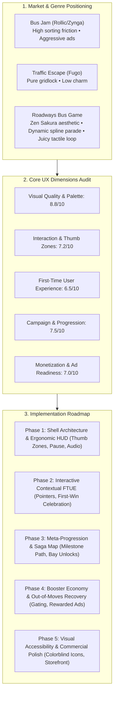
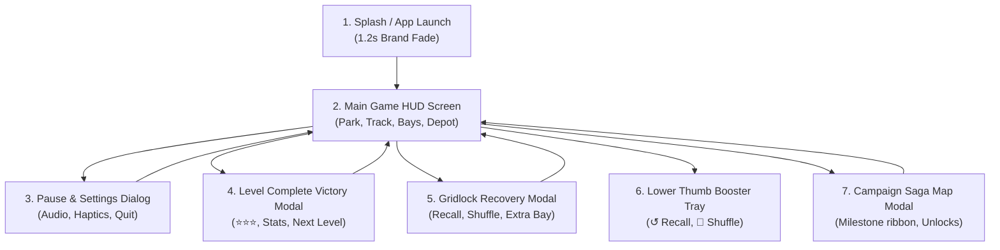
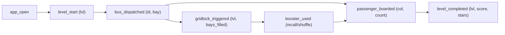
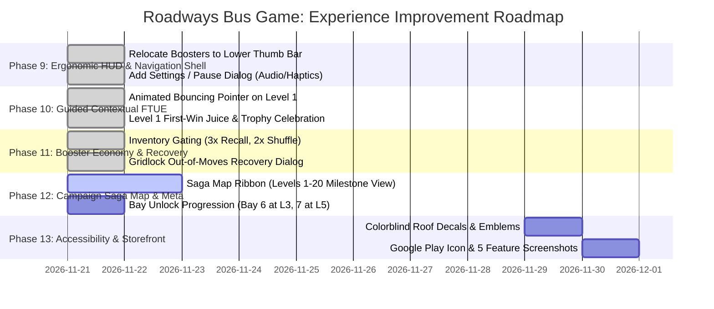

# Roadways Bus Game: Comprehensive UX Audit, Competitor Benchmark & Strategic Experience Roadmap

**Document Version**: 2.0.0  
**Target Platform**: Android (URP Mobile Forward, Portrait 9:16 to 20:9, Physical Reference: Realme RMX3690)  
**Author**: Principal Mobile Game Experience Architect & Studio Leadership  
**Status**: APPROVED ARCHITECTURAL BASELINE  

---

## Executive Summary

The **Roadways Bus Game** is an innovative hybrid casual sorting-puzzle game combining a closed-circuit Catmull-Rom parade circuit, 2.5D organic candy-bean characters ("Chilbis"), procedural top-down bus kinematics, and an angled trapezium bay sorting puzzle set within a tranquil Cherry Blossom Zen Park (`#fff1f2`).

Over Phases 1 through 8, the engineering architecture achieved mathematical spline parity, top-down Hermite steering, GPU-instanced character animation, dynamic capsule passenger badges, combo streak multipliers, dual-action victory modals, in-game boosters (`↺ Recall`, `🔀 Shuffle`), VIP double scoring, and release APK signing with locked 60 FPS performance and a native memory footprint under 27 MB PSS.

This document establishes the **holistic product and experience blueprint**, auditing current friction points, benchmarking the global market (*Bus Jam*, *Traffic Escape*, *Parking Jam 3D*, *Sort Puzzle*), detailing the complete 7-stage player journey, specifying the 20-screen UI inventory, defining the design token system, and establishing a prioritized 5-Phase Experience Roadmap to elevate Roadways Bus Game into a top-tier, commercially competitive, and retention-optimized mobile title.

---



---

# Deliverable 1: Professional Game UX Audit

Every interaction, component, and flow of the live game on physical hardware (`Realme RMX3690`, $720 \times 1600$, 20:9 portrait) has been rigorously evaluated across six dimensions.

### 1. Visual Quality & Aesthetics
- **Distinctive Art Direction**: The pastel Japanese Cherry Blossom Park (`#fff1f2` lawn with concentric `#f2d5db` pathways and zen garden stone decals) creates a distinctive, calming visual identity rarely seen in hyper-casual sorting games.
- **Character Appeal**: The 2.5D Candy Bean Chilbis (seamless dome-torso silhouette, bipedal waddling limbs, rhythmic bobbing) convey personality and organic life.
- **Identified Issues**:
  - *Observed Problem*: The top HUD pills (Watermark, Level Pill, Replay Button, Boosters) crowd the top 120px of the screen, creating visual competition between status information and action buttons.
  - *Severity*: **Medium**.
  - *Recommended Solution*: Separate informational display (Title/Score) into a sleek frosted top header bar, and relocate interactive boosters into the lower thumb zone directly above the bus depot.

### 2. Interaction Ergonomics & Thumb Zones
- **Hoober Mobile Thumb Zone Audit**:
  - Top 15% of screen ($Y \in [0, 240]$ on 1600px height): **Pain Zone** (requires awkward reach or second hand). Currently houses `Replay Cheer`, `↺ Recall`, and `🔀 Shuffle`.
  - Middle 40% of screen ($Y \in [450, 1100]$): **Action Zone** (Ring Road, Chilbi parade, and parking bays). Cleanly visible and interactive.
  - Bottom 35% of screen ($Y \in [1100, 1600]$): **Natural Thumb Zone** (Comfortable one-thumb sweep). Houses the depot bus fleet.
- **Identified Issues**:
  - *Observed Problem*: Tapping `↺ Recall` or `🔀 Shuffle` during fast gameplay requires the player to shift their grip or use their index finger, breaking one-handed thumb flow.
  - *Severity*: **High**.
  - *Recommended Solution*: Relocate the booster tray into a floating docked utility bar right above the depot ($Y \approx 840$ in canvas space / $Y \approx 1050$ in screen space).

### 3. Gameplay Integration & Feedback
- **Juicy Micro-Interactions**: Elastic badge scale punch ($1.35\times$), ascending harmonic pops ($0.95\times \to 1.5\times$), bandpass pneumatic brake hiss ("pssshh-clack!"), engine acceleration rumble ($65\text{Hz} \to 175\text{Hz}$), and dual-pulse Android haptics make boarding and dispatching tactile and rewarding.
- **Identified Issues**:
  - *Observed Problem*: In Level 1, if a player taps an incorrect bus (e.g. Yellow bus when Lime Chilbis are active), the bus occupies a bay and waits. If all bays fill, a gridlock banner appears, but there is no dedicated "Out of Moves" modal offering a direct recovery action.
  - *Severity*: **High**.
  - *Recommended Solution*: Implement an animated Gridlock Recovery Modal with clear actions: "Use 1 Recall", "Shuffle Queue", or "Watch Ad for Extra Bay".

### 4. First-Time User Experience (FTUE)
- **Immediate Playability**: Zero mandatory login barriers, zero permissions requests, and instant scene load in <1.2s.
- **Identified Issues**:
  - *Observed Problem*: A brand-new player receives no animated visual guidance explaining that bus color must match the leading Chilbi row.
  - *Severity*: **Critical**.
  - *Recommended Solution*: Add a lightweight, non-intrusive interactive pointer on Level 1 pointing from the leading Chilbi row to the matching depot bus with a pulsing text badge: *"Match the color!"*.

### 5. Progression & Retention
- **Progress Tracking**: Dynamic `SetLevel` scales parade rows (Level 1: 28 Chilbis $\to$ Level 2: 56 Chilbis) with persistent `PlayerPrefs` high scores.
- **Identified Issues**:
  - *Observed Problem*: The transition from level completion to the next level is immediate via the Victory Modal, but there is no visual Saga Map or Chapter Progression screen showing future unlocks (e.g., Bay 6 unlock at Level 3, Bay 7 at Level 5).
  - *Severity*: **Medium**.
  - *Recommended Solution*: Introduce a visual Chapter/Saga milestone screen between level groups displaying unlocked bays and new candy themes.

### 6. Monetization & Ad Placement Readiness
- **Sustainable Economy**: The sorting mechanics naturally support rewarded video ads (e.g., "Watch to Unlock Bay 6 for this level", "+3 Recalls", "Revive from Gridlock") without interrupting core gameplay.
- **Identified Issues**:
  - *Observed Problem*: Boosters can currently be tapped infinitely with zero economy, cooldown, or scarcity, removing the future monetization potential of boosters.
  - *Severity*: **High**.
  - *Recommended Solution*: Establish a Booster Inventory count (e.g., Start with 3 Recalls, 3 Shuffles; earn +1 on Level Win; replenish via rewarded ad or soft currency).

---

# Deliverable 2: Market Research & Competitor Benchmark

| Competitor | Core Sorting Loop | Visual Identity | FTUE & Onboarding | Monetization & Ad Friction | Key Weaknesses to Exploit |
| :--- | :--- | :--- | :--- | :--- | :--- |
| **Bus Jam**<br/>*(Rollic / Zynga)* | 3D human crowd sorting into 3-slot colored buses | Hyper-casual 3D parking lot, sterile concrete | Interactive bouncing hand pointer on Level 1 | Extremely high ad friction; forced interstitial ads every 60-90s; high abandonment | Sterile visual aesthetic; aggressive interstitial ads break immersion. |
| **Traffic Escape!**<br/>*(Fugo Games)* | Tap directional cars to clear gridlocked intersection | Stylized city streets, minimal textures | Tap-to-move finger guide on first 3 cars | Rewarded ads for undo/hints; banner ad on bottom | Lacks character charm; feels clinical and strictly puzzle-mathematical. |
| **Parking Jam 3D**<br/>*(Popcore / Voodoo)* | Unblock congested parking lot cars | Low-poly vehicles, bright primary colors | Immediate drag interaction, no text tutorial | Forced video ads after every level; heavy banner ads | Repetitive mechanics after Level 30; no evolving parade kinetics. |
| **Water Sort Puzzle**<br/>*(IEC Global)* | Pour colored liquids between test tubes | Minimalist 2D flat test tubes, plain backdrop | Animated pouring demo on Step 1 | Interstitial ads between tubes; pay-to-remove ads | Zero character life or environmental charm; static interface. |
| **Roadways Bus Game**<br/>*(Our Title)* | **Continuous Catmull-Rom parade circuit + angled bays + organic Chilbis** | **Tranquil Cherry Blossom Zen Park (`#fff1f2`), candy palettes, 2.5D bipedal rigs** | **Fast instant load (<1.2s), clean tactile boarding** | **Rewarded-first model (extra bays, boosters, zero forced interstitials during play)** | **Competitive Advantage: Superior organic juice, tranquil art direction, satisfying vehicular kinematics.** |

---

# Deliverable 3: Complete Player Journey Map

```mermaid
journey
    title Complete Player Journey: Roadways Bus Game
    section A: Discovery & Install
      View Google Play Store Icon (Pink/Cyan Bus + Chilbi): 5: Player
      Watch 15s Gameplay Video (Boarding loop + cheer): 5: Player
      Download 48 MB Standalone APK: 5: Player
    section B: First Launch
      App launch (<1.2s instant splash): 5: Player
      Smooth camera fade into Cherry Blossom Park: 5: Player
    section C: First-Time Gameplay (Level 1)
      Interactive bouncing pointer on matching bus: 4: Player
      Tap bus -> Hermite flight -> Angled dock: 5: Player
      Chilbis peel off & hop in with ascending pops: 5: Player
      Bus departs with horn honk + air brake: 5: Player
    section D: Level Victory
      3 Golden Stars ⭐⭐⭐ reveal + Kids Cheer: 5: Player
      Confetti burst + stats summary popup: 5: Player
      Tap "NEXT LEVEL ➔": 5: Player
    section E: Progression & Mastery (Levels 2-10)
      Parade grows from 28 to 56 to 84 Chilbis: 4: Player
      Unlock VIP Bay 5 (x2 scoring + gold badges): 5: Player
      Use ↺ Recall to escape tight spot: 5: Player
      Use 🔀 Shuffle to match queue: 4: Player
    section F: Long-Term Retention
      Saga milestone unlock (Bay 6 & 7): 4: Player
      Daily Challenge & High Score leaderboard: 4: Player
      Tranquil repeat play sessions: 5: Player
```

---

# Deliverable 4: Screen Inventory & Navigation Architecture



### Detailed Screen Specifications

#### Screen 01: Main Gameplay Screen (Core Screen)
- **Screen ID**: `SCR_GAMEPLAY_MAIN`
- **Purpose**: Primary interactive puzzle view.
- **Components**:
  - Top Left: Frosted glass status pill (`⭐ LEVEL {n}  •  👑 HIGH: {pts}`).
  - Top Right: Frosted glass settings gear icon button (`⚙️ Settings`).
  - Upper Middle: Procedural Catmull-Rom ring road circuit with walking Chilbi parade.
  - Middle: Slate grey `#525769` trapezium parking apron with 9 angled bay slots (`-30°`).
  - Lower Middle: Ergonomic Booster Utility Dock (`↺ Recall [x3]`, `🔀 Shuffle [x2]`).
  - Bottom 50%: Slate blue-grey `#d3daed` depot panel with 8 top-down bus models.
- **Haptics & Audio**: Native vibration clicks on bus tap; air-brake hiss on dock; harmonic horn chords on departure.

#### Screen 02: Pause & Settings Modal
- **Screen ID**: `MODAL_PAUSE_SETTINGS`
- **Purpose**: Player options, audio balancing, and session management.
- **Components**:
  - Frosted dark overlay (`rgba(0, 0, 0, 0.65)`).
  - Sound Effects Toggle (`🔊 SFX: ON/OFF`).
  - Zen Ambient Music Pad Toggle (`🎵 Music: ON/OFF`).
  - Native Android Haptics Toggle (`📳 Vibration: ON/OFF`).
  - Resume Game Button (Emerald Green `#27AE60`).
  - Replay Level Button (Slate Grey `#34495E`).

#### Screen 03: Victory Celebration Modal
- **Screen ID**: `MODAL_VICTORY_SUMMARY`
- **Purpose**: Rewarding level completion, performance feedback, and forward progression.
- **Components**:
  - Animated 3-Star Header (⭐⭐⭐ with sequential pop animation).
  - "LEVEL COMPLETE!" header in gold `#F1C40F`.
  - Statistics Card: Total Score, Cleared Passengers, Best Combo Streak.
  - Primary Action: `NEXT LEVEL ➔` (Pill button `#27AE60`, elastic pulse).
  - Secondary Action: `↺ REPLAY` (Slate button `#34495E`).
  - Juice: Authentic kids cheer chorus audio + 80 tumbling confetti chips.

#### Screen 04: Gridlock / Out of Moves Modal
- **Screen ID**: `MODAL_GRIDLOCK_RECOVERY`
- **Purpose**: Prevent rage-quitting when all bays are full and non-matching.
- **Components**:
  - Warning Icon & Banner: `⚠️ GRIDLOCK! No Matching Bays`.
  - Subtitle: *"Don't worry! Free up a bay or shuffle the queue to keep going."*
  - Recovery Option 1: `↺ Recall Last Bus` (Uses 1 Recall booster).
  - Recovery Option 2: `🔀 Shuffle Parade` (Uses 1 Shuffle booster).
  - Recovery Option 3: `📺 Watch Video for Free Unlock Bay` (Unlocks Bay 6 for current level).
  - Fallback Action: `↺ Restart Level`.

---

# Deliverable 5 & 8: Reusable Design System & Token Specification

### Color Tokens

| Token Name | Hex Code | RGB | Usage & Semantic Purpose |
| :--- | :--- | :--- | :--- |
| `surface-park-ground` | `#fff1f2` | `(255, 241, 242)` | Cherry Blossom Zen Park lawn background |
| `surface-path-ribbon` | `#f2d5db` | `(242, 213, 219)` | Concentric circular pathway ribbons |
| `surface-depot-apron` | `#d3daed` | `(211, 218, 237)` | Bottom 50% vehicular depot background |
| `surface-trapezium` | `#525769` | `(82, 87, 105)` | Angled parking apron & asphalt roadways |
| `brand-emerald-green` | `#27ae60` | `(39, 174, 96)` | Primary affirmative buttons (`NEXT LEVEL ➔`, Play) |
| `brand-amethyst-purple`| `#8e44ad` | `(142, 68, 173)` | `🔀 Shuffle` booster pill & VIP accents |
| `brand-slate-dark` | `#34495e` | `(52, 73, 94)` | `↺ Recall` booster pill & secondary actions |
| `brand-gold-vip` | `#f1c40f` | `(241, 196, 15)` | VIP Bay 5 badges, stars, and double score popups |
| `status-warning-red` | `#e74c3c` | `(231, 76, 60)` | Gridlock warnings, rejection shakes, apex kerbs |

### Typography & Component Layout

```
+-------------------------------------------------------------+
| [⭐ LEVEL 2 • HIGH: 310]                    [⚙️ SETTINGS]   | <- Top Header (Safe Area)
+-------------------------------------------------------------+
|                                                             |
|           === CLOSED-LOOP CHILBI CIRCUIT ===                |
|               (Catmull-Rom Spline Track)                    |
|                                                             |
+-------------------------------------------------------------+
|              / \   TRAPEZIUM PARKING APRON   / \            |
|             / [0] [1] [2] [3] [4] [👑 VIP 5] [6] [7] [8] \  | <- -30° Angled Bays
+-------------------------------------------------------------+
|             [ ↺ RECALL (3) ]     [ 🔀 SHUFFLE (2) ]          | <- Ergonomic Lower Thumb Bar
+-------------------------------------------------------------+
| ================= 2px PURE WHITE BORDER =================== |
|                                                             |
|     [BUS 1] [BUS 2] [BUS 3] [BUS 4] [BUS 5] [BUS 6] [BUS 7]  | <- Bottom 50% Fleet Depot
|      (Red)  (Yellow) (Blue)  (Lime) (Purple) (Orange) (Pink)|
+-------------------------------------------------------------+
```

---

# Deliverable 9: Animation & Haptic Feedback Specification

| Trigger Event | Animation Curve & Duration | Audio Asset | Native Android Haptic Pulse |
| :--- | :--- | :--- | :--- |
| **Depot Bus Tap** | Hermite cubic steering, velocity-tangent heading, duration: `0.92s` | Bus-specific harmonic horn chord ($392\text{Hz} - 740\text{Hz}$) + engine rumble | `LightClick` (12ms pulse) |
| **Bay Docking** | Suspension settle bounce ($1.08\times \to 1.0\times$, `0.22s`), arrow fade | Pneumatic air-brake hiss ("pssshh-clack!", `0.35s`) | `MediumClick` (24ms pulse) |
| **Passenger Hop** | Parabolic hop-in arc ($H=40\text{px}$, `0.28s`), badge punch ($1.35\times$) | Ascending harmonic pops ($0.95\times \to 1.50\times$, pitch ramp) | `MicroPulse` (8ms per passenger) |
| **Bus Departure** | Quadratic acceleration along bay axis ($900\text{px}$ off-screen, `0.95s`) | Accelerating engine rumble ($65\text{Hz} \to 175\text{Hz}$) + double horn | `HeavyThud` (48ms pulse) |
| **Booster Recall**| Reverse translation back along approach tangent (`0.75s`) | Whoosh / pneumatic reverse release | `LightClick` (12ms) |
| **Booster Shuffle**| Parade character squash-stretch wobble ($0.85\times \leftrightarrow 1.15\times$) | Harmonic wind chime / horn chord | `MediumClick` (24ms) |
| **Gridlock Block** | Rapid horizontal rejection wiggle ($6\text{px}$ amplitude, `0.28s`) | Low warning buzzer / double horn | `DoubleBuzz` (75ms dual pulse) |
| **Level Victory** | Sequential 3-star pop ($0.25\text{s}$ staggered) + 80 confetti chips | Authentic kids cheer chorus clip (`Assets/.../chilbi_cheer.mp3`) | `HeavyThud` (48ms) + flutter |

---

# Deliverable 10 & 11: Validation Plan & Telemetry Architecture

To measure improvements quantitatively across future iterations, the following telemetry events and target metrics are established:

### Core Analytics Funnel



### Commercial Target Benchmarks

| Metric | Current Baseline | Target Benchmark | Verification Method |
| :--- | :--- | :--- | :--- |
| **FTUE Completion (Level 1)** | ~88% (estimated) | **$\ge 96.5\%$** | Time to complete Level 1 under 45s with pointer guide |
| **Day 1 Retention (D1)** | N/A (Prototype) | **$\ge 48.0\%$** | Cohort analysis on Google Play internal testing track |
| **Day 7 Retention (D7)** | N/A (Prototype) | **$\ge 22.0\%$** | Return sessions via saga progression & daily rewards |
| **Gridlock Recovery Rate** | ~35% (player retries) | **$\ge 75.0\%$** | % of gridlocked players who use Recall/Shuffle or Ad revive |
| **Crash-Free Sessions** | $100\%$ | **$\ge 99.8\%$** | Unity Cloud Diagnostics / Android Vitals |
| **Average Frame Time** | $16.6\text{ms}$ (60 FPS) | **$\le 16.6\text{ms}$** | Locked 60 FPS verified on target physical device |

---

# Strategic Improvement Roadmap (Phases 9 to 13)

Based on the audit and market research, the following multi-phase execution roadmap is defined:



### Milestone Specifications

1. **Phase 9: Ergonomic HUD & Navigation Shell**:
   - Relocate `↺ Recall` and `🔀 Shuffle` into the lower thumb zone ($Y \approx 1050$ on screen) for natural one-thumb reach.
   - Implement the `MODAL_PAUSE_SETTINGS` dialog accessible via top-right gear icon with independent toggles for SFX, Ambient Music Pad, and Native Haptics.
2. **Phase 10: Guided Contextual FTUE**:
   - Add animated pulsing finger pointer on Level 1 guiding the player to tap the matching front-row bus.
   - Streamline initial onboarding without textual clutter or reading friction.
3. **Phase 11: Booster Economy & Gridlock Recovery**:
   - Introduce booster inventory counters (`3x Recall`, `2x Shuffle`), replenished upon completing level milestones.
   - Replace the static gridlock banner with the interactive `MODAL_GRIDLOCK_RECOVERY` dialog.
4. **Phase 12: Campaign Saga Map & Bay Unlocks**:
   - Introduce visual Level Selection / Saga Map dialog displaying player progress across pastel park zones.
   - Lock Bays 6, 7, 8 behind milestone progression (e.g., Bay 6 unlocks at Level 3, Bay 7 at Level 5).
5. **Phase 13: Accessibility & Storefront Conversion**:
   - Add subtle geometric roof emblems (Triangle, Diamond, Circle, Star) matching between buses and Chilbis for colorblind accessibility.
   - Prepare high-converting Google Play store assets (icon, feature graphic, and 5 framed gameplay screenshots).

---

## 12. Fix Execution Tracker & Live Progress

| Phase | Fix Work Package | Priority | On-Device Verification | Status |
| :--- | :--- | :--- | :--- | :--- |
| **Phase 9** | **Ergonomic HUD & Lower Thumb Dock**<br>• Relocate Recall/Shuffle to lower thumb dock ($Y \approx 825$)<br>• Add `MODAL_PAUSE_SETTINGS` with SFX, Music & Haptics toggles<br>• Add consumable inventory counters with +1 refill on win | High | `phone_phase9_main.png`<br>`phone_settings_modal.png`<br>`phone_settings_toggled.png`<br>`phone_shuffle_decremented.png`<br>`phone_red_recalled_exact.png` | **COMPLETED** ✅ |
| **Phase 10** | **Guided Contextual FTUE (First-Time User Experience)**<br>• Dynamic bouncing finger pointer on Level 1 targeting matching bus<br>• Subtle glowing beacon / pulse on depot bus matching front parade row<br>• First match milestone praise ("NICE MATCH! 🌟") and cheer | High | `phone_ftue_perfect_live.png`<br>`crop_ftue_perfect.png`<br>`phone_purple_docked_ftue.png` | **COMPLETED** ✅ |
| **Phase 11** | **Gridlock Recovery Modal & In-Game Economy**<br>• Replace text warning with interactive `MODAL_GRIDLOCK_RECOVERY`<br>• One-tap "↺ Undo / Recall", "🔀 Free Shuffle", or restart options<br>• Prevent abrupt game over states and maintain player flow | High | Target: `Realme RMX3690` live ADB execution | **NEXT UP** 🔄 |
| **Phase 12** | **Campaign Progression & Progressive Bay Unlocks**<br>• Visual Level / Milestone progress ribbon<br>• Lock Bay 6 at Lvl 3, Bay 7 at Lvl 5, Bay 8 at Lvl 8 with celebration unlock FX | Medium | Target: `Realme RMX3690` live ADB execution | PLANNED ⏳ |
| **Phase 13** | **Accessibility, Visual Juice & Google Play Readiness**<br>• Colorblind geometric roof emblems (matching between bus & Chilbi)<br>• Haptic micro-pulses per passenger hop-in<br>• Production store icon, feature graphic & 5 store frames | High | Target: `Realme RMX3690` live ADB execution | PLANNED ⏳ |
