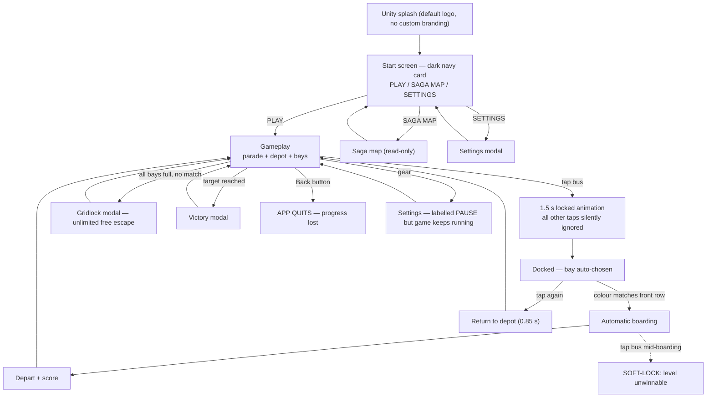
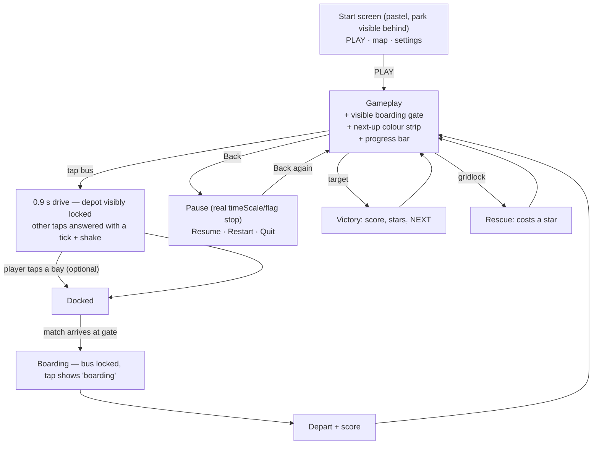

# Roadways Bus Game — Senior UI/UX Audit (Code-Verified)

**Date:** 2026-11-21
**Auditor role:** Senior Mobile Game UI/UX Designer
**Build audited:** `main` @ `f2a135e` (post Phase-12)
**Platform target:** Android portrait-locked, Unity URP, canvas-driven UI

---

## 0. Evidence base and limits (read this first)

This audit is based on **the source code, scene file and project settings**, not on a device session.

| Evidence I had | Evidence I did **not** have |
| :--- | :--- |
| All runtime UI code (`GameUIController.cs` 2136 L, `BusFleetUIController.cs` 2354 L, `ChilbiFlowController.cs` 697 L) | A device or emulator run |
| `ProjectSettings.asset` (orientation, splash, architectures) | Screenshots or screen recordings |
| `MainGame.unity` object inventory (680 GameObjects) | An installed APK |
| `Requirements.md`, `Design.md`, prior `GAME_EXPERIENCE_AUDIT_AND_ROADMAP.md` | Unity Profiler / Frame Debugger captures |
| Asset inventory (1 audio file, 1 texture, 0 fonts) | Any usability test with real players |
| *Bus Fever Party!* store identity + mechanics (web, incl. an **unofficial** fan site — see §J.0) | ***Bus Fever Party!*'s screenshots, palette or art style** — its store page was not retrievable through my tooling, so §J makes **no** claim about how it looks |

Every finding below is tagged:

- **[VERIFIED]** — provable by reading the code; the file:line is cited.
- **[CALCULATED]** — arithmetic on verified constants (canvas scale → dp/sp conversions, layout overflow).
- **[HYPOTHESIS]** — a strong inference that still needs a device or profiler to confirm.

I have **not** tested any interaction, device, or flow. Where the prior audit document (`GAME_EXPERIENCE_AUDIT_AND_ROADMAP.md`, "Status: APPROVED ARCHITECTURAL BASELINE") claims behaviour that the code does not implement, I say so explicitly in §E.4.

### The one conversion that drives half this report

`GameUIController.cs:234-237`:

```csharp
canvasScaler.uiScaleMode = ScaleMode.ScaleWithScreenSize;
canvasScaler.referenceResolution = new Vector2(1080f, 1920f);
canvasScaler.matchWidthOrHeight = 0f;   // match WIDTH
```

Nearly every Android phone is **360 dp wide** (1080×2400 @3x, 720×1600 @2x). Matching width maps 1080 reference units onto 360 dp. Therefore:

> **1 reference unit = 1/3 dp. `fontSize: 21` renders at ≈ 7 sp. A `64`-wide button is ≈ 21 dp.**

The layout was authored in CSS-pixel values lifted 1:1 from `3D_Showcase_Preview.html` onto a 1080-wide canvas. Proportions survived the port; **physical legibility and touch ergonomics did not.** Android's minimum touch target is 48 dp; minimum comfortable body text is 14 sp. Almost nothing in this UI meets either.

---

## A. Executive Summary

| Dimension | Rating | Why |
| :--- | :--- | :--- |
| **Overall UX quality** | **4.0 / 10** | A reachable soft-lock, an unhandled Back button, and a 7 sp HUD outweigh a genuinely complete feature set. |
| **Visual design quality** | **4.5 / 10** | Charming in-game art direction (pastel park, candy-bean rigs) wrapped in dark navy + gold template menus, Arial, and 40+ emoji standing in for icons. Two different games visually. **Measured cause of the "dull" look: only ≈ 6 % of screen pixels carry any chroma — see §J.** |
| **Gameplay usability** | **3.5 / 10** | The core decision — "which row boards next?" — is computed from an invisible point on the track and is never shown to the player. 21 dp tap targets. 1.5 s of dead input per move. |
| **Space efficiency** | **2.5 / 10** | **≈ 38–40 % of the screen is a flat, empty grey panel.** Actual playfield is 37–47 %. |

### Top five issues, in fix order

1. **P0 — Level becomes unwinnable if the player taps a bus while it is boarding.** The boarding is voided, the 7 Chilbis are recycled out of the game logic's row range, and the level target can never be reached. No fail state exists to catch it, so the player is stuck in a level that cannot be won or lost. Restart from Settings is the only exit. *(§B-1, VERIFIED)*
2. **P0 — Android Back button is unhandled: it quits the app instantly, losing in-level progress.** No `KeyCode.Escape` handler anywhere in `Assets/`. *(§B-2, VERIFIED)*
3. **P0 — The player cannot see which Chilbi row boards next.** "Front row" = the row nearest arc-length `s = 0`, an unmarked point on the loop (`ChilbiFlowController.cs:393-418`). Nothing on screen indicates it. Colour-matching is therefore guesswork plus waiting. *(§B-3, VERIFIED)*
4. **P1 — The entire HUD is illegible and un-tappable at Android scale.** HUD text ≈ 7 sp (min 14), the primary gameplay target (a depot bus) is 21 × 43 dp (min 48 × 48), and the Settings/Map buttons are 21 × 21 dp with a 2.7 dp gap between them. *(§B-4, CALCULATED)*
5. **P1 — Layout overlaps itself on any screen shorter than ≈ 18.5:9, and ignores the status bar / camera cutout on every screen.** The header sits 16 dp from the physical top edge with `renderOutsideSafeArea = true` and zero `Screen.safeArea` compensation. Works on the 20:9 dev device; breaks on 16:9 and 18:9. *(§B-5, CALCULATED)*

**Sixth, and the answer to "why does it look dull":** colour coverage, not colour choice. ≈ 94 % of the screen is cold grey or near-white; the eight candy hues are confined to under 6 % of pixels; the buses are flat unshaded fills with no contact shadow (mandated by `Requirements.md` FR-4.3); and **4 of the 8 Chilbi↔bus colour pairs are not actually the same colour** because the shipped UI ignores `ColorPaletteDatabase` and hardcodes two divergent palettes. Fully measured in **§J**, with five small fixes. *(§J, VERIFIED + CALCULATED)*

### What is genuinely good — keep it

- **Art direction of the playfield.** The pastel `#fff1f2` park, `#f2d5db` path decals, matte candy palette and 6-part bipedal Chilbi rig are a real differentiator in a genre full of grey concrete. Do not touch this.
- **Feel of a single dispatch.** Hermite steering with a velocity-tangent heading, the squash on launch, the rebound on braking, the roof-arrow fade on dock, the badge punch — this is well-observed juice. `BusFleetUIController.cs:938-1000`.
- **Blocked-bus communication.** The tandem depot greys the blocked bus, shows a lock badge, shakes *both* the blocked bus and its blocker, and names the blocker in a tip (`:786-798`). That is better feedback than most shipped games in this genre give.
- **Feature completeness.** Start screen, saga map, settings, gridlock recovery, boosters with persisted counts, combo scoring, FTUE pointer all exist and are wired. The problem is sizing, state legibility and polish — not missing scope.

---

## B. Screen-by-Screen Audit

### B-1. Gameplay — Boarding (P0 soft-lock)

| Field | Detail |
| :--- | :--- |
| **Screen / flow** | In-game, a docked bus is boarding passengers |
| **Problem** | `OnParkedBusClicked` (`BusFleetUIController.cs:1009-1013`) guards on `isInFlight` but **not** on `isBoardingActive`. Tapping a boarding bus runs `ReturnToDepotRoutine`, which nulls `parkedBusObjects[bay]`. The in-flight `ExecuteBoardingSequence` then calls `DepartFullBusRoutine(bay)`, which hits `if (busObj == null) yield break` (`:1067`) — so `totalClearedChilbis += 7` (`:1143`) **never runs** — and then unconditionally calls `RecycleRow(row)` (`:440`), which reassigns the row to index `maxRow + 1`. |
| **Why it breaks the game** | `GetFrontRowIndex()` only scans `r < rowCount` (`:396`). Recycled rows always exceed that bound, so those 7 Chilbis are permanently invisible to the boarding logic. Each level needs *exactly* `rowCount` successful boardings to hit `LevelTargetChilbis` (L1: 4 rows = 28; L5+: 20 rows = 140). Lose one and the target is mathematically unreachable: `GetFrontRowIndex()` eventually returns `-1`, `CheckBoarding()` returns early forever, and because there is no fail state the player sits in a level that can neither be won nor lost. |
| **Fix** | Two lines. (a) Add `if (isBoardingActive) return;` to `OnParkedBusClicked`, and show the existing reject shake + "Boarding — can't recall" tip so the tap is *answered*. (b) In `ExecuteBoardingSequence`, re-check `parkedBusObjects[bayIndex] != null` before `RecycleRow`; if the bus is gone, restore the row in place (`isBoarding = false`, keep its original index) instead of recycling it. |
| **Benefit** | Removes the only unrecoverable state in the game. |
| **Effort** | **Small.** |
| **Confidence** | **VERIFIED** — traced through code; worth one playtest to confirm the timing window is as wide as it reads (it spans the full ~1.3 s boarding animation). |

### B-2. Global — Android Back button (P0)

| Field | Detail |
| :--- | :--- |
| **Screen / flow** | Any screen; especially mid-level and with a modal open |
| **Problem** | `grep -rn "KeyCode.Escape\|OnApplicationPause\|Application.Quit"` over `Assets/` returns **nothing**. Unity's default Android behaviour is to quit the activity on Back. |
| **Why it breaks the game** | Back is the most-pressed button on Android. A player who presses it expecting "close this modal" loses the app. In-level progress (`currentScore`, `totalClearedChilbis`, bay contents) is never persisted mid-level — only `Roadways_Level`, `HighScore` and booster counts are (`:1719`, `:2153`). So Back mid-level = session gone. |
| **Fix** | One `Update` handler on `GameUIController`, in priority order: modal open → close the topmost modal; game running → open Settings/Pause; start screen → `Application.Quit()` after a confirm. |
| **Benefit** | Removes the single most likely cause of accidental session loss and matches the platform convention every Android player already holds. |
| **Effort** | **Small.** |
| **Confidence** | **VERIFIED** (absence of handler) + **HYPOTHESIS** on the exact default quit behaviour for this Unity version — confirm on device in 30 seconds. |

### B-3. Gameplay — unreadable puzzle state (P0)

| Field | Detail |
| :--- | :--- |
| **Screen / flow** | The core loop: read the parade → pick a bus |
| **Problem** | `GetFrontRowIndex()` returns the row whose arc-length position is closest to `s = 0` **in either direction** (`d = Mathf.Min(s, totalLength - s)`, `:412`). `s = 0` is an arbitrary unmarked point on a 1936 px closed loop. Rows sit 18 units apart (`rowSpacing`, `:22`) and move at 95 px/s, so at Level 1 four rows occupy 54 px of a 1936 px loop and the "front row" flips every ~0.2 s as that clump sweeps past the origin. Meanwhile `CheckBoarding()` runs every frame (`:209`) and fires the instant a parked bus's colour matches. |
| **Why it breaks the game** | The player's only decision is "which colour boards next", and the answer is invisible. They dispatch a bus and then wait an unpredictable interval for the parade to wrap around. Worse, boarded rows are recycled to the back with a **new** colour (`RecycleRow`, `:447-449`), so the track looks identically full no matter how much progress was made. There is no queue order, no "next up", no boarding marker, no progress in the play space. Compare *Bus Jam* or *Parking Jam 3D*, where the queue order is the entire readable board. |
| **Fix** | Three additions, all in the play space, none in a HUD bar: (1) a fixed **boarding gate** graphic on the highway neck at `s = 0` so the trigger point is a visible place; (2) a **next-up strip** of 3–5 colour chips at the bottom of the circuit panel showing the order rows will arrive, driven by the same sort `GetFrontRowIndex` uses; (3) an outline/bounce on the row currently in the gate. |
| **Benefit** | Turns a waiting game into a planning game — the genre's actual retention driver. This is the highest-value change in the document. |
| **Effort** | **Medium.** |
| **Confidence** | **VERIFIED** for the mechanism; the *player-experience* claim is a designer's judgement that a 5-person playtest would settle. |

### B-4. Global — scale, legibility and touch targets (P1)

All values below are **[CALCULATED]** from the verified `1 unit = 1/3 dp` conversion.

| Element | Code | Renders as | Android minimum | Verdict |
| :--- | :--- | :--- | :--- | :--- |
| Depot bus (primary tap target) | `busSize = 64 × 128` (`:52`) | **21 × 43 dp** | 48 × 48 dp | ✗ 44 % of min width |
| Settings button | `64 × 62` (`GameUI:545`) | **21 × 21 dp** | 48 dp | ✗ |
| Map button | `64 × 62`, 8-unit gap | **21 × 21 dp, 2.7 dp apart** | 48 dp, 8 dp apart | ✗ mis-tap near-certain |
| Booster buttons | `290 × 54` (`GameUI:727`) | **97 × 18 dp** | 48 dp tall | ✗ |
| Saga-map level nodes | `138 × 78` (`GameUI:1456`) | **46 × 26 dp** | 48 dp | ✗ |
| Status HUD text | `fontSize 21` (`GameUI:530`) | **7 sp** | 14 sp | ✗ half of min |
| Header level/score | `fontSize 24` | **8 sp** | 14 sp | ✗ |
| FTUE pointer "TAP TO DOCK" | `fontSize 13` (`BusFleet:238`) | **4.3 sp** | 14 sp | ✗ illegible |
| Passenger badge `0/7` | `fontSize 17` (`:918`) | **5.7 sp** | 14 sp | ✗ |
| Settings modal title | `fontSize 32` | 10.7 sp | 14 sp | ✗ |
| Start screen "ROADWAYS" | `fontSize 64` | 21 sp | — | ✓ |
| PLAY button | `640 × 110`, `fontSize 38` | 213 × 37 dp, 12.7 sp | 48 dp | ✓ (only compliant control in the game) |

**Why it matters:** the one control the player touches hundreds of times per session is 21 dp wide. Fat-finger misses on a 21 dp target in a row of eight, 16 dp apart, will read to the player as "the game ignored me" — compounded by B-6 below, where ignored taps genuinely produce no feedback.

**Fix (concrete, not "make it bigger"):**
- **Depot:** adopt the Level-3+ tandem layout at *all* levels (`ApplyDepotLayout`, `:649-678` already implements 4 lanes × 2 rows). With 4 lanes the bus can grow to **170 × 200 units = 57 × 67 dp** and still fit `1040` of width. Eight across cannot reach 48 dp — the arithmetic forbids it (8 × 144 = 1152 > 1040).
- **Text:** multiply every `fontSize` by **2.2** (21 → 46 = 15 sp; 17 → 38 = 12.7 sp) and grow the containing pills proportionally. This is mechanical; the pills are already explicit `sizeDelta` values.
- **Icon buttons:** 64 → **150 × 150 units (50 dp)**, spaced ≥ 24 units apart.
- **Better still:** migrate text to TextMeshPro — `com.unity.textmeshpro 3.0.9` is already a dependency (`Packages/manifest.json`) and is currently unused. Legacy `Text` with dynamic Arial is also why the glyphs will look soft (see §E-2).

### B-5. Global — layout overflow and safe areas (P1)

**Vertical budget** (reference units; screen height in ref units = `1080 × aspect`):

```
bottom panel  = 0.50 × H      (anchored, GameUI:362)
trapezium     = 240           (fixed,    GameUI:38)
road circuit  = 660           (fixed,    GameUI:47)
header        = 48 + 160      (fixed,    GameUI:424-425)
```

Fit requires `0.5H + 900 + 208 ≤ H` → **`H ≥ 2216` → aspect ratio ≥ 18.5:9.**

| Device class | H (ref) | Result |
| :--- | :--- | :--- |
| 20:9 (Realme RMX3690 — the dev device) | 2400 | ✓ fits, 300 units spare |
| 19.5:9 | 2340 | ✓ fits, marginal |
| **18:9** | 2160 | **✗ header overlaps the circuit by ~56 units** |
| **16:9** | 1920 | **✗ header overlaps the circuit by ~148 units** |
| **4:3 tablet** | 1440 | **✗ circuit top clipped off-screen by 180 units; header entirely off-screen** |

This is a textbook "works on my device" defect: the fixed `240 + 660 + 208` stack only clears a half-screen panel on tall phones.

**Safe area:** the header is anchored `-48` units = **16 dp from the physical top edge** (`GameUI:424`), while `PlayerSettings.Android.renderOutsideSafeArea = true` is set in both `Phase1Setup.cs:50` and `AndroidBuildScript.cs:78`. `Screen.safeArea` is read **nowhere** in `Assets/`. A 24–32 dp status bar and any punch-hole camera will sit directly on top of the level/score pill.

**Fix:**
1. Read `Screen.safeArea` once in `BuildUI` and offset `HeaderContainer` by `safeArea.yMax` delta — one computed value, one line. (Also honour `safeArea.yMin` for the bottom, cheap insurance against gesture-nav overlap.)
2. Make the circuit + trapezium stack **proportional** instead of fixed: anchor the circuit between the trapezium top and the header bottom and let the sprite letterbox, or clamp `bottomPanelHeightRatio` so the stack always fits (`ratio = min(0.50, (H - 1108) / H)`).
3. Add 16:9 and 4:3 to the Editor's aspect-ratio test list before every build.

### B-6. Gameplay — input dead time and swallowed taps (P1)

| Field | Detail |
| :--- | :--- |
| **Problem** | A single `isInFlight` flag gates all dispatching. A dispatch is `1.25 s` of driving + `0.25 s` of arrow fade (`:943`, `:977`); a recall is `0.85 s` (`:1040`); a departure is `0.95 s` (`:1118`). During all of it, `OnBusClicked` returns **silently** at `:781` — no shake, no sound, no haptic, nothing. `IsBusAlreadyDispatched` (`:782`) also returns silently. |
| **Why it matters** | ≈ 1.5 s of unexplained dead input per move, in a game whose only verb is tapping. The player's model becomes "sometimes it doesn't register". They will tap harder and faster, which produces more silent rejections. It also contradicts the docs' claim of "simultaneous multi-bus docking" — only one bus can move at a time. |
| **Fix** | (a) Always answer a tap: route the silent `return`s through the existing `RejectShake` + a soft tick. (b) Grey or desaturate the depot while `isInFlight` so the lock is *visible*. (c) Better: make `isInFlight` per-bay rather than global — the Hermite paths are independent and the bays are distinct, so genuine parallel dispatch is a small change with a large pacing payoff. (d) Cut the dispatch to ~0.9 s; 1.25 s is long for a move you will repeat 20 times a level. |
| **Effort** | (a)(b) Small · (c) Medium |
| **Confidence** | **VERIFIED.** |

### B-7. Gameplay — the HUD status line (P2)

`BusFleetUIController.cs:2293`:

```
⭐ Lvl 1 • 🌸 0/28 • 🅿️ 6 Free • 0 pts
```

Four unrelated metrics, emoji-delimited, at 7 sp, in a 440 × 52-unit pill (147 × 17 dp). The header above it (`GameUI:519`) reads `⭐ LEVEL 1 • 👑 HIGH: 0` — **level is printed twice, 70 units apart.** Score appears as `pts` here and `HIGH` there, with no explanation that per-passenger points (+10/+20) and per-departure points (100 × combo) are the same currency.

**Fix:** one metric belongs on screen during play — **progress to target**. Replace both pills with a single slim progress bar (filled by `totalClearedChilbis / LevelTargetChilbis`) carrying the level number inline. Move score and high score to the victory modal, where they are the point. Delete the duplicate.

### B-8. Start screen (P2)

`CreateStartScreen` (`GameUI:845-1130`) builds an 820 × 780 dark navy card (`#162030`) with a cyan border, gold Arial "ROADWAYS" at 64 px with a hard 3 px drop shadow, and a 175-unit mission card.

- **Visual identity break.** The game is a pastel cherry-blossom park. The menu is dark navy + gold + cyan — a completely different product. *(§E-1)*
- **`PLAY LEVEL n` is correct and well-sized.** Keep it. It is the only 48 dp-compliant control in the build.
- **Dead weight:** "🌸 SAKURA TRAFFIC SORTING 🌸" (decorative), "🚌 Bus Fleet & Chilbi Parade Challenge" (restates the title), and the mission card's three stacked lines all compete with the CTA. Visual hierarchy is five near-equal blocks.
- **The tip** — "💡 Match bus colors to the active Chilbi parade row!" at `fontSize 19` = **6.3 sp** — is the only place the core rule is ever stated in words, and it is the least legible text in the game.

**Fix:** pastel card on the live park background; keep the title, the PLAY button and *one* progress line; delete the two taglines; promote the rule to a short animated demo loop (see §G).

### B-9. Settings / "Pause" modal (P1)

| Field | Detail |
| :--- | :--- |
| **Problem** | The modal is titled `"⚙️ SETTINGS & PAUSE"` (`GameUI:1617`) **but nothing pauses.** `Time.timeScale` is never assigned anywhere in `Assets/` (verified by grep), and every animation uses `Time.unscaledDeltaTime`, so setting `timeScale` would not help. The parade keeps walking, `CheckBoarding` keeps firing, and a player can be dropped into gridlock while reading the audio toggles. |
| **Also** | "🎉 Replay Chilbi Cheer" with a 50-particle confetti burst is a developer test hook shipped in the player-facing Settings menu. "↺ Restart Level" (destructive, no confirmation) sits 38 units above "▶ RESUME GAME" (primary) — one mis-tap at 62 units tall wipes the level. |
| **Fix** | (a) Add a real `isPaused` flag that gates `ChilbiFlowController.Update` and `CheckBoarding`; keep animations on unscaled time so the modal itself still animates. (b) Delete "Replay Chilbi Cheer". (c) Order the buttons Resume (largest, top) → Restart → Main Menu, with a confirm step on Restart and ≥ 24 units of separation. |
| **Effort** | Small. |
| **Confidence** | **VERIFIED.** |

### B-10. Gridlock "recovery" — there is no fail state (P2, design)

`SetGridlockWarning(true)` fires only when `openBays == 0` and no occupant matches the front row (`:2270-2290`). The recovery modal offers Recall and Shuffle, and when a booster count hits zero the label changes to **"FREE EMERGENCY RECALL (+1 Free)"** (`:1970-1974`).

So the player is handed an unlimited free escape. There is **no Game Over** — which contradicts `Requirements.md` FR-11.2, and more importantly means the game cannot be lost. No loss → no tension → no reason to replay a level → the booster economy the prior roadmap built has nothing to be scarce against.

**Fix:** keep the generous recovery (correct for a casual audience) but make it *cost* something legible — a star rating on the level, a combo reset, or a finite "tows per level" count that refills on win. Scarcity, not a wall.

### B-11. Saga map (P3)

Level nodes at 138 × 78 units (**46 × 26 dp**) with `fontSize 17-20` (5.7–6.7 sp) and text like `L3 ⭐⭐⭐`. Below minimum target size, below minimum text size, and the three-star glyph row at 6 sp will be an unreadable smudge. The map is also reachable from three entry points (header pill, header map button, start screen button) — three doors to a screen with no decisions on it.

**Fix:** nodes to ≥ 150 units (50 dp), text to ≥ 42 units (14 sp), and drop one of the three entry points (the header *pill* opening the map is unexpected — a level/score readout should not be a navigation control).

### B-12. First-run experience (P2)

`UpdateFTUEGuide` (`:277-353`) recomputes its target **every frame** from `GetFrontRowIndex()`. Because the front row flips every ~0.2 s (§B-3), the pointer and the scale-pulse hop between depot buses continuously. A tutorial pointer that strobes across four buses teaches nothing.

Two further defects:
- The pulse scale is written to the new target each frame but only reset in `HideFTUEPointer` (`:363-370`), so previously-targeted buses are left stuck at ~1.08 scale. **[VERIFIED]** cosmetic bug.
- `idleTimer > 6.0f` re-shows the pointer on *every* level, forever (`:287`). Since one dispatch plus boarding routinely exceeds 6 s of not-tapping, this becomes a permanent nag rather than a hint.

**Fix:** latch the FTUE target when it is first chosen and hold it until the player taps or the row leaves the gate; raise the idle threshold to ~12 s and cap it at 2 appearances per session.

---

## C. User Flow Audit

### Current flow (as implemented)



### Problems in the flow

| # | Problem | Severity |
| :--- | :--- | :--- |
| 1 | `Back` is an unguarded exit from every node | **P0** |
| 2 | Boarding → soft-lock dead end with no exit but Restart | **P0** |
| 3 | The player never chooses a bay — `GetFirstAvailableBay()` (`:748`) picks the lowest free index. Nine bays, a VIP bay and three unlock bays exist, but the only one the player can influence is "whichever is free". The VIP 2× bonus is therefore pure luck. | **P1** |
| 4 | Boarding is fully automatic (`CheckBoarding` in `Update`), so after the tap the player is a spectator for several seconds | **P1** |
| 5 | "Pause" does not pause | **P1** |
| 6 | Three entry points to one read-only map screen | **P3** |
| 7 | No mid-level persistence: backgrounding or a kill restarts the level at 0 while keeping the level number | **P2** |

### Recommended flow



Changes: Back becomes Pause (and Pause→Back resumes), the depot lock is visible, every tap is answered, bay choice becomes optional player agency, and the next-up strip makes the puzzle readable before the tap rather than after.

---

## D. Gameplay Space Audit

### Where the pixels go (20:9 device, 2400 reference units tall)

| Band | Units | % of screen | Content |
| :--- | :--- | :--- | :--- |
| Top strip | 300 | 12.5 % | Header pills (208) + a sliver of 3D park |
| **Circuit road** | **660** | **27.5 %** | **Playfield — the parade** |
| **Trapezium bays** | **240** | **10.0 %** | **Playfield — 9 bays** |
| Depot content | 238 | 9.9 % | Booster dock (58) + one row of buses (128) + padding |
| **Empty grey panel** | **962** | **40.1 %** | **Nothing. Flat `#d3daed`.** |

On 16:9 (1920 units) the empty band is 722 units — still **37.6 %** of the screen.

### The finding

`bottomPanelHeightRatio = 0.50f` (`GameUI:30`) reserves half the screen for a depot whose content needs 238 units. **Two-fifths of an Android screen is a flat grey rectangle**, while the parade — the thing the player must read to play — gets 27 %.

### What to do, in order of payoff

1. **Cut the panel to `0.22`–`0.25`.** It needs 238 units plus breathing room; `0.25 × 2400 = 600` is already generous. **Frees ~600 units (25 % of the screen).** One serialized field.
2. **Spend the freed space on the circuit.** `roadCircuitHeight: 660 → 1100+`. The parade is currently rendered at roughly 1/3 the scale the HTML preview was designed at — which is also why individual Chilbis are too small to read as characters and why colour-matching is hard. This single reallocation improves readability, charm *and* the core mechanic at once.
3. **Adopt the tandem 4 × 2 depot everywhere** (§B-4): buses go from 21 dp to ~57 dp wide in a *smaller* panel, because two rows of four use the width that eight-in-a-row wastes on gaps.
4. **Delete the duplicated header.** One progress bar (§B-7) replaces two pills and the separate 160-unit header container: **~150 more units** for the playfield.
5. **Drop the 2 px white top border and the flat fill** for a soft gradient edge, so the depot reads as "ground continuing" rather than a hard UI chrome boundary cutting the screen in half.

Nothing here requires shrinking text or targets — the space comes from emptiness, not from density.

---

## E. Visual Design Audit

### E-1. Two products in one build

| | In-game | Menus / modals |
| :--- | :--- | :--- |
| Background | Pastel `#fff1f2` park | Dark navy `#162030`, `#1E272E` |
| Accents | Candy matte palette | Gold `#F1C40F`, cyan `#4BCFFA`, emerald `#27AE60` |
| Mood | Zen, soft, Japanese garden | Generic dark hyper-casual template |

Four modals (start, settings, victory, saga map, gridlock) all use the same dark card + 4 px bright border + gold title + hard drop shadow. That combination — dark card, saturated gradient-ish border, gold bold caps, emoji — is the single most recognisable "assembled from a template" signature in mobile games. The game's actual identity, which is good and distinctive, appears nowhere in its own UI.

**Fix:** rebuild all five modals in the park palette — warm white `#fff8f9` card, soft `#f2d5db` border, deep plum `#4a3340` text, one accent colour borrowed from the Chilbi palette per modal type (green for victory, amber for gridlock). Keep the gold *only* for VIP, so gold means something.

### E-2. Typography: Arial, legacy `Text`, and no font asset

`EnsureFontStatic()` (`GameUI:646-655`) tries built-in `Arial.ttf`, then `LegacyRuntime.ttf`, then an OS font list. The project ships **zero font files** (`find Assets -iname "*.ttf" -o -iname "*.otf"` → empty) and **TextMeshPro 3.0.9 is installed but entirely unused.**

Consequences:
- Every string in the game is system Arial/Roboto Bold. No typographic identity at all.
- Legacy `Text` rasterises a bitmap atlas per size with no SDF, so glyphs will look soft at the small sizes used, and the `Shadow`/`Outline` components (`GameUI:905`, `:1189`) stack extra geometry on top of that softness. **[HYPOTHESIS — needs a device screenshot to grade]**
- **Emoji will very likely not render.** At least 40 user-facing strings use emoji as icons: `⚙️ 🗺️ ⭐ 👑 🌸 🅿️ 🏆 🎁 🔒 📳 🔊 🎵 🎉 💡 🚌 🚦 ⚠️ 🔀 ⚡ ⭐️`. Arial has no emoji glyphs, and Unity's legacy dynamic-font rasteriser does not support colour-emoji font formats. The Settings and Map buttons are *icon-only* (`GameUI:563`, `:600`) — if the glyph falls back to tofu, **the two header buttons are blank boxes with no label.** **[HYPOTHESIS — but high confidence; verify on device immediately, it is a 2-minute check and the consequence is severe.]**

**Fix:** (1) license one display font for the logo and one rounded UI font (e.g. Baloo 2 / Nunito — both free, both fit candy-pastel); (2) convert all text to TextMeshPro with SDF, which also fixes the small-size softness; (3) **replace every emoji with a real sprite icon.** Emoji-as-icon is the loudest amateur tell in this build, independent of whether it renders.

### E-3. Other generic-looking patterns

| Pattern | Where | Why it reads amateurish | Fix |
| :--- | :--- | :--- | :--- |
| One pill sprite for everything | `CreatePillSprite(128,64,24)` used for buttons, badges, HUD, toggles, map nodes | Every control has identical geometry, so nothing signals its own importance. Primary, secondary and destructive actions are the same shape in different colours. | Three shapes: large soft-rect primary, pill secondary, circular icon button. |
| Colour is the only state channel | Blocked bus = grey tint (`:711`), locked bay = green border + `+`, VIP = gold border | A red/green colour-blind player (~8 % of men) cannot distinguish VIP gold from unlock green, and several Chilbi colours (`#c0392b` red vs `#e67e22` orange; `#20bf6b` green vs `#0fbcf9` cyan) will be hard to separate. In a **colour-matching game** this is not a nice-to-have. | Add a shape or glyph per colour on both the Chilbi and the bus (circle/triangle/square/star…). This is the standard genre solution and costs 8 small sprites. |
| 7 floating score texts per boarding | `UpdatePassengerCount` → `FloatingScoreRoutine` per passenger (`:1183-1190`) | Seven `+10`s plus a combo text rise through the same 70 units in 0.85 s, overlapping each other and the bays. Reads as noise, not reward. | One aggregated `+70` on departure, with the badge punch carrying the per-passenger beat. |
| Procedural textures, no atlas | `CreatePillSprite` / `CreateRoundedBoxSprite` generate a fresh `Texture2D` on every call and the result is never cached or destroyed (`GameUI:1981`, `:2088`) | Each dispatch leaks a 64 × 32 passenger-badge texture; each `BuildUI` regenerates the lot. No texture is ever in an atlas, so UI batching cannot merge them. | Cache the generated sprites in static fields (they are parameterised by ~6 distinct size/radius combos), or author them as real 9-slice PNGs in a sprite atlas. |
| Unity splash screen with no logo | `ProjectSettings.asset:20-42` (`m_ShowUnitySplashScreen: 1`, `m_SplashScreenLogos: []`) | First frame the player sees says "Made with Unity", not the game's name. | Add a branded splash (and disable the Unity logo if the license allows). |

### E-4. Where the prior audit document overstates the build

`GAME_EXPERIENCE_AUDIT_AND_ROADMAP.md` is marked "APPROVED ARCHITECTURAL BASELINE" and rates Visual Quality 8.8/10. Several of its claims are not implemented in the code I read. Flagging these because the document is being used as the project's source of truth:

| Claim in that document / `Requirements.md` | What the code does |
| :--- | :--- |
| "Phase 1: Ergonomic HUD, **Pause**, Audio" — and the modal is titled "SETTINGS & PAUSE" | `Time.timeScale` is never set; no pause flag exists. The game runs under the modal. **[VERIFIED]** |
| FR-12.2: differentiated haptics (15 ms tick / 25 ms click / 40+60 ms double buzz / 10 ms pop) | All four helpers call `Handheld.Vibrate()` and **discard the duration argument** (`BusFleetUIController.cs:2338-2356`). Every haptic is the same fixed system buzz. During boarding this fires 7 times in ~0.6 s. **[VERIFIED]** |
| FR-12.1: "12-voice kids cheer chorus, 8 harmonic bus horns, pneumatic air-brake hiss, engine rumble" | One real audio file exists (`chilbi_cheer.mp3`). Everything else is runtime sine synthesis — the horn is `sin(f) * 0.7 + sin(1.5f) * 0.3` (`:1404-1410`). That is a two-tone beep, not a horn. **[VERIFIED]** |
| NFR-4: "Notch and cutout handling: canvas elements must respect `DisplayCutout` safe areas" | `Screen.safeArea` appears nowhere; `renderOutsideSafeArea = true` is set. **[VERIFIED]** |
| FR-11.1: win = all 430 Chilbis cleared | `LevelTargetChilbis` caps at **140** from level 5 onward (`:1602-1614`), so levels 5, 6, 7… are identical in length and 430 never occurs. **[VERIFIED]** |
| FR-11.2: Gridlock → Game Over modal | Gridlock always offers a free escape; there is no Game Over. **[VERIFIED]** |
| "Phase 5: Visual Accessibility — Colorblind Icons" | No shape/glyph channel exists; colour is the only matching cue. **[VERIFIED]** |
| NFR-1: < 50 draw calls, 0 B GC alloc in `Update` | See §F-perf. Both look unlikely on inspection. **[HYPOTHESIS]** |

None of this means the work wasn't done — it means the roadmap document was written ahead of the implementation and never reconciled. Worth a pass to re-align, because decisions are being made from it.

---

## F. Priority Fix List

**P0 — ship-blocking**

| # | Fix | File | Effort | Confidence |
| :--- | :--- | :--- | :--- | :--- |
| 1 | Guard `OnParkedBusClicked` on `isBoardingActive`; don't `RecycleRow` a voided boarding | `BusFleetUIController.cs:1009`, `:437` | S | VERIFIED |
| 2 | Handle the Android Back button (modal → close, play → pause, menu → confirm quit) | `GameUIController.cs` `Update` | S | VERIFIED |
| 3 | Show the boarding gate + a next-up colour strip so the puzzle has readable state | `ChilbiFlowController`, new HUD element | M | VERIFIED mechanism |

**P1 — high (abandonment risk)**

| # | Fix | Effort |
| :--- | :--- | :--- |
| 4 | Scale all text ×2.2 and all touch targets to ≥ 48 dp (144 units); tandem depot at all levels | M |
| 5 | Safe-area offset for the header; make the circuit/trapezium stack proportional so 16:9 and 18:9 don't overlap | M |
| 6 | Answer every tap (shake + tick on silent rejects); visibly lock the depot while `isInFlight`; shorten the dispatch to ~0.9 s | S |
| 7 | Make "Pause" actually pause | S |
| 8 | Verify emoji rendering on device; replace all emoji with sprite icons | M |
| 9 | Differentiate haptics via a real `VibrationEffect` JNI call (or drop to two patterns and stop buzzing 7× per boarding) | S |
| 9b | **Unify the Chilbi and bus palettes on `ColorPaletteDatabase`** — 4 of 8 pairs are currently different colours, and the green Chilbi (teal `#00B894`) is nearly equidistant between the green and cyan buses *(§J.3)* | S |

**P2 — medium (friction / consistency)**

| # | Fix | Effort |
| :--- | :--- | :--- |
| 10 | Replace the two header pills with one progress bar; delete the duplicated level readout | S |
| 11 | Re-skin all five modals in the park palette | M |
| 12 | Add a shape/glyph channel to colours (colour-blind accessibility in a colour-matching game) | M |
| 13 | Give gridlock a legible cost instead of an unlimited free escape | M |
| 14 | Cut the bottom panel to 0.22–0.25 and give the freed ~600 units to the circuit — **also the single biggest fix for the "dull" look**, since it raises chroma coverage from ≈ 6 % toward 20 % *(§D, §J-1)* | S |
| 14b | **Shade the buses:** vertical gradient + fake key light + a contact-shadow ellipse + window reflection. Requires amending `Requirements.md` FR-4.3, which currently mandates the flatness. The technique is already implemented for Chilbis at `ChilbiFlowController.cs:618-634` *(§J-2)* | S |
| 14c | **Darken the bay interiors** `#626479 → #3E4252` so a docked bus contrasts ~28 ΔL against its bay instead of 7 *(§J-4)* | S |
| 14d | **Warm the depot panel** `#D3DAED → #EDE4E6` and replace the hard 2 px white border with a soft gradient edge, so it reads as ground rather than placeholder UI chrome *(§J-5)* | S |
| 15 | Aggregate 7 floating scores into one `+70` on departure | S |
| 16 | Latch the FTUE target; raise the idle-hint threshold and cap it | S |
| 17 | Persist mid-level state on `OnApplicationPause` so backgrounding doesn't reset the level | M |
| 18 | Remove "Replay Chilbi Cheer" from Settings; reorder Resume/Restart/Quit; confirm on Restart | S |

**P3 — polish**

| # | Fix | Effort |
| :--- | :--- | :--- |
| 19 | Cache the generated sprite textures; stop leaking one per dispatch | S |
| 20 | Migrate to TextMeshPro + a licensed display/UI font pair | M |
| 21 | Branded splash screen | S |
| 22 | Saga-map node and text sizing; drop one of three map entry points | S |
| 23 | Extend `LevelTargetChilbis` past level 5 so progression doesn't flatten | S |
| 24 | Replace sine-wave horns with sampled audio | M |

### Performance notes (all **[HYPOTHESIS]** — need Profiler / Frame Debugger)

These are inspection-level concerns, not measurements. I did not profile anything.

- **One canvas holds everything.** 140 Chilbis × 6 `Image` components (`ChilbiFlowController.cs:253-313`) = **840 UI graphics**, every one of them repositioned and rotated every frame (`:341-390`), on the *same* canvas as the HUD and modals. Any transform change dirties the canvas, forcing a full batch rebuild each frame — for the HUD too. **Split into three canvases** (static background / animated parade / HUD+modals). This is the highest-probability frame-time win in the project.
- **Interleaved textures defeat batching.** Each Chilbi draws body + 2 legs + 2 arms + shadow from 4 different generated textures, and the Chilbis are ordered by position, so consecutive elements rarely share a texture. NFR-1's "< 50 draw calls" looks implausible against this; a single sprite atlas would fix it.
- **The 3D systems still run under opaque 2D UI.** `MainGame.unity` contains populated `[ROAD_NETWORK]`, `[CHARACTERS]`, `[BUS_SYSTEM]` and `[ENVIRONMENT]` hierarchies (8 bus meshes, bay slots, 5 apex kerbs, road blocks), and `ApplyDisplayMode()` only deactivates them in `parkOnlyMode` (`GameUIController.cs:153-173`). In normal play they render *behind* a fully opaque screen-space-overlay canvas. If confirmed, that is a whole second rendering of the game that nobody can see. **Check this first — it may be free performance.**
- **`PlayerPrefs.Save()` on every passenger.** `UpdatePassengerCount` writes and flushes PlayerPrefs on each high-score change (`:1197-1200`) — up to 7 synchronous disk flushes per bus. Save on level end and on `OnApplicationPause` instead.
- **`GameObject.Find` on hot paths.** `ApplyDisplayMode` does 3 finds every 0.25 s (`:137-151`); `FindBayTransforms` does 9 per tap and per dispatch (`:731`); `FindStatusText` does one per HUD update. All are O(scene) string lookups over 680 objects. Cache the references once.
- **`56` baked Chilbis in the scene file.** `[ExecuteAlways]` + `BuildUI()` in `Awake`/`OnEnable` has serialised 56 generated Chilbi hierarchies (336 Images) into a **7.8 MB** `MainGame.unity`, all of which `BuildUI` destroys and recreates at runtime. Guard the editor-time build or strip the baked children.

---

## G. Recommended Design Direction

**Keep the park. Make the UI belong to it.**

The differentiator is already in the build: a tranquil pastel sakura park with matte candy characters, in a genre that otherwise looks like grey car parks. Nothing in this document asks to change that. Everything asks the UI to stop fighting it.

**Visual language**
- **Palette:** warm whites `#fff8f9`/`#fff1f2`, blossom `#f2d5db`, asphalt `#525769`, ink `#4a3340`. The 8 candy colours are **gameplay-only** — never decoration, so colour always means "match this". Gold means VIP only.
- **Type:** one rounded display face for the logo and numbers, one rounded UI face for everything else, via TextMeshPro. Minimum 14 sp anywhere, 16 sp for anything a player reads mid-action.
- **Shape:** three control shapes only — soft-rect primary (≥ 56 dp tall), pill secondary (≥ 48 dp), circular icon (≥ 50 dp). Two corner radii, not six.
- **Icons:** hand-made sprites in one weight. No emoji anywhere.
- **Surfaces:** flat tints with one soft shadow tier. No glassmorphism, no multi-stop gradients, no 4 px neon borders.

**Layout principles**
- Playfield ≥ 65 % of the screen. HUD is a single progress bar plus one icon cluster in the top safe area.
- Everything interactive lives in the bottom third (thumb zone); everything informational lives in the top sliver. Nothing interactive sits in the middle 40 % except the bays.
- Proportional anchoring for every band. No fixed-height stack that assumes a 20:9 screen.

**Interaction rules**
- Every tap produces a response within 100 ms — including refusals.
- Animations that gate input stay under 1 s. Nothing that gates input exceeds 1.2 s.
- State is shown in the play space, not described in a text pill. The gate, the next-up strip and the progress bar replace the status line entirely.
- Haptics: exactly three patterns (tick / confirm / reject), never more than one per 150 ms.

**Where to borrow from (genre conventions worth adopting, not copying)**
The prior roadmap document benchmarks *Bus Jam*, *Traffic Escape!*, *Parking Jam 3D* and *Water Sort Puzzle*. **I have not played or researched those four titles and cannot verify that document's claims about them** — so I will not restate them as evidence. I *did* research **Bus Fever Party!** (Lumi Games, `gridplus.busjam.carpuzzle`) at your request; see **§J.4** for the mechanic-by-mechanic comparison and §J.0 for exactly how far that evidence goes. The two patterns I recommend are structural, well-established across the sorting-puzzle genre, **and both independently confirmed by what Bus Fever Party does differently**:

1. **An explicit, always-visible queue.** The readable queue *is* the board in this genre. §B-3 is this.
2. **A shape channel alongside colour.** Standard accessibility practice in any colour-matching game. §E-3 is this.

If you want a grounded competitive comparison, that needs a real research pass (store pages, gameplay capture, 30 minutes per title). Worth doing before the monetisation decisions — not worth faking here.

---

## H. Implementation Plan

### Sprint 1 — Quick wins (≈ 1–2 days, mostly single-line changes)

1. `isBoardingActive` guard + no-recycle-on-void → **removes the soft-lock** *(P0-1)*
2. Back-button handler *(P0-2)*
3. Real pause flag *(P1-7)*
4. Answer silent tap rejections; shorten dispatch to 0.9 s *(P1-6)*
5. Safe-area offset on the header *(part of P1-5)*
6. `bottomPanelHeightRatio: 0.50 → 0.24`; `roadCircuitHeight: 660 → 1100` *(P2-14)*
7. Delete "Replay Chilbi Cheer"; reorder the Settings buttons *(P2-18)*
8. Cache generated sprites; move `PlayerPrefs.Save()` off the per-passenger path *(P3-19)*
9. **Verify emoji rendering on the Realme device** — 2 minutes, and it decides how urgent P1-8 is
10. **Colour pass** *(§J.5, all Small, all local)*: unify the two palettes on `ColorPaletteDatabase` *(J-3)*; shade the buses with a gradient, fake key light and a contact-shadow ellipse *(J-2)*; darken the bay interiors *(J-4)*; warm the depot panel *(J-5)*. Together with #6 above, this is the whole "dull → vivid" fix and it is a day's work.

### Sprint 2 — High impact (≈ 1 week)

10. Global scale pass: ×2.2 on text, ≥ 144-unit touch targets, tandem depot at all levels *(P1-4)*
11. Proportional vertical layout; test 16:9 / 18:9 / 19.5:9 / 20:9 / 4:3 *(P1-5)*
12. Boarding gate + next-up colour strip + progress bar; retire the two header pills *(P0-3, P2-10)*
13. Split the canvas into three (background / parade / HUD) and profile before-and-after *(perf)*
14. Confirm whether the 3D hierarchies render under the UI; deactivate them if so *(perf)*
15. Sprite-icon set replacing all emoji *(P1-8)*

### Sprint 3 — Larger, only where it pays (≈ 1–2 weeks)

16. Re-skin all five modals in the park palette; TextMeshPro + font pair *(P2-11, P3-20)*
17. Shape channel for colour-blind matching *(P2-12)*
18. Per-bay dispatch (parallel buses) + optional player bay choice *(flow-3, flow-4)*
19. Gridlock cost model + star ratings; extend level targets past 5 *(P2-13, P3-23)*
20. Mid-level persistence *(P2-17)*
21. Sampled audio to replace sine synthesis; real `VibrationEffect` haptics *(P3-24, P1-9)*

### Validation to run after each sprint

- Aspect-ratio matrix: 16:9, 18:9, 19.5:9, 20:9, 4:3 — screenshot every screen, check for overlap and clipping.
- Touch-target pass: measure every interactive rect in dp; nothing below 48.
- Text pass: measure every string in sp; nothing below 14.
- Interruption pass: Back at every node, background/foreground mid-boarding, Restart spam, tap-during-every-animation.
- Profiler: frame time, draw calls, `GC.Alloc` in `Update`, PSS — before and after the canvas split.
- **The soft-lock regression test:** tap a boarding bus, confirm the level is still winnable.

---

## I. Final Verdict

**1. Does the game look professionally designed?**
Partly. The **playfield** does — the pastel park, candy palette and bipedal Chilbi rigs are distinctive, coherent and better than the genre average. The **interface** does not. Dark navy + gold template modals, system Arial, 40+ emoji standing in for icons, one pill shape for every control, and a visual language that shares nothing with the game it frames. The game's identity stops at the edge of the canvas.

And it reads **dull** for four measured reasons, none of which is the palette itself: only ≈ 6 % of screen pixels carry chroma, the buses have no gradient/highlight/shadow at all, the bus-against-bay contrast is 7 ΔL while background-against-road is 60 ΔL, and the two largest surfaces are cold blue-grey against a warm pink theme. Five small edits (§J.5) address all four without changing the art direction. *(§J)*

**2. Does the gameplay flow feel natural?**
No. Three structural breaks: the Back button quits the app, "Pause" doesn't pause, and roughly 1.5 seconds out of every move is dead input that the game never acknowledges. Add the auto-chosen bay and the automatic boarding, and the player is a spectator for most of the loop they just initiated.

**3. Is the game easy to understand and operate?**
Understand: no — and this is the deepest issue. The one thing the player must read, *which colour boards next*, is derived from an unmarked point on the track and is never displayed. Operate: no — the primary target is 21 dp wide against a 48 dp minimum, and the HUD explaining the state runs at ~7 sp against a 14 sp minimum.

**4. Is too much screen space wasted?**
Yes, badly. **About 40 % of the screen is a flat empty grey panel** holding content that needs a quarter of it, while the parade the player must read gets 27 %. This is the easiest big win in the project: two serialized fields.

**5. The three changes most likely to improve the player experience**

1. **Make the puzzle visible.** A boarding gate on the neck plus a next-up colour strip. This converts the loop from "tap a colour and wait" into "read the queue and plan" — the actual mechanic the genre is built on. *(§B-3)*
2. **Fix the scale.** Text ×2.2, touch targets to 48 dp, tandem depot everywhere, bottom panel from 50 % to ~24 % with the space given to the circuit. One coordinated pass that fixes legibility, ergonomics and the wasted 40 % together. *(§B-4, §D)*
3. **Make the game trustworthy.** The soft-lock, the Back button and the silent tap rejections all teach the player that the game is unreliable. They are two small guards and one feedback pass, and together they are worth more than any amount of polish on top. *(§B-1, §B-2, §B-6)*

---

### Appendix: primary source references

| Area | Location |
| :--- | :--- |
| Canvas scaler / reference resolution | `Assets/_Project/Scripts/Runtime/UI/GameUIController.cs:234-237` |
| Vertical layout constants | `GameUIController.cs:30`, `:38`, `:47`, `:424-425` |
| Header & HUD construction | `GameUIController.cs:418-607` |
| Booster dock | `GameUIController.cs:704-800` |
| Start screen | `GameUIController.cs:845-1130` |
| Settings / "Pause" modal | `GameUIController.cs:1570-1810` |
| Saga map nodes | `GameUIController.cs:1440-1530` |
| Procedural sprite generation | `GameUIController.cs:1981-2140` |
| Bus size / spacing / depot layout | `BusFleetUIController.cs:52-54`, `:649-678` |
| Tap handling & rejection | `BusFleetUIController.cs:778-830` |
| Dispatch (Hermite drive) | `BusFleetUIController.cs:832-1005` |
| Recall / depart | `BusFleetUIController.cs:1009-1150` |
| Boarding sequence | `BusFleetUIController.cs:372-470` |
| Level targets / bay unlocks | `BusFleetUIController.cs:1596-1700` |
| Status HUD strings | `BusFleetUIController.cs:2250-2300` |
| Haptics | `BusFleetUIController.cs:2338-2356` |
| Audio synthesis | `BusFleetUIController.cs:1395-1510` |
| Parade kinematics & front-row logic | `ChilbiFlowController.cs:341-418` |
| Row recycling | `ChilbiFlowController.cs:440-476` |
| Orientation / splash | `ProjectSettings/ProjectSettings.asset:11`, `:20-42`, `:61-64` |
| Safe-area build flags | `Phase1Setup.cs:50`, `AndroidBuildScript.cs:78` |

---

# J. Colour & Visual Fidelity — Why This Reads Dull, and How It Compares to *Bus Fever Party!*

*Added 2026-11-21 in response to a direct question: why does Roadways look dull next to Bus Fever Party, which looks "HD"?*

## J.0 What I could and could not verify about *Bus Fever Party!*

Honest scope statement before any comparison:

| Item | Status |
| :--- | :--- |
| App identity — **"Bus Fever Party!"**, developer **Lumi Games**, package **`gridplus.busjam.carpuzzle`** | **Confirmed** from the Play Store search results page. Note the title is ambiguous in search: at least five other "Bus Fever …" games exist from different developers (Auxo Studios, CMGame, MobGame, SIRGAME, Long Live Games). |
| Play Store rating ≈ **4.1** | **Confirmed** from the Play search card. |
| Installs **10M+**, Android release **23 Apr 2025**, free with ads + IAP, ad-free passes $1.99–$31.99 | **Unofficial** — from `bus-fever.com`, a fan site whose own footer states "Unofficial fan site. Bus Fever Party! is a trademark of Lumi Games." Treat its figures as claims, not facts. |
| Its **mechanics** (queue, colour matching, waiting row, boosters, out-of-spots flow) | **Unofficial but detailed and internally consistent** — same fan site. I treat this as good-quality secondary evidence and say so each time I use it. |
| Its **art style, palette, lighting, screenshots** | **NOT VERIFIED.** The Play Store detail page returned only a page title through my tooling; AppBrain returned 403; apkcombo is behind a Cloudflare gate. The fan site contains **no** description of palette, lighting, background, character design or UI style — it never uses the words HD, 3D, colourful, vibrant or cartoon. |

**Therefore I make no claims about how Bus Fever Party looks.** I have not seen it. You have.

That turns out not to matter much, because **the "dull" question is answerable entirely from your own code** — and the answer is specific and measurable. §J.1–J.3 below is all first-hand evidence from this repository. §J.4 compares *mechanics* only, where I do have evidence. If you want a pixel-level visual comparison, drop 3–4 screenshots of each game in the repo and I will do a side-by-side on palette, value structure and chroma coverage.

---

## J.1 The measured cause: your palette is fine, your **colour coverage** is 6 %

I converted every surface colour in the code to HSL and weighted it by the screen area the layout constants give it (20:9 device, 1080 × 2400 reference units = 2,592,000 units²).

### Screen area by colour

| Surface | Hex | H | S | L | Share of screen | Reads as |
| :--- | :--- | :--- | :--- | :--- | :--- | :--- |
| Depot panel | `#D3DAED` | 224 | 42 % | **88 %** | **~40 %** | pale cold blue-grey |
| Road asphalt | `#525769` | 227 | **12 %** | 37 % | ~27 % | near-neutral grey |
| Trapezium apron + bays | `#525769` / `#626479` | 227/235 | **12 % / 11 %** | 37 / 43 % | ~10 % | near-neutral grey |
| Park background | `#FFF1F2` | 356 | 100 %\* | **97 %** | ~12 % | **effectively white** |
| Curbs / shoulders | `#E6E9EE` / `#CBB27A` | 218 / 41 | 19 % / 44 % | 92 / 64 % | in road | grey-white, dust tan |

\* `#FFF1F2` reports S = 100 % in HSL, which is an artefact of being at L = 97 %. Its actual chroma is ~14/255. **It is white.** HSL saturation at extreme lightness is not perceptual colourfulness — a point worth internalising, because the design docs describe this background as "pastel pink" when it is, in practice, paper.

### Chroma-carrying area

Saturated colour exists only on the buses and the Chilbis. From the actual rect sizes:

| Element | Rect | Count on screen | Area | Share |
| :--- | :--- | :--- | :--- | :--- |
| Chilbi body | `20 × 32` (`ChilbiFlowController.cs:296`) | 56 (8 rows × 7) | 35,840 u² | **1.4 %** |
| Depot buses | `64 × 128` (`BusFleetUIController.cs:52`) | 8 | 65,536 u² | **2.5 %** |
| Docked buses | `64 × 128` | up to 6 | 49,152 u² | **1.9 %** |
| | | | **Total** | **≈ 5.8 %** |

> **Roughly 94 % of the screen carries no meaningful colour.** The eight candy hues — which are genuinely well-chosen, mean S = 75 %, L = 50 % — are confined to under 6 % of the pixels, surrounded by cold grey (S 11–12 %) and white (L 97 %).

**That is the whole answer to "why does it look dull."** It is not the palette. A vivid palette covering 6 % of the frame cannot make a frame look vivid. The "HD colour" impression in polished casual games comes from saturated colour occupying **25–45 %** of the frame — big coloured props, coloured ground planes, coloured backdrops — not from brighter hex codes on small objects.

Worse: **the single most important colour in the game — the Chilbi row colour the player must match — is rendered on a 20 × 32 unit sprite, i.e. 6.7 × 10.7 dp**, about the size of a grain of rice on a phone, totalling 1.4 % of the screen. The player is being asked to match a rice grain to a 21 dp bus (§B-4). This is simultaneously a colour problem *and* the real reason colour-matching feels hard.

**[CALCULATED]** from verified constants. Counts assume 8 visible rows and 6 open bays; the share is an order-of-magnitude figure, not a pixel count — but it would have to be wrong by 4× to change the conclusion.

---

## J.2 Five technical reasons the art reads flat (all verified in code)

### J.2.1 Your own spec forbids shading — and the buses obey it

`Requirements.md` FR-4.3: *"Matte finish: Zero specular shine, zero glossy reflections, and zero eyes on characters; zero drop shadows or roof gloss on buses."*

`CreateBusSprite` (`BusFleetUIController.cs:1291-1360`) implements that literally:

```csharp
Color32 cur = bodyColor;        // :1320 — one flat fill, edge to edge
// ... only darker windows punched in: tintWindow #1E2430
```

No gradient. No rim light. No top-light. No ambient occlusion. **No shadow sprite under the bus anywhere** — `grep -n "shadow" BusFleetUIController.cs` returns nothing. The buses are untextured, unlit, ungrounded flat silhouettes.

**And the game contradicts itself.** The Chilbi sprite generator *does* shade (`ChilbiFlowController.cs:618-634`):

```csharp
// Vertical candy gradient (slightly brighter on head)   ±15 per channel
byte cr = (byte)Mathf.Clamp(color.r + (tY * 30 - 15), 0, 255);
// Gloss highlight on head — 65 % white, radial
cr = (byte)Mathf.Lerp(cr, 255, hAlpha);
```

…plus a dedicated shadow ellipse Image per character (`:253-257`). **That is precisely why the Chilbis read as little objects and the buses read as stickers.** The one element with a gradient, a highlight and a contact shadow is the one element that looks three-dimensional. The spec's "matte" rule is being applied to mean "no shading" rather than "no mirror specular", and it is the single largest cause of the flat look.

### J.2.2 Post-processing can never touch a single gameplay pixel

`mainCanvas.renderMode = RenderMode.ScreenSpaceOverlay` (`GameUIController.cs:230`).

Overlay canvases are composited **after** the URP render and after all post-processing. So every effect in `DefaultVolumeProfile.asset` — and it has the full set: `Bloom`, `Tonemapping`, `ColorAdjustments`, `Vignette`, `WhiteBalance`, `ShadowsMidtonesHighlights`, `ColorCurves`, `SplitToning` — **cannot affect the game.** It only grades the 3D park peeking out at the top.

And the 3D side has no headroom either (`Mobile_URP_Asset.asset`):

```
m_SupportsHDR: 0          # no highlight headroom
m_ColorGradingMode: 0     # LDR grading
```

Every `LiftGammaGain` channel in the default profile is at neutral `(1,1,1,0)` — nothing is actually graded.

The "HD" look in polished casual titles is, technically: saturated albedo **+ a directional key light + soft contact shadows + mild bloom + a saturation/contrast lift in grading**. Roadways currently has access to **none** of those five on the pixels that constitute the game. It is flat vector art composited on top of a render, which is why it reads like a diagram rather than a scene.

### J.2.3 The contrast budget is spent on the wrong things

| Pair | ΔL | Matters to the player? |
| :--- | :--- | :--- |
| Park background → asphalt | `L97 → L37` = **60** | No. Pure decoration. |
| Asphalt → curb | `L37 → L92` = **55** | No. |
| **Docked bus → bay interior** | `L50 → L43` = **7** | **Yes — this is the read that decides the move.** |
| **Chilbi → asphalt** | `L54 → L37` = **17** | **Yes.** |
| Depot bus → depot panel | `L50 → L88` = 38 | Yes, and this one is fine. |

The largest value jump in the frame is background-to-road, which carries no information. The *smallest* is bus-against-bay — a **7-point lightness difference** between a docked bus and the bay it sits in. A well-art-directed board gives the highest local contrast to the elements the player must read. This one does the opposite.

### J.2.4 The neutrals are cold; the theme is warm

The park is warm (`#FFF1F2`, H356) and the lawn decal is warm (`#F2D5DB`, H348). The two biggest surfaces are **cold**: depot panel H224, asphalt H227, bays H235 — a 110–130° hue swing into blue. Cold desaturated grey-blue adjacent to warm pink is the signature of *unfinished UI chrome placed over art*, and that is exactly how the depot panel reads: a wireframe placeholder, not ground.

### J.2.5 The palette is 2013 flat-UI, not candy

The bus set is recognisably the **Flat UI Colors** palette (`#c0392b`, `#f39c12`, `#8e44ad`, `#27ae60`, `#2c3e50`) — mean **S 75 %, L 50 %**. Mid-saturation, mid-lightness, flat-filled. That palette was designed for 2013 web flat design: ink on paper, deliberately non-dimensional.

Candy/HD mobile palettes sit higher on both axes — roughly **S 85–95 %, L 60–70 %** — so colours read as *lit plastic* rather than *printed ink*. Your Chilbi palette is already most of the way there (mean **S 86 %, L 54 %**). Your buses are not.

---

## J.3 A real bug found while measuring this: the Chilbi and bus palettes don't match

**Half of the colour pairs the player must match are different colours.** Measured:

| Colour | Chilbi body | Bus body | ΔH | ΔS | ΔL | |
| :--- | :--- | :--- | :--- | :--- | :--- | :--- |
| Red | `#EE5253` H360 S82 L63 | `#C0392B` H6 S63 L46 | 6° | **19** | **17** | ✗ |
| Yellow | `#FED330` H47 S99 L59 | `#F39C12` H37 S90 L51 | **10°** | 9 | 8 | ✗ |
| Blue | `#1E90FF` H210 S100 L56 | `#2548AD` H225 S65 L41 | **15°** | **35** | **15** | ✗ |
| Green | `#00B894` H168 S100 L36 | `#20BF6B` H148 S71 L44 | **20°** | **29** | 8 | ✗ |
| Purple | `#8854D0` | `#8854D0` | 0 | 0 | 0 | ✓ |
| Orange | `#E67E22` | `#E67E22` | 0 | 0 | 0 | ✓ |
| Pink | `#E84393` | `#E84393` | 0 | 0 | 0 | ✓ |
| Cyan | `#0FBCF9` | `#0FBCF9` | 0 | 0 | 0 | ✓ |

This violates `Requirements.md` **FR-4.1**: *"Whatever color exists for a Chilbi walker must have an identical corresponding bus of the exact same solid primary hex color."*

The worst case is green. The green Chilbi is **`#00B894`, a teal at H168**. Its own green bus is at H148 (20° away) — while the **cyan** bus sits at H196 (28° away). The teal Chilbi is nearly equidistant between the green bus and the cyan bus. On a 6.7 dp sprite (§J.1), that is a coin flip.

### Root cause — verified

`Agents.md` §3.2 states: *"No agent hardcodes colors, coordinates, or speeds; all systems pull from `ColorPaletteDatabase.cs` and `GameConstants.cs`."*

`ColorPaletteDatabase.cs:38` even documents itself as *"Master single-source-of-truth color palette database for Chilbis and Buses."*

But:

```
$ grep -rn "ColorPaletteDatabase" --include="*.cs" Assets/ | grep -v ColorPaletteDatabase.cs
Bus/BusVehicleController.cs:288
Bus/BusFleetController.cs:70
Characters/ChilbiInstancedRenderer.cs:104,105
Characters/ChilbiCharacterRig.cs:142,143
```

**Every consumer is one of the dormant 3D systems.** The three controllers that *are* the shipped game — `GameUIController`, `BusFleetUIController`, `ChilbiFlowController` — never reference it. They each hardcode their own array: `BusFleetUIController.Fleet[]` (`:41-50`) and `ChilbiFlowController.Themes[]` (`:41-51`). Two hardcoded palettes, drifting apart, while the single source of truth governs only the code nobody sees.

**Fix:** point `Fleet[]` and `Themes[]` at `ColorPaletteDatabase.Themes`, and make the **Chilbi (brighter) values** the canonical ones — they are closer to where the palette should go anyway (§J.2.5). One array, deleted twice. **Effort: Small. Severity: P1** — it is both a visual-fidelity defect and a core-mechanic legibility defect.

---

## J.4 Mechanic comparison with *Bus Fever Party!* — and what it tells you

Using the fan-site description (**unofficial, flagged**). I compare mechanics only; I have no visual evidence (§J.0).

| Dimension | Bus Fever Party! *(per unofficial fan site)* | Roadways *(verified in code)* | Verdict |
| :--- | :--- | :--- | :--- |
| **Passenger queue** | Passengers queue **visibly at the top of the screen**. The passenger at the head boards a parked bus of matching colour. | "Front row" = the row nearest an **unmarked** arc-length `s = 0` on a closed loop, flipping every ~0.2 s. Nothing on screen shows it. | **Their core advantage.** Independent confirmation of §B-3. |
| **Per-bus progress** | **A number under each parked bus** counts passengers still to board. | A `0/7` badge exists — at `fontSize 17` ≈ **5.7 sp** (§B-4). | Same idea, illegible execution. |
| **Waiting row** | Orange **VIP** slot left, grey slots middle, green **`+`** slots right. | 5 standard / 1 VIP / 3 green `+` unlock bays. | **Near-identical structure.** |
| **Bus selection** | Tap a bus **with open road ahead**; blocking is the puzzle. Buses have different **lengths**. Later: garages, `?` buses, direction-change buses, two-layout levels. | Tap a bus; blocking exists only at L3+ as a 4×2 tandem depot. All buses identical size. | They have far more mechanical depth. |
| **Bay choice** | Player's bus goes to the waiting row; "**keep one grey spot free**" is a recurring tactical tip → spot management is a real decision. | `GetFirstAvailableBay()` auto-picks the lowest free index (`:748`). The player never chooses. | **Roadways removed the decision.** |
| **Fail pressure** | "Out of Spots" window → coins or ad to clear buses; **Restart** offered. Reviews reportedly complain levels *need* boosters. | Gridlock always offers "**FREE EMERGENCY RECALL**" (`:1970`). No Game Over. | They have stakes; Roadways has none (§B-10). |
| **Boosters** | **Three** at the **bottom** with charge badges: VIP, **Arrange** (sorts passengers by colour), Jumble. VIP = 80 coins **or** a watched ad. | Two (Recall, Shuffle) at the **top of the depot panel**, persisted counts, free when exhausted. | Their "Arrange" is a *readability* booster — it sells the thing Roadways is missing. |
| **Levels** | Hundreds; the fan site documents levels 15→259 with escalating layouts. | `LevelTargetChilbis` caps at 140 from **level 5** (`:1602`); L5, L6, L7… are identical. | Progression flattens at level 5. |

### The strategic read

The bay row was copied almost exactly — orange VIP, grey middle, green `+` unlocks. **The readable queue was not.** Roadways reproduced the decoration of the genre leader and omitted the mechanic that makes the genre work.

Note also what their "Arrange" booster is: a paid button that *sorts the queue by colour* — i.e. the market leader **monetises queue readability**. That is only possible because the queue is visible in the first place. Roadways cannot sell that booster, because its queue is an invisible arc-length computation.

**This independently raises §B-3 from "a designer's opinion" to "the thing the 10M-install competitor does differently."** It stays the #1 recommendation in this document.

---

## J.5 Fixes, cheapest-first

Each of these is additive to §F. None requires changing the art direction — the park and the candy-bean characters stay exactly as they are.

### J-1 · Flip the area budget *(Small — 2 serialized fields)* — **biggest single visual win**

```
bottomPanelHeightRatio:  0.50f → 0.24f     // GameUIController.cs:30
roadCircuitHeight:        660f → 1100f     // GameUIController.cs:47
```

Reclaims ~600 reference units of dead grey and spends them enlarging the parade. This raises chroma coverage, makes the Chilbis legible as characters, and improves the core mechanic — one change, three wins. Already §D-1/D-2; restated here because it is also **the single largest fix for "dull"**.

**Target metric:** chroma-carrying area from ≈ 6 % to **≥ 20 %**. Measure it by screenshotting and histogramming S > 50 %.

### J-2 · Amend FR-4.3 and shade the buses *(Small — ~15 lines inside an existing loop)*

Redefine "matte" as *no mirror specular*, **not** *no shading*. Then in `CreateBusSprite`, reuse the technique already proven on the Chilbis:

1. **Vertical gradient** ±18 per channel along the body (copy `ChilbiFlowController.cs:618-621`).
2. **Fake key light:** 2 px lighter rim on the top/leading edge, 2 px darker band on the bottom edge.
3. **Contact shadow:** a soft dark ellipse as a sibling Image under each bus — the Chilbis already have exactly this (`:253-257`). **This one element does more for a "3D/HD" impression than anything else on the list.**
4. **Window reflection:** 1 px bright edge on the top of each tinted pane; lift `tintWindow` from `#1E2430` toward a blue-grey.

### J-3 · Unify the palette on the brighter values *(Small)*

Make `ColorPaletteDatabase` actually canonical (§J.3), seeded with the Chilbi values, and push the whole set ~+8 S / +8 L so it sits in candy territory rather than flat-UI:

| | Current bus | Proposed (= Chilbi, brightened) |
| :--- | :--- | :--- |
| Red | `#C0392B` | `#EE5253` |
| Yellow | `#F39C12` | `#FED330` |
| Blue | `#2548AD` | `#1E90FF` |
| Green | `#20BF6B` | `#2BD97C` *(pull the Chilbi teal `#00B894` back toward green so it stops colliding with cyan)* |
| Purple / Orange / Pink / Cyan | unchanged | unchanged |

Fixes the FR-4.1 violation, the green/cyan ambiguity and the flat-UI dullness in one edit.

### J-4 · Give the playfield local contrast *(Small)*

- Bay interior `#626479` (L43) → **`#3E4252`** (L ≈ 28), so a docked bus pops **~25–30** L-points off its bay instead of 7.
- Add a 2 px dark inner edge at the bay mouth for depth.
- Keep curbs bright — they currently out-contrast the gameplay, so once the bays darken, drop the curb to `#D8DCE2` to stop it competing.

### J-5 · Warm the neutrals *(Small)*

Depot panel `#D3DAED` (H224, cold) → **`#EDE4E6`** or **`#E8DCDE`** (warm neutral, H ≈ 350). Puts the whole frame in one temperature and stops the depot reading as placeholder UI chrome. Pair with a soft 40-unit gradient at its top edge instead of the hard 2 px white border (`:371-383`), so it reads as ground rather than a panel seam.

### J-6 · Real lighting — a strategic decision, not a quick fix *(Large)*

If you want genuine "HD", the gameplay has to move off the overlay canvas so post-processing can reach it:

- `RenderMode.ScreenSpaceOverlay` → **`ScreenSpaceCamera`** (or finish the 3D path), then
- one directional key light + soft contact shadows, `m_SupportsHDR: 1`, `m_ColorGradingMode` → HDR, mild Bloom, `ColorAdjustments` saturation +10, slight `Vignette`.

**But be clear-eyed about this:** the repo already contains a complete, dormant 3D implementation (`Spline/`, `Characters/`, `Bus/`, `Environment/` — ~2,400 lines, and it is the *only* consumer of `ColorPaletteDatabase`), and `MainGame.unity` still ships those hierarchies rendering underneath the opaque 2D UI (§F-perf). So the real question is not "should we add lighting" but **"which of the two implementations is the product?"**

**My recommendation was: commit to polished 2D.** J-1 through J-5 are five small edits that deliver most of the perceived-quality gain, where J-6 is a re-architecture.

> **DECISION (2026-11-21): the 3D path was chosen.** This recommendation was not taken, and that is a legitimate call — the 3D route is the only one that yields genuine lighting, soft shadows and HDR grading, i.e. the "HD" look this section is about. The analysis above stands as the record of the trade-off; the plan now follows it. See [`FIX_ROADMAP_PHASE13-20.md`](./FIX_ROADMAP_PHASE13-20.md) §0 for the decision record and what changed: J-6 becomes **Phase 18**, and J-1/J-2/J-4 are **re-solved in 3D** (camera framing, real lighting, materials) rather than implemented as the 2D workarounds described here. Phases 14–19 are different work from the 2D plan, not the 2D plan plus lighting. Cost: ≈ 38 developer-days. The remaining open risk is NFR-1 — see the roadmap's §0 Risk 1.

---

## J.6 Revised visual-design rating

The §A rating of **4.5 / 10** for visual design stands, but the reasoning is now specific rather than impressionistic:

| Factor | Assessment |
| :--- | :--- |
| Palette *choice* | **Good.** The candy hues are well-spaced; the park theme is a genuine differentiator. |
| Palette *coverage* | **Poor.** ≈ 6 % of pixels carry chroma; 94 % is cold grey or white. |
| Palette *consistency* | **Broken.** 4 of 8 Chilbi↔bus pairs are different colours; the single-source-of-truth file is unused by the shipped game. |
| Shading / dimensionality | **Absent on buses by specification.** Present and effective on Chilbis — proving the technique is already in the codebase. |
| Value structure | **Inverted.** 60 ΔL on decoration, 7 ΔL on the read that decides the move. |
| Lighting / grading | **Structurally impossible** on an overlay canvas; HDR off, grading neutral. |
| UI styling | **Generic** (§E-1, §E-2) — dark navy + gold template modals, Arial, emoji-as-icons. |

**The honest summary: the game is not dull because of bad colour choices. It is dull because the colours occupy 6 % of the screen, nothing is shaded, nothing casts a shadow, and the largest two surfaces are cold grey.** All four are fixable with small, local edits — J-1 through J-5 are a few hours of work in total and would move this rating substantially without touching the art direction.
